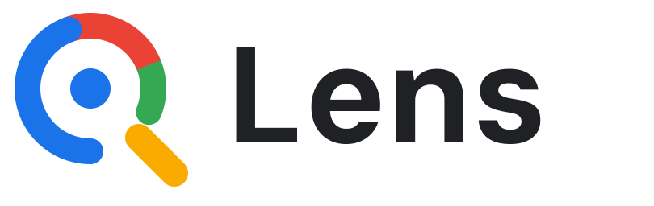

<p align="center">
  <picture>
    <source media="(prefers-color-scheme: dark)" srcset="docs/brand/lens-horizontal-dark.svg">
    
  </picture>
</p>

# Lens: intelligence for your agent

**Safe, secure and cost-effective.**

Connect your live data streams; Lens turns them into a cited knowledge graph your agent can reason over, through MCP,
a REST API or its own assistant. It runs on your hardware with local models or any cloud model, private by default and
cost-aware.

## Install

```bash
curl -fsSL https://raw.githubusercontent.com/adeelahmad/lense/main/install.sh | sh
```

That one line is all: it opens an installer in your browser that checks the computer, then either installs with the
defaults in one click (with a model server it finds on the computer) or asks how Lens should run (in Docker or a
[microsandbox](docs/microsandbox.md) microVM), the AI model and its key and any extras. Either way it installs what's
missing (Docker included), starts Lens and opens its setup page ([details](docs/get-started.md#the-web-installer)).
Run it again to update. On Windows, run `irm https://raw.githubusercontent.com/adeelahmad/lense/main/install.ps1 | iex`
in PowerShell; or skip the terminal and double-click the launcher for your system from the
[latest release](https://github.com/adeelahmad/lense/releases/latest). On a Mac with Apple silicon,
[Lens.app](docs/get-started.md#the-mac-app) from the same release installs Lens, runs it without Docker and keeps it in
the menu bar (built, early: not signed yet).
[Deployment](docs/deployment.md) covers servers and Cloudron; there are also packages for
[Synology](packaging/synology/README.md), [QNAP](packaging/qnap/README.md) and [Proxmox](proxmox/README.md), and each
release publishes Lens's images for amd64 and arm64 (a Raspberry Pi) to GHCR, which `LENS_IMAGES=pull` before `sh`
downloads instead of building ([prebuilt images](docs/deployment.md#prebuilt-images)).
The [checks](docs/requirements.md#install) say which of these CI proves.

To work on the code instead, `make run` builds and runs everything from a checkout, `make setup-code` prints the
first-admin setup code, and `make dev` runs it with hot reload; see [Get started](docs/get-started.md).

## Why Lens

**AI doesn't lack intelligence. It lacks structure. Lens gives your agent eyes.** Without structure, every prompt is a
guess about who you are and what happened. Lens supplies the people and things involved, how they relate, what happened
when, and the source of each fact, so your agent stops guessing.

Lens is one private AI hub for your whole life. Every source is a sensor: recordings, documents, email, calendars,
web pages, chat rooms, devices and webhooks all flow in, and everything becomes memory you can trust, because every
answer cites where it came from, down to the second of a recording or the line of a document. It runs on your own
hardware, from a Raspberry Pi to the cloud, and you own every byte.

Lens is built first for agents and AI assistants. People talk to their agent in chat, by voice, or in Slack, WhatsApp
and other chat rooms; the web app is for setup, settings, pipelines and workflows, review, debugging and the charts
that show what is in the archive and what it cost.

Lens is also infrastructure to build on. An app built on Lens, such as an email responder or a customer manager,
starts with real, structured context (who is involved, what was said, what was decided, with sources) instead of a
blank prompt. Apps reach it the same way agents do: through the MCP server, the REST API and OAuth sign-in, limited to
what their person may read.

## What you can do with it

Everything below is built and merged, and each item links to the checks that prove it: tests, clicks journeys and
measured numbers ([requirements and their checks](docs/requirements.md)). Work that is still in a pull request is
listed under [In progress](#in-progress), and what comes next under [Planned](#planned).

- **Connect your agents.** Lens is an MCP server (`/mcp`): agents search, find assets by face, voice, entity, topic,
  type, content type or date in one call, find what was said about a day, classify an asset or a text with the decision
  model, read assets' text and notes, cite exact moments, find similar content, explore the graph with Cypher or SPARQL
  or browse it as folders and files, suggest topics and graph changes, edit and merge entities and topics (with undo),
  write notes and specs, and make podcasts. They sign in with OAuth and see only what their person may read; the account
  menu copies the MCP address in one click. A namespace can also have an MCP server of its own (`/mcp/<namespace>`) and
  answer OpenAI's chat completions API for any app, cited from that namespace alone, each off until its owner turns it
  on, with API keys that open that one namespace and nothing else. The same folders and files can be mounted over S3,
  WebDAV, NFS or SMB (S3 and WebDAV also at the web app's address, through remote access), so file managers and scripts
  read Lens too, and a file copied into any of them is imported where it was put. The web app runs on the same REST
  API, so an agent can do what a person can. ([MCP](docs/mcp.md), [one namespace's MCP
  server](docs/mcp.md#one-namespaces-mcp-server), [chat completions](docs/api.md#chat-completions-for-any-app),
  [API](docs/api.md), [the graph as files](docs/file-tree.md), [authentication](docs/authentication.md);
  [checks](docs/requirements.md#connect-your-agents))
- **Ask, and get cited answers.** A chat assistant on every page, and by voice, searches your archive by words (with
  "phrases", OR, and -word to leave lines out) and by meaning, once turned on, reads it, cites it and acts on it with
  tools: changes wait for your approval. A search result opens the asset with Find showing the words. Ask it about Lens itself ("what's the MCP address?", "is Telegram on?") and it
  answers from Lens's docs and this server, citing both. A Tools chip picks which tools an answer may use, how many
  calls it may make and which namespaces it reads. Once an admin turns them on, it also searches the web and reads
  pages, cited like the archive, and runs Python and bash in a sandbox of each conversation's own (on a Docker install,
  Settings starts the sandbox's gateway next to Lens); each run opens under the answer with its code and output, and a
  file it makes downloads from there. An admin's assistant searches and reads the mail, calendars and files connected to
  Lens (Gmail, Google Calendar, Google Drive, S3 and the rest), cites messages and events, and brings them in once you
  approve; where an admin allows it, it sends mail, adds events and writes files, each only after you read all of it and
  say yes yourself (an API key, an app or an agent can only decline). Give it a goal that needs many look-ups and deep
  research comes back with a plan to approve, edit or revise, then runs in the background and returns a cited report,
  checked against its sources, to keep as a note, hear aloud or turn into a podcast. Regenerating an answer or editing a
  question makes a new version beside the old one, and nothing is lost. A thumbs up or down marks an answer good or bad
  (pressed again, it's taken back), and agents rate answers the same way over MCP. Each answer keeps a record of what produced it
  (the model, its tools, how long it took and what it cost), opened from its header. Copy an answer as Markdown or plain
  text, a question or a code block, and export a conversation as Markdown, PDF or JSON, its citations as footnotes that
  link back to the moment in Lens. It reads answers aloud with a speech provider, macOS `say`, or Kokoro (54
  voices, fetched once picked) or StyleTTS2 on this machine (opt-in), any message in one click. Long conversations are summarised before they fill the model's context,
  and `/clear` and `/compact` start afresh or summarise now. Conversations title themselves after their first answer,
  unless you name them. Each namespace can have its own assistant with its own name, instructions and memory, answering
  in Telegram and Slack (built in, with voice notes and files), in Discord, Matrix, WhatsApp and other chat rooms
  through Matterbridge, and by email at an address of its own that you email or forward things to.
  ([Chat](docs/assistant.md), [questions about Lens](docs/assistant.md#questions-about-lens-itself), [choosing
  tools](docs/assistant.md#choosing-tools-namespaces-and-a-limit), [web
  search](docs/assistant.md#web-search-and-reading-pages), [code sandbox](docs/assistant.md#code-sandbox), [the
  gateway](docs/assistant.md#the-gateway), [mail, calendars and files](docs/assistant.md#mail-calendars-and-files),
  [deep research](docs/assistant.md#deep-research), [answer records](docs/assistant.md#what-each-answer-records), [copy
  and export](docs/assistant.md#copy-and-export), [chat rooms](docs/chat-rooms.md), [email](docs/assistant-email.md),
  [speech providers](docs/speech-providers.md); [checks](docs/requirements.md#ask-and-get-cited-answers))
- **Answer your email.** Lens drafts a reply to an email a watched mailbox brought in, from what that email's
  namespace holds: each fact cited to its excerpt, what the archive doesn't say marked for you to confirm, addressed
  and threaded as a reply to it. Drafts wait for you to edit or set aside, and nothing is sent on its own: you send it
  through the Gmail it came in on (Undo for a few seconds), keep it in Gmail's drafts, or open it in your mail app, and
  an agent's ask to send waits in Approvals. Ask for one on the Replies page (Enter drafts the first), through the API or MCP
  (agents list what waits and draft with your instructions), or add the reply step to a pipeline to draft each new
  email, which skips mailing lists, no-reply senders and your own mail without a model call.
  ([Email replies](docs/email-replies.md); [checks](docs/requirements.md#answer-your-email))
- **Work toward a goal in projects.** A project has a name, a goal in your words, instructions and the namespaces it
  draws on. Its coordinator conversation looks at the project as a whole: it is told about every thread, starts threads
  with a brief that the assistant answers there in the background, reads them and marks them done. Each thread is a
  conversation about one part of the work, scoped to the project's namespaces. Every answer in a project reads its goal
  and instructions. Schedules ask a prompt on a schedule, in a new thread each time or the same one. The Projects
  page, under Chat, starts threads with a brief and shows which are working. Agents
  start and change projects over MCP and the API. ([Projects](docs/projects.md); [checks](docs/requirements.md#work-toward-a-goal-in-projects))
- **Extend the assistant.** Add tools (a prompt, a web request, a graph drawn on the canvas, or sandboxed Python),
  skills, hooks and MCP servers, by code, on the canvas or just by asking. Remote MCP servers connect by address, and
  ones that run as a program (`npx`, `uvx`) run in a sandboxed container of their own, off until you turn it on. Add one
  with a form or by pasting another app's config, its tokens sealed and each of its tools switched on or off, or pick a
  ready-made one: GitHub's own server, or a browser (a headless Chromium in a sandbox of its own) the assistant opens,
  reads, clicks and types in, asking before anything that acts on a page. Settings › AI assistant › MCP servers lists
  them all, and agents list and add them over MCP. The MCP runner, the browser and monitoring are containers Lens starts
  next to itself from the web app, through the machine's upgrade agent, each off until an admin turns it on. Install
  skills and plugins from marketplaces in the open plugin format, or from a repository or an archive, and keep your own
  as files in a folder with `lens ext` (pull, push, check). Agents find and install them too, and an installed plugin
  says when a new version is listed. ([Extending the
  assistant](docs/assistant.md#extending-the-assistant-tools-skills-hooks-and-plugins), [adding an MCP
  server](docs/assistant.md#adding-an-mcp-server), [the MCP runner](docs/assistant.md#the-mcp-runner), [the
  browser](docs/assistant.md#the-browser), [optional containers](docs/assistant.md#optional-containers);
  [checks](docs/requirements.md#extend-the-assistant))
- **Bring in everything.** Watched folders on S3, Dropbox, Google Drive, OneDrive, SFTP, SMB, WebDAV or local disks (a
  local folder in four clicks); IMAP mail, Gmail and Google Workspace (routing rules send a shared inbox's mail to the
  right namespaces), iCal calendars, Google Calendar and RSS and Atom news feeds; a built-in MQTT broker, syslog and
  webhook streams; import webhooks for scanners and phone shortcuts, which can hand back the PDFs of Office files and
  emails a light server can't convert itself.
  Google accounts connect with Connect with Google once Lens has a Google client, and Dropbox, OneDrive and Google
  Drive can sign in through rclone on the Lens server, with no app of your own to register. Upload audio, video, PDFs,
  Office files, photos, JSON and zip or tar archives (photos and videos dated by when they were taken, from the file
  itself, and photos placed by their GPS on the Library's map, by API and MCP too), and transcripts made elsewhere
  (SRT, WebVTT, text, Word, PDF), each line credited to the speaker the file names, and one that came without times
  lined up with its audio when you ask; and, with an Apache Tika server (an
  opt-in extra), documents nothing else here can read; capture web pages one at a time, from a link list or a
  bookmarks file, by API or by asking the assistant, from private networks you allow in Settings too; and import
  videos and podcasts by their address (off by default), taking a video's own captions as its transcript when people
  wrote some (off by default too). Say what a file or a page is as it comes in (a podcast, an interview, a scan), in
  Import, by API or to the assistant, and its content type's pipeline runs from the start. A file, page or video the
  namespace already has links to the one there instead of being imported again. Media browsers can't play, such as an
  AVI or HEVC from a phone, can get a copy they can (off by default). A bulk import (a folder scan, an archive's
  files, a link list, a source's files) is one run: the toast after it, and the Import screen's list of recent runs,
  undo it whole.
  ([Sensors](docs/sensors.md), [processing](docs/processing.md), [Apache Tika](docs/configuration.md#apache-tika),
  [import webhooks](docs/api.md#import-webhooks), [lining up a transcript](docs/processing.md#aligning),
  [playable copies](docs/video.md#playable-copies),
  [where an asset was taken](docs/processing.md#where-an-asset-was-taken),
  [import runs](docs/api.md#import-runs);
  [checks](docs/requirements.md#bring-in-everything))
- **Clip from the browser.** The Lens web clipper for Chrome, Edge, Firefox and Safari turns a page, a selection or a
  part you pick into Markdown, lets you look it over, and sends it to a namespace. It signs in to Lens with nothing to
  copy, or takes your API token or an import webhook's, and says why a token is refused. New releases reach installed
  copies through the browser's store or a self-hosted update file. In Chrome and Edge, its side panel is a chat with the
  assistant, which can also use that browser on the sites you allow (open, read, click, type), asking before anything
  that sends, deletes, buys or posts.
  ([Web clipper](docs/web-clipper.md), [setting it up](docs/web-clipper.md#setting-it-up),
  [the assistant in your browser](docs/browser-assistant.md); [checks](docs/requirements.md#clip-from-the-browser))
- **Understand it.** Transcription, which can expect the names your namespace knows (off by default), people
  recognised by voice (an owner can keep voices to each recording instead; long recordings go to a speech provider in pieces that fit its limits), text on screen and in scans, faces (off by default; the ones nobody has named yet are named in a row, the most seen first, with Undo), NSFW pictures flagged by a model on your own
  server (off by default, per namespace), low quality images enhanced before they're read (off by default), entities
  and topics in a knowledge graph you can explore, query with Cypher or
  SPARQL, and see as it was at any version, where every source, sensor, person and agent is a node linked to what it
  brought in. Every entity has its own page at a wiki address
  (`/wiki/<namespace>/<Name>`), and entities, topics and people are edited and merged from their lists, the graph or an
  asset, with Undo instead of a confirm (and a voice matched to the wrong person split off, and not matched to them again). Names get their real types (people, places, organisations, events, works) by
  rules, without a model, and a decision model types the ones the rules can't. Find what is most like a passage, an
  asset, a topic or an entity, in a Similar tab on every asset or by selecting text anywhere, and, with anytopdf, photos
  by what they show. Search filters moments by person, emotion or the sound heard in them (laughter, applause,
  music), with a count for each, and keeps to the assets recorded between two days, with a tag, from a source or in a
  language, in the link and for agents too. Pages and shots are described in words by the model provider's vision model or, off by
  default, by Florence-2 or Moondream on your own server. A recording's sound can be cleaned up before it's transcribed
  (noise, volume, echo, and silence left out, with the transcript's times kept), and transcripts cleaned up before
  analysis (stutters, "um"s, spacing and, with a local model, punctuation put back, and grammar by a LanguageTool server
  you run), entities found by spaCy instead of the rules, and the dates people say read as days on the calendar, each
  off by default. Words transcription wasn't sure of are underlined, with how sure, to check and correct in place. The language
  transcription hears is kept on the asset, and you can correct it with a region (en-GB or en-US, pt-BR or pt-PT), which
  transcribing again keeps. Translate a transcript into another language when you ask, with the estimate shown first: it's kept
  beside the asset as a translation whose lines keep their times, found by search like an uploaded one.
  A date said ("let's meet next Tuesday at 3") becomes a calendar event in one click,
  prefilled from the line and added only once you approve it ([propose an event](docs/processing.md#propose-an-event)).
  Videos play their transcript, and timed captions and translations added beside them, as captions the browser
  itself shows (its captions menu, full screen, picture in picture), in the workspace and on public pages.
  ([Graph](docs/graph.md), [entity pages](docs/notes.md#entity-pages),
  [similar content](docs/processing.md#similar-content), [graph history](docs/graph-history.md),
  [topics](docs/topics.md), [video](docs/video.md), [naming faces](docs/video.md#naming-faces), [NSFW classification](docs/nsfw.md),
  [enhancing images](docs/enhance.md), [long recordings](docs/speech-providers.md#long-recordings),
  [cleaning up audio](docs/processing.md#cleaning-up-audio),
  [your own names](docs/processing.md#your-own-names-in-transcription),
  [cleaning up transcripts](docs/processing.md#cleaning-up-transcripts), [dates](docs/processing.md#dates),
  [unsure words](docs/processing.md#unsure-words), [an asset's language](docs/api.md#an-assets-language),
  [translations](docs/api.md#translating-a-transcript), [captions](docs/video.md#captions);
  [checks](docs/requirements.md#understand-it))
- **Learn from it.** Make a two-host podcast episode about what you pick, every claim cited and checked against its
  source, read aloud in two voices, by Kokoro on this machine or a speech provider. Turn a voice session or a meeting into a technical spec, in a note linked to it,
  that keeps every decision, every no and every constraint in the speaker's own words, linked to when they said them,
  flags what was left to decide later and marks any quote the transcript doesn't hold. Keep notes beside every asset,
  entity and topic, written by you or the assistant, in a tree where notes are renamed, moved, copied and pinned (pins
  are your own) and each note shows the notes it's inside and the ones inside it, with today's note one click away,
  templates to start from, a search by their words, a download as Markdown, and Undo and Recently deleted instead of a
  confirm. Keep a moment of any recording, video or document as a clip with a title and a note, in one click from the
  transcript or a highlight, and play clips from any resources back to back in a playlist, reordered by dragging and
  taken out with Undo. Export an asset or a collection as an evidence PDF with everything Lens found about it, or the parts you
  pick. Publish a namespace's resources, episodes, timeline activities or text as a private RSS feed or a podcast
  feed that any feed reader or podcast app follows (Feeds, from the Podcasts page), and let a routine fill it on a schedule with
  what's new, or make an episode about the week's new resources. Follow a saved collection in your podcast app: its
  page gives your own private address for it, listing its assets with audio or video that you can read.
  ([Podcasts](docs/podcasts.md),
  [specs from transcripts](docs/notes.md#specs-from-transcripts), [notes](docs/notes.md),
  [playlists](docs/playlists.md), [evidence PDFs](docs/api.md#evidence-pdfs), [published feeds](docs/feeds.md);
  [checks](docs/requirements.md#learn-from-it))
- **Automate it.** Pipelines and workflows on a canvas (with Convert steps that make a video's soundtrack an audio
  asset and a document's pages image assets, and Read steps that pick their own converter, such as anytopdf; what their model steps write about
  an asset is found by search, under the step's name), routines on a schedule, batch runs over a collection, and
  notifications to webhooks, Slack, Discord and Matterbridge, including when a routine's run fails or leaves graph
  changes to review. Everything that happens in Lens (new assets, emails,
  calendar events, files, feed posts, what people say to Lens, sensor readings, sensors switched on or off, notes,
  moves between namespaces, graph changes, runs, budget warnings) is kept as a stream of activities in W3C Activity Streams form, which agents read through the API, MCP and
  the assistant, and people review on the Timeline page (and Latest on Home), marking what they've seen, reacting with
  an emoji and commenting in threads everyone who sees the item shares (agents too, over MCP), and asking the
  assistant about any item from the item; a comment that tags @lens gets the agent's answer in the thread, with
  every change it proposes waiting for a yes, a For you order learned from each person's own reactions, comments
  and marks says why each item is where it is, each person mutes a source or a kind for themselves, with nothing
  deleted, and saves the filters they read often as views, and an opened item shows what it caused, the runs and approvals, with Approve and Decline right there.
  Automations act
  on that stream, on a schedule, at a time or when their own webhook is called, alone or with their triggers joined (all
  of them, a number of times, one that doesn't come in time, or a batch): they test conditions (text, patterns,
  numbers, lists, times, days, whether a value changed, the entities an asset mentions (any person, or names like
  Acme*) and whether something like it happened before in their namespaces) and let a decision model pick the branch,
  then tell you in your own chat app, ask the model or the agent, use a tool, call a web address (its credentials kept sealed), run a
  workflow, pipeline or routine, or change assets and notes. The Schedules page is Lens's crontab: every routine,
  automation schedule and the backup in one list with when each runs next and last, to switch, re-time or run now, and
  agents do the same over the API and MCP. A Classify node in a workflow sorts an asset into labels, content types or
  topics, acting only on a sure answer, and an Entity filter node keeps the entities you want. An HTTP call node calls
  a web address through the same guard as the assistant's web tools, with its keys sealed to their host. Graph workflows tidy the
  entities on a routine: look-alikes to merge or link, types the rules now read differently, noise to hide and topics
  to group under a broader one, making the changes they're sure of and proposing the rest, each one undoable. Anything that reaches outside Lens or changes
  more than what set it off asks first, until you let it run on its own: on the Approvals page or, for a change inside
  Lens, with a yes in the chat it told you in; agents can decline an approval but never give one. Each automation has
  limits and budgets, and agents make, try and run them over MCP and in the assistant, draft one from a sentence, or
  start from one of five starters that stay off until you turn them on. An automation's workflow is drawn and tried
  on the workflow canvas, with its actions in the palette, and the studio lists your automations, builds one in When, If and Then (tested on a recent activity before you save it), and shows
  its runs, what's coming up, its variables and its costs.
  ([Processing](docs/processing.md#workflows-and-the-canvas),
  [converting assets](docs/processing.md#converting-assets), [notifications](docs/notifications.md),
  [automations](docs/automations.md), [approvals](docs/automations.md#approvals), [schedules](docs/schedules.md),
  [timeline](docs/timeline.md); [checks](docs/requirements.md#automate-it))
- **Share with the people close to you.** Make circles of trust (your family, close family, friends, colleagues) of
  people on the same Lens, and share an activity from your timeline or a resource with a circle and a note: each of
  them sees it in their own timeline, and you see it in yours, so nothing is shared behind anyone's back. Share with the
  item to also let them open the resource; undo takes it all back, and nothing leaves a vault. In the web app, circles
  live under Profile and Share sits on every timeline item and resource. Rules (automations) share what comes in,
  like the school's emails, asking you first until you let them run on their own. Let a circle see when you're free
  (never what), and agents find a time that suits everyone, or ask your agent questions about the namespaces you
  pick, answered with citations. Once an admin turns it on, circles hold people on other Lens or ActivityPub servers
  by handle, and shares reach them signed. Agents do the same over MCP, and the assistant asks you first before
  sharing.
  ([Circles of trust](docs/circles.md);
  [checks](docs/requirements.md#share-with-the-people-close-to-you))
- **See what it costs.** An activity ledger of every model call, with reports, charts and budgets that cap spending.
  Setup asks for one overall budget after a cloud model, with a soft limit that warns and a hard limit that stops paid
  calls. A meter in the top bar shows spend against the budget, and the Costs page breaks it down by day, model and
  what cost most; ask the assistant, or an agent over MCP, where budgets stand. Models are priced by tokens or by the
  hour, and speech providers by the minute of audio or the character read aloud. Routine choices go to small decision
  models, and the LLM only when it adds value.
  ([Activity and costs](docs/activity.md), [budgets](docs/budgets.md#one-budget-for-everything),
  [the meter](docs/budgets.md#the-meter-and-the-costs-page); [checks](docs/requirements.md#see-what-it-costs))
- **Scale out.** Scaling groups add workers when work waits and let them go when it doesn't, by target, step and
  schedule rules, within min and max and a monthly budget, with every launch, join and hour of cost in the activity
  ledger; a unit a provider runs with Lens's tag that Lens lost track of shows on the provider, for you to let go. You add providers and make groups in Settings › Auto scaling, and a group launches nothing until you approve
  its terms there; agents propose and manage groups over the API, MCP and the assistant, and never approve one. It
  runs more workers on this machine today; AWS EC2 (spot or on demand), DigitalOcean, Hetzner Cloud, Lambda GPU
  instances, Proxmox VE and Linux hosts over SSH providers are in progress (built, with machines that join over the mesh to transcribe and tell
  voices apart, not yet tried on a real cloud), so are RunPod GPUs, Hugging Face Inference Endpoints and Amazon
  SageMaker endpoints, Lambda GPU instances and Amazon Bedrock provisioned throughput that serve Lens's model calls while they run, in turn
  across a group's units;
  Bedrock's models can be the LLM provider too, and more model hosts are planned. ([Auto scaling](docs/scaling.md); [checks](docs/requirements.md#scale-out))
- **Run on more machines.** Add a Mac with a GPU, a box for the assistant's code or a server with more disk, and
  Lens joins it over a private network of its own, a Nebula mesh it issues the certificates for: one install line
  with a one-time token, and the machine needs nothing else. Worker nodes run jobs as their own user of the
  database, never with Lens's keys; compute nodes run the assistant's code on a sandbox gateway of their own.
  Settings › Nodes and Network show each machine and the mesh, and agents do the same over the API, MCP and the
  assistant. Not yet tried between two real machines. ([Nodes and the mesh](docs/mesh.md);
  [checks](docs/requirements.md#run-on-more-machines))
- **Keep it up to date and backed up.** Lens checks for a new release once a day and tells admins by email or a
  notification. One click in Settings › Updates (or one API call) upgrades it through a small agent on the machine,
  showing each step, and rolls back when the new version doesn't start; nothing installs unless an admin says so. The
  same agent changes whether other devices reach Lens and which edition runs, from Settings. Settings › Backups takes,
  lists, downloads and restores backups of the database and Lens's files (a file that hasn't changed takes no new room),
  takes them on any schedule, and can copy each one, encrypted, to a storage connection. Before a version is released,
  CI upgrades the one before it, holding data, to it, and releases nothing when any of that data is lost.
  ([Updates and backups](docs/updates.md), [backups](docs/database.md#backups),
  [the upgrade check](docs/database.md#checked-before-every-release);
  [checks](docs/requirements.md#keep-it-up-to-date-and-backed-up))
- **Watch it run.** Structured logs from every process, read in Settings › Logs and optionally sent to a syslog
  server, or straight to Grafana Loki or another HTTP endpoint, with client certificates for servers that ask for one.
  OpenTelemetry traces and metrics, and a Prometheus `/metrics` endpoint, both off until you turn them on, and sending
  nothing anywhere else. On a Docker install, one switch in the web app (or one API call from an agent) starts
  Prometheus, node-exporter and Grafana next to Lens, already connected, with the Lens dashboard as Grafana's home.
  Activity clears the job queue, reorders it by drag and drop and retries every failed run at once; agents do the
  same through the API and MCP.
  The Analytics page shows admins active people, churn, retention and which features get used, worked out on this
  machine; the same daily events can also go to a Google Analytics 4 property of your own (off unless you turn it on).
  System health shows the space each source takes, its files and what Lens made of them.
  ([Logging](docs/logging.md), [telemetry](docs/telemetry.md), [Prometheus](docs/prometheus.md),
  [usage analytics](docs/analytics.md), [storage per source](docs/api.md#resources);
  [checks](docs/requirements.md#watch-it-run))
- **Stay private and safe.** Passkeys instead of passwords (one at Lens's remote address added from a signed-in one with
  Open signed in), encryption at rest with a key per namespace, roles per namespace (viewer, editor, owner, or custom
  roles made of permissions), who sees each asset, set for many at once from the Library, access that ends on a date
  you pick (a role in a namespace or on a collection, or permission on one asset), a downloads switch per asset (off,
  it still plays and reads, but only its owners save its files), a video's copy with faces blurred for sharing (made
  when you ask, and played to visitors instead of the original if you pick that), email invitations, removing someone
  for good, and an audit log. Prompt injection meets
  several layers: what the assistant reads (recordings, documents, web pages, tool results) reaches the model marked as
  data, not instructions, and text that reads like instructions to an AI is flagged (by free patterns, or an optional
  classifier model that runs on your machine and is fetched only when you pick it). Once an answer has read such text,
  sending anything out, or the browser opening or typing what the assistant wrote, waits for your yes. Chat-room answers
  have links they built themselves broken up, agents over MCP get the archive as data, and what Lens caught goes into
  the audit log. Serve Lens over HTTPS, set
  up in Settings, with certificates from Let's Encrypt or ZeroSSL that renew on their own, answering only for its own
  domains and, if you choose, only to devices holding a client certificate; or reach it from anywhere through a
  Cloudflare tunnel with nothing opened on your router. Either way, the S3 and WebDAV shares and the MQTT hub answer at
  that same address once you turn them on. Keep API keys and tokens in a Vaultwarden or Bitwarden vault: a secret
  field in Settings can refer to an item there, and Lens reads it without anyone, agents included, seeing it.
  ([Encryption](docs/encryption.md), [secrets](docs/secrets.md), [access](docs/access.md),
  [prompt injection](docs/assistant.md#third-party-content-and-prompt-injection), [HTTPS](docs/https.md),
  [remote access](docs/remote-access.md), [blurring faces](docs/video.md#blurring-faces-for-sharing);
  [checks](docs/requirements.md#stay-private-and-safe))
- **Use open standards.** RDF and Dublin Core for every record, OAuth for apps and OpenID Connect sign-in, MCP, MQTT,
  IIIF for publishing (with your team's shared notes and comments as W3C Web Annotations, for people with a role on the
  asset only), OpenTelemetry and Prometheus for monitoring, an optional Fedora mirror, and a CSV catalogue of the assets
  you select in the Library.
  ([Linked data](docs/rdf.md), [IIIF](docs/iiif.md), [Fedora](docs/fedora.md),
  [catalogue](docs/processing.md#finding-by-any-attribute);
  [checks](docs/requirements.md#use-open-standards))

## Light by default

Lens runs on a small machine. Heavy parts (local speech models, a local LLM, document conversion, an Apache Tika
server, the NSFW model, the MCP runner, Fedora) stay off or download only when you turn them on, and any of them can be
swapped for a cloud provider instead. Setup asks only what has no default: the model, and a budget for a cloud model.
Picking a cloud model provider fills in its address and a model, so only its key is left to paste. Every setting lives
in the web app, which works on a phone too: settings are in named groups, a search finds any one by name, and the
options most people leave as they are stay folded. A thin bar along the top of the web app shows a page or its data is
still loading. Heavy steps can be kept to the night, or to so many at a time (off by default).
([Components](docs/components.md), [quiet processing](docs/architecture.md#background-work),
[speech providers](docs/speech-providers.md), [local models](docs/local-models.md),
[cloud model providers](docs/configuration.md#cloud-model-providers); [checks](docs/requirements.md#light-by-default))

## In progress

Open pull requests, not yet part of Lens, are listed here; none right now.

## Planned

Next, and not in a pull request yet; each links to where it is tracked:

- **Notes:** nesting a note under its project or area without a click, pages in the graph, and wiki addresses for
  topics, recordings and the other things that have pages ([notes](docs/notes.md)).
- **Local models:** GPU builds of llama.cpp fetched by Lens, and local embedding models
  ([local models](docs/local-models.md)).
- **Speech providers:** their summaries, chapters and entities as optional imports
  ([speech providers](docs/speech-providers.md)).
- **Storage:** uploads and assets' media in the file store, and a storage key to download
  ([storage](docs/storage.md)).
- **Secrets:** references in sources' credentials and MCP servers ([secrets](docs/secrets.md)).
- **Proof:** the install timed on a real Raspberry Pi, where GitHub's faster arm64 runner gives only a floor
  ([scorecard](docs/contributing.md#scorecard)).

## Stack

| | |
|---|---|
| `fastapi_backend/` | FastAPI API (`/api/v1`), MCP server, the processing engine, and the `lens` CLI and workers |
| `nextjs-frontend/` | Next.js web app with a typed client generated from the API's OpenAPI schema |
| `extensions/browser/` | the web clipper browser extension |
| `installer/` | the web installer and the double-click launchers |
| SurrealDB | documents, graph edges, the job queue and graph history; word search in a small SQLite index beside it |

## Documentation

The guides are on the [docs site](https://adeelahmad.github.io/lense/) and in the [docs](docs/) folder:

- **Start:** [Get started](docs/get-started.md), [deployment](docs/deployment.md),
  [microsandbox](docs/microsandbox.md), [configuration](docs/configuration.md), [components](docs/components.md),
  [updates and backups](docs/updates.md), [remote access](docs/remote-access.md), [HTTPS](docs/https.md)
- **Agents and apps:** [MCP server](docs/mcp.md), [API](docs/api.md), [authentication](docs/authentication.md),
  [access](docs/access.md)
- **Use:** [chat and batch runs](docs/assistant.md), [chat rooms](docs/chat-rooms.md),
  [the assistant by email](docs/assistant-email.md), [email replies](docs/email-replies.md), [podcasts](docs/podcasts.md), [notes](docs/notes.md),
  [web clipper](docs/web-clipper.md), [the assistant in your browser](docs/browser-assistant.md),
  [sensors](docs/sensors.md), [processing](docs/processing.md), [video](docs/video.md),
  [NSFW classification](docs/nsfw.md), [enhancing images](docs/enhance.md), [notifications](docs/notifications.md),
  [automations](docs/automations.md), [timeline](docs/timeline.md), [published feeds](docs/feeds.md)
- **Knowledge:** [graph and Cypher](docs/graph.md), [graph history](docs/graph-history.md), [topics](docs/topics.md),
  [the graph as files](docs/file-tree.md), [NFS share](docs/file-shares.md), [SMB share](docs/smb.md),
  [linked data (RDF)](docs/rdf.md), [IIIF](docs/iiif.md), [Fedora](docs/fedora.md)
- **Models and cost:** [local models](docs/local-models.md), [speech providers](docs/speech-providers.md),
  [activity and costs](docs/activity.md), [budgets](docs/budgets.md), [auto scaling](docs/scaling.md)
- **Operate:** [encryption](docs/encryption.md), [storage](docs/storage.md), [database](docs/database.md),
  [logging](docs/logging.md), [telemetry](docs/telemetry.md), [Prometheus](docs/prometheus.md),
  [usage analytics](docs/analytics.md)
- **Build:** [architecture](docs/architecture.md), [web app](docs/frontend.md),
  [technology](docs/technology-selection.md), [API work the design needs](docs/backend-gaps.md),
  [contributing](CONTRIBUTING.md), [requirements and checks](docs/requirements.md), [agent rules](AGENTS.md)

[Security](SECURITY.md), [threat model](threat-model.md), [changelog](CHANGELOG.md).

## License

Lens is open source under the [MIT License](LICENSE.txt). Optional extras that you install yourself may carry their own
licenses (for example `extract-msg`, GPL-3.0, for Outlook `.msg` files); none is part of the default install.

Built on the [Next.js FastAPI Template](https://github.com/vintasoftware/nextjs-fastapi-template) (MIT).
