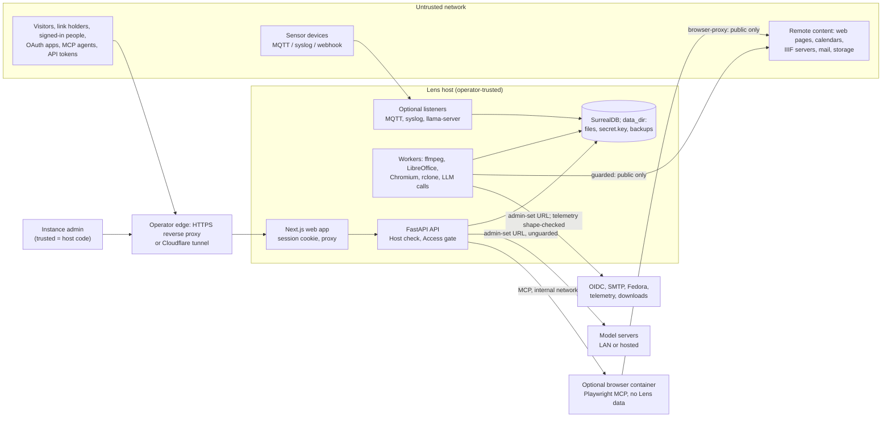

# Lens threat model

## 1.1 Header

- **Project**: Lens, a self-hosted archive for documents, recordings, photos and messages (repository `adeelahmad/lense`).
- **Modeled version**: commit `5f799f2ff8bb8a762d8151d9b10b535a17878b55` on `main`, dated 2026-10-05. The repository has
  no release tags. The manifests say 0.3.0, and everything since 0.3.0 sits under "Unreleased" in `CHANGELOG.md`.
- **Date and authors**: 2026-10-05. Drafted with AI tooling (below). The maintainer, Adeel Ahmad, answered question
  waves 1 and 2.
- **Generation metadata**:
  - Model/agent: orchestrator, authoring, revision and sidecar by Claude Opus 5.5 (`claude-opus-5-5`); recon,
    surface and backtest specialists by Claude Sonnet 5.5 (`claude-sonnet-5-5`).
  - Effort level: default.
  - Skills: threat-model orchestrator 1.2.1, threat-model-recon, threat-model-surface, threat-model-interview,
    threat-model-authoring (draft and phase 3.7 revision), threat-model-backtest, threat-model-sidecar.
- **Version binding**: a report against commit *N* is judged against this model as it stood at *N*, not against
  `main`. Only the latest release and `main` get fixes *(documented, SECURITY.md section "Supported versions")*.
- **Reporting**: report a breach of a §1.11 property privately, as `SECURITY.md` "Reporting a vulnerability" says.
  Reports that land in §1.3 or §1.12 are closed by citing this document. `SECURITY.md` stays the reporting policy and
  links here *(maintainer, 2026-10)*.
- **Status**: under maintainer review (2026-10-05); waves 1 and 2 answered, §1.18 open. An **inferred** claim may
  escalate a report but never close it; under `strict` an **assumption** also escalates only.
- **Triage policy**: `strict`.
- **Provenance legend**: **documented** names a locator in project docs, `SECURITY.md`, a contract-stating docstring
  or user-facing message, or changelog rationale. **maintainer** is dated: said in this process. **assumption** (a
  cautious default the author acts on) and **inferred** (read from code, still open) carry a §1.18 question number.
- **Draft confidence**: 201 documented / 46 maintainer / 91 inferred / 8 assumption (counted over the whole file, including tags that wrap across lines).
- **Backtest note**: Backtested 117 items in 114 clusters, covering all 8 in-scope runtime families and the 60
  contract-dimension cells present at the first run; rows added in 3.7 are routed only where a corpus item reaches
  them. 36 carry a real historical outcome (31 fixed Lens defects, 5 dependency bumps); 81 are synthesized and counted
  apart. Routed: 47 VALID, 24 MODEL-GAP (all owned by an `unresolved` row and a §1.18 question), 0 VALID-HARDENING,
  27 BY-DESIGN: property-disclaimed (14 closed, 13 escalated), 16 OUT-OF-MODEL (3 trusted-input closed,
  5 non-default-build: 4 closed and 1 escalated, 1 adversary-not-in-scope closed, 6 dependency-contract: 1 closed and
  5 escalated, 1 unsupported-component escalated), 3 KNOWN-NON-FINDING closed. Fail-safe figure: 0 of 31 historically
  fixed items route to a closed or provisional disposition, and none route to a closing disposition as escalated; scored
  per sub-fix (two corpus rows bundle two fixes each) it is still 0 of 33. The one closed dependency-contract route is
  a dependency bump (Starlette and FastAPI), not a fixed Lens defect. 26 of 117 items (22%) close outright and 46 (39%)
  carry a closing disposition, 20 of them only escalated; every close is documented or maintainer tagged. The first run
  found 5 fixed items closed and 4 contradictions; the 3.7 revisions removed the closes. The contradictions were
  resolved from documents or the maintainer's 2026-10 ruling except the admin-operand guards, which raised Q35;
  the gaps raised Q36 to Q47.
- **Sibling models**: none. One model covers the API, web app, workers, CLI and packaging.

**What Lens is.** Lens stores people's documents, recordings, photos and messages. It reads, transcribes, indexes and publishes
them, and people search and chat over them. An operator runs one instance for their own users: a FastAPI API, a
Next.js web app that proxies the API and holds the sign-in session, and background workers, around one SurrealDB
database. Content is split into **namespaces**; people get roles per namespace.

**Short glossary.**

| Term | Plain meaning |
| --- | --- |
| Disposition | The one bucket a report lands in after triage (§1.17). |
| Sink | The exact place a report targets: a route, a parameter, a tool. |
| Control kind | What an attacker controls: data, size/rate, type, code, a URL, a credential. |
| Taint | How untrusted an output is. |
| Claimed / disclaimed | A property Lens promises (§1.11) or openly does not promise (§1.12). |
| False friend | A feature that looks like a security control but is not one. |
| Tier | `security-critical` (a breach is a vulnerability) or `correctness-only` (a bug, not a hole). |
| Trusted input | Something only the instance admin or host operator can set. |
| Escalated | The model has a route, but the claim behind it is not confirmed, so a maintainer decides. |
| Namespace | A tenant-like space of assets. People have no role, or viewer, editor or owner in it. |
| Signed link | A URL the server signs. Whoever holds it can open that one path until it expires. |

> **Triager quick-start.** Given an inbound finding:
> 0. This model's triage policy is `strict`. An **assumption** may escalate but not close.
> 1. Find the sink. Look up its operand class in the §1.7 trust table, or its output channel in §1.8.
> 2. Find the contract dimension (numeric limits, failure atomicity, recursion, callback/collaborator, serialization,
>    lifecycle, concurrency, resource cost, or the `x-` rows). Follow the family's matrix row in §1.7 to its owner.
> 3. Check what the attacker needs. Which role (§1.10)? Which control kind (§1.7)? A URL only an admin can set, or
>    code only an admin can write, is trusted input, unless Lens documents a guard on it (P-ADMIN-GUARD).
> 4. Check the component against §1.2 and §1.3, and any configuration against §1.6.
> 5. If the root cause is in a dependency, apply §1.9.
> 6. Apply the §1.17 precedence order, starting with an exact §1.15 match.
> 7. Assign exactly one §1.17 disposition and cite the licensing section and its tag. If none fits, assign
>    `MODEL-GAP` and trigger §1.16.
> 8. **Provenance gate, before any close** (`OUT-OF-MODEL: *`, `BY-DESIGN: *`, `KNOWN-NON-FINDING`):
>    - **documented** or **maintainer** licence: close.
>    - **inferred** licence: escalate, never close.
>    - **assumption** licence: escalate (policy is `strict`).
>    - A disclaimer that rests only on silence never closes a `security-critical` report, a `KNOWN-NON-FINDING` or a
>      `dependency-contract` route.
>    Record the status as `closed`, `provisional` or `escalated` (§1.17). `VALID` and `MODEL-GAP` take no status.

## 1.2 Scope and intended use

**Intended use.** One operator (the instance admin) runs Lens for their own people. Documents, recordings, photos
and messages "matter most" *(documented, SECURITY.md "What counts")*. It is supported to expose an instance to the public
internet behind HTTPS, through a reverse proxy or a Cloudflare tunnel. Anonymous visitors then reach the sign-in page,
share links, the embed player and public IIIF *(maintainer, 2026-10)*.

**Roles and trust.** Only the instance admin is trusted, and an admin is equivalent to code execution on the host. The
host operator (who edits `.env` and `archive.yaml`) is as trusted as the admin. Namespace owners, editors and viewers,
API-token holders, OAuth apps and MCP agents are trusted only as far as their role *(maintainer, 2026-10)*. Role
powers follow docs/architecture.md *(documented, docs/architecture.md "Access model")* and Aviary's matrix
*(documented, docs/access.md "the roles and permissions matrix of Aviary")*. Workers may run on other machines;
optional listeners (MQTT, syslog, tunnel, local model server) run inside workers.

| Family (short name) | Representative entry points | Touches outside the process | In model? |
| --- | --- | --- | --- |
| Web app & API gateway (Web) | `nextjs-frontend/proxy.ts`, `lib/api/backend-proxy.ts`, `next.config.mjs`; `core/middleware.py` Host check and CSP | network | In |
| Identity & sessions (Identity) | `routes/{auth,passkeys,oauth,external,setup,users}.py`, `domain/{auth,passkeys,oauth,external_login,iiif_auth}.py`, `core/security.py`, `nextjs-frontend/auth.ts` | DB, OIDC providers, SMTP, logs | In |
| Authorization & data API (AuthZ) | `api/deps.py` (`Access`, `Writer`, `Admin*`), `domain/access.py`, `domain/ipgroups.py`, share links, `api/media.py`, `api/iiif.py`, `api/pages.py`, `api/mcp_tools.py` | DB, files | In |
| Outbound fetchers & stored secrets (Outbound) | `domain/netguard.py`, `webcapture.py`, `feeds.py`, `notify.py`, `sources.py`, `llm.py`, `semantic.py`, `speech.py`, `fedora.py`, `bridge.py`, `telegram.py`, `slack.py`, `mailbox.py`, `telemetry.py`, `settings.py` seal, `keyring.py`, `vaults.py` | network, child processes, files | In |
| Ingest & processing (Ingest) | `routes/{uploads,files,imports}.py`, `domain/{ingest,documents,convert,video,uploads}.py`, `templates.py`, `render.py` | child processes (ffmpeg, LibreOffice, Chromium, poppler, Tesseract), files | In |
| Query engines (Query) | `domain/cypher.py`, `domain/rdf.py` (SPARQL), `domain/rdf_import.py`, `domain/search.py` | DB | In |
| Assistant & extensions (Assistant) | `domain/{chat,ai_tools,ops_tools,extensions,tool_nodes,flow,custom_nodes,code_tools,mcp_client,mcp_servers,marketplace}.py`, MCP write tools | network (model servers, admins' MCP servers, the MCP runner, the browser), child process (code tools) | In |
| Optional services, off by default (Optional) | `domain/{sensors,mqtt,syslog,shares,s3,webdav,share_import,http_body}.py`, `tunnel.py`, `https.py`, `local_llm.py`, `components.py`, `telemetry.py` | listening sockets, downloads, child processes | In |
| Packaging variants | `docker-compose.prod.yml`, `install.sh`, `cloudron/`, `packaging/{synology,qnap}`, `proxmox/` | host | §1.6 |
| Dev and CI tooling, samples | `docker-compose.yml`, `make dev`, `.github/`, `ci/`, `examples/`, `overrides/`, `prod-frontend-deploy.yml`, `watcher.py`, `commands/`, `fastapi_backend/tests/` | host | Out (§1.3) |

## 1.3 Out of scope

- **Admin and host-operator actions.** Anything that needs the instance admin or host operator is trusted input:
  admin-set URLs, admin-written code tools, templates, workflows and regexes, component installs, break-glass
  environment variables, and `api_key_env` *(maintainer, 2026-10)*. This includes "an admin to configure Lens
  insecurely on purpose" *(documented, SECURITY.md "Out of scope")*. It does not include the guards Lens documents on
  admin-set operands (P-ADMIN-GUARD): an escape of one of those is in model.
- **Volume denial of service.** "denial of service by sheer volume" is out *(documented, SECURITY.md "Out of scope")*.
- **Unreached dependency bugs.** "vulnerabilities in dependencies that Lens doesn't reach" are out *(documented,
  SECURITY.md "Out of scope")*. Such a report routes `OUT-OF-MODEL: dependency-contract` only with a cited argument
  that Lens never calls the vulnerable code; otherwise §1.9 decides.
- **Exposed hosts on shipped defaults.** Plain HTTP, the SurrealDB `root`/`root` credential and similar defaults are
  supported on one machine only. A report that needs them on an exposed host is out (§1.6) *(maintainer, 2026-10)*.
- **Dev compose and `make dev`.** `docker-compose.yml` and `make dev` are dev-only and unsupported for exposure
  *(maintainer, 2026-10)*. The close covers findings that need their known secrets (such as
  `dev-only-access-secret-change-me`), `SURREAL_PASS=root`, or the web port on all interfaces *(maintainer, 2026-10)*.
  The compose hardening Lens documents is claimed for both compose files (P-HARDENED). Any other default exposure of
  the dev stack is not closed here: it routes `VALID` under P-HARDENED until Q36 is answered *(inferred, Q36)*.
- **Tampered upstream downloads.** Lens trusts HTTPS and the upstream publisher for llama.cpp, cloudflared, pip
  installs and `hf:` models, and claims nothing more *(maintainer, 2026-10)*.
- **Unsupported paths**, each checked against every Dockerfile and packaging script; none is built into a running
  service *(assumption, Q34)*:
  - `examples/` (source clone only), `overrides/` (mkdocs theme), `ci/`, `.github/`, `.pre-commit*` (CI, in no
    image), and `prod-frontend-deploy.yml` (a stale Vercel workflow Actions does not run).
  - `fastapi_backend/tests/`, `watcher.py` and `commands/`: copied into the backend image by `COPY . .` but never
    started by the production command. A report must show production code reaching them.

## 1.4 Trust boundaries and data flow

- **B1, network to web app.** Everything a browser, app or agent sends is untrusted. The web app forwards
  `/api`, `/mcp`, `/iiif`, `/embed` and `/s` to the API, which authorizes every call.
- **B2, request to role.** The API turns a bearer token, signed link, share link, IIIF cookie or vouched-for address
  into a role per namespace. This is the main boundary, and namespace isolation lives here, in application code.
- **B3, content to parser.** Uploaded and fetched bytes cross into ffmpeg, LibreOffice, Chromium, poppler, Tesseract,
  anytopdf (here, or on an admin-set conversion node, P-CONVERSION-NODE), an admin-set Apache Tika server
  (P-TIKA-SERVER) and the LLM prompt.
- **B4, Lens to the outside.** Fetches whose URL a non-admin sets, and iCal and news feeds, go through `netguard`.
  Other admin-set URLs do not; the telemetry endpoint is only shape-checked (P-ADMIN-GUARD). The opt-in browser
  container has no way out but `browser-proxy`, the same guard run on its own. A password manager an admin set up
  (Vaultwarden) is read for the secret fields that refer to it (P-SECRET-REFERENCES).
- **B5, peers.** Workers, the API and the web app trust the database and each other. Workers hold the DB credential.
- **B6, devices.** Sensor listeners take traffic from the LAN (or wider, per `sensors.bind`) once an admin enables them.

**Reachability preconditions.** A finding is in model only if it meets its family's condition:

| Family | In model only if |
| --- | --- |
| Web | It is reachable from a browser request and changes what the API decides or what another person's browser runs. |
| Identity | It is reachable with no account, or with an account, and yields a session, token or admin the attacker was not given. Setup-code findings apply only while no account exists *(documented, docs/authentication.md "one-time **setup code**")*. |
| AuthZ | It lets a principal read or change more than its role and the asset's access level allow, or open media without a link the server signed for it *(documented, SECURITY.md "What counts")*. |
| Outbound | A URL a non-admin sets, or a guarded admin operand, reaches a non-public address; or a stored secret reaches anyone but the host the admin set *(maintainer, 2026-10)*. |
| Ingest | It is reachable from bytes an editor uploads or a watched source delivers, and the fault is in how Lens runs the tool (arguments, environment, timeouts, sandbox flags). |
| Query | Query text from a non-admin reads outside the caller's namespaces, writes, fetches, or reaches SurrealQL. |
| Assistant | A non-admin (or content steering the model for one) exceeds the person's reads, changes data without approval outside notes and admin setup, or runs code on the host. |
| Optional | The service is turned on by an admin, and the attacker lacks the login, network or token the feature requires. |

## 1.5 Assumptions about the environment

- **Host.** Linux containers, an LXC on Proxmox, a NAS package, or a native install on Linux or macOS. The host and its
  root user are trusted *(maintainer, 2026-10)*.
- **Database.** One SurrealDB database holds every namespace *(documented, docs/database.md "SURREAL_NS=archive")*,
  with optimistic, retried transactions *(documented, docs/database.md "optimistic")*. The embedded engine "is for
  trying Lens and small archives" *(documented, docs/database.md "is for trying Lens")*.
- **Clock and processes.** Expiry uses wall-clock time with no skew handling *(assumption, Q5)*. Several API processes
  and workers may run at once; throttle counters and the setup code live in each process's memory *(inferred, Q5)*.

**Host side effects.** Lens makes no outbound connection except to configured sources, model servers, mail,
notification and telemetry targets; telemetry and the Google Analytics export (`analytics.py`: daily counts for the
install, no personal content) are off by default and there is no update check *(maintainer, 2026-10)*.

| Behaviour | Observed | Tag |
| --- | --- | --- |
| Default outbound calls (exceptions to the rule above) | `components.auto` (on by default) runs pip installs and fetches hashed model files; llama.cpp and cloudflared come from GitHub "latest" when those features are on; `hf:` models from Hugging Face | *(maintainer, 2026-10)* |
| Other outbound calls | none found in Lens code outside the configured destinations | *(assumption, Q19)* |
| Optional ML extras | some download weights on first use on their own (Hugging Face, ModelScope) | *(inferred, Q19)* |
| Env proxies | plain `urllib` callers honour `HTTP(S)_PROXY`; the guarded openers ignore it | *(assumption, Q19)* |
| Child processes | rclone, ffmpeg/ffprobe, LibreOffice, Chromium, Tesseract, poppler tools, antiword/catdoc, cloudflared, llama-server, `unshare` + Python for code tools, uv/pip; all as argument lists | *(assumption, Q20)* |
| Listening sockets | API and web app; a `netguard` proxy on loopback during captures; MQTT 1883 and syslog 5514 on `sensors.bind` (default `0.0.0.0`) when sensors are on, and MQTT over WebSockets on 9883 when `sensors.mqtt_web` is on too; the file shares' S3 server on 9555 and WebDAV server on 9556 (`shares.bind`) when file shares are on; llama-server on its port (0.0.0.0 in containers, with its own API key) | *(assumption, Q19)* |
| Logs | the setup code and a `/setup?code=` link at WARNING; sign-in and reset links when mail is not set | *(documented, docs/authentication.md "the API prints in its log")* |
| Files | everything under `data_dir`, including `secret.key` (mode 600) when `ARCHIVE_SECRET_KEY` is unset; temp dirs for imports, rclone config, LibreOffice and Chromium profiles | *(inferred, Q19)* |
| Process-wide state | `rdflib` `SPARQL_LOAD_GRAPHS = False` on each SPARQL call; `sys.path` gains `data_dir/python` (components); a signal handler in the CLI | *(assumption, Q19)* |
| Secrets to children | promoted to P-CHILD-SECRETS | *(documented, docs/remote-access.md "in its environment, not on its command line")* |

## 1.6 Build-time and configuration variants

Support posture, not defaultness, decides routing. Shipped defaults are supported on one machine. Exposing beyond one
machine requires HTTPS, and a changed DB credential when SurrealDB runs as its own server *(maintainer, 2026-10)*.

| Variant or knob | Default | Effect on the model | Supported for exposure? | Provenance |
| --- | --- | --- | --- | --- |
| `docker-compose.yml`, `make dev` | dev secrets, web on `0.0.0.0:3000` | known `ACCESS_SECRET_KEY` and `AUTH_SECRET` forge links and cookies | No: dev-only. Licenses `non-default-build` only for the known secrets, `SURREAL_PASS=root` and the web port (§1.3); other exposure routes `VALID` under P-HARDENED until Q36 is answered | *(maintainer, 2026-10)* |
| `docker-compose.prod.yml`, `install.sh`, Cloudron, Synology, QNAP, Proxmox | random secrets (Makefile `.env` writes `SURREAL_PASS=root`) | the supported variants; both compose files trust the web app container by name (`LENS_TRUSTED_PROXY_HOSTS`) | Yes, behind HTTPS | *(maintainer, 2026-10)* |
| Proxmox LXC service user | systemd units have no `User=`, so Lens runs as root inside the unprivileged LXC; the SurrealDB container runs as root | a non-admin who reaches code execution gets root in the container, not the Lens user | unresolved: a report that depends on the service user routes `MODEL-GAP`, owned by Q33 | *(inferred, Q33)* |
| `install.sh` on a headless host, NAS packages | HTTP on all interfaces, `?code=` setup URL printed | setup window open to the LAN | Supported on a trusted LAN only until HTTPS is set up | *(inferred, Q31)* |
| Plain HTTP | on | setup code alone makes the admin; a sign-in link alone signs in *(documented, docs/authentication.md "the code alone makes the admin")* | No | *(maintainer, 2026-10)* |
| SurrealDB `root`/`root` | on in env defaults | full DB access for anyone reaching the DB port | No, when the DB is reachable | *(maintainer, 2026-10)* |
| Image build context | `.dockerignore` per image | whether host-local files (`.env.local`) can enter a released image layer | unresolved | *(inferred, Q44)* |
| `/docs` and `/openapi.json` (`OPENAPI_URL`) | on | API schema readable | Yes | *(maintainer, 2026-10)* |
| `tokens.oauth_enabled` | on | open app registration and OAuth sign-in | Yes | *(maintainer, 2026-10)* |
| `iiif.allowed_origins` | `["*"]` | any site may obtain an IIIF token for a person signed in to IIIF | open | *(inferred, Q1)* |
| `server.trusted_proxies`, `LENS_TRUSTED_PROXY_HOSTS` | `127.0.0.0/8`, `::1`; compose names its containers | who may state the visitor address | Yes; must list the real front hops | *(documented, docs/configuration.md "Trusted proxies")* |
| `TRUST_PROXY_HEADERS` (web app) | off | when on, the browser's `X-Forwarded-Host` reaches OAuth discovery | Only behind a proxy that sets it | *(documented, docs/authentication.md "anyone could choose the address")* |
| `server.allowed_hosts`, `ARCHIVE_ALLOWED_HOSTS` | `127.0.0.1`, `localhost` | `*` disables the rebinding check | `*` is admin trusted input | *(documented, docs/configuration.md "stops DNS rebinding")* |
| `server.secure_cookies` | false | IIIF cookie lacks `Secure` on HTTP | Set true behind HTTPS | *(documented, docs/configuration.md "Put everything behind HTTPS")* |
| `auth.passwords` | off on fresh installs | password sign-in answers 403 | Yes, either way | *(documented, docs/authentication.md "With passwords off")* |
| `documents.web_networks`, `LENS_WEB_NETWORKS`; `notifications.networks` | empty | widen the outbound guard to listed private networks. `documents.web_networks` is in Settings → Documents for admins (and agents with an admin token), who can't list loopback, `0.0.0.0/8` or link-local (cloud metadata) networks there; only archive.yaml and `LENS_WEB_NETWORKS`, on the server, can | Yes (operator and admin input) | *(documented, docs/configuration.md "The web app can't list this machine (loopback) or link-local addresses")* |
| Chromium sandbox | off as root or without user namespaces | the `netguard` proxy is the only barrier | Yes | *(documented, docs/configuration.md "runs with its sandbox where it can")* |
| `sensors.enabled`, `sensors.mqtt_anonymous` | off (`bind` `0.0.0.0`); off | opens MQTT and syslog listeners; anonymous MQTT publish | Yes; anonymous is the admin's choice | *(documented, docs/sensors.md "Sensors are off until an admin turns them on")* |
| `shares.enabled` | off (`bind` `0.0.0.0`) | opens the S3 and WebDAV servers for the asset tree; with `shares.add_files` (on) files people add through them are imported | Yes | *(documented, docs/file-tree.md "Off until an admin turns it on")* |
| `sensors.mqtt_web` | off | the broker also takes MQTT over WebSockets on `sensors.mqtt_web_port` (9883), which the web app relays at `/mqtt` (`nextjs-frontend/lens-relay.js`), so the tunnel and HTTPS reach the broker from the internet; there it takes hub logins only, never anonymous clients, and throttles failed logins per visitor | Yes | *(documented, docs/sensors.md "At the web app's address")* |
| `shares.remote` | off | the web app relays the file shares at its own address (`/s3`, `/dav`; `nextjs-frontend/lens-relay.js`), so the tunnel and HTTPS reach them from the internet; until it's on, the share servers refuse requests carrying `X-Forwarded-Prefix` before any sign-in | Yes | *(documented, docs/file-tree.md "At the web app's address")* |
| `tunnel.mode`, `local_llm.enabled`, `telemetry`, `analytics.enabled` | off | outbound tunnel (Cloudflare terminates TLS, Q30); local model server; OTLP export; GA4 Measurement Protocol export of daily counts | Yes | *(documented, docs/remote-access.md "It's off until an admin turns it on")* |
| `https.enabled` (and install.sh's `LENS_HTTPS=1`, which Settings › HTTPS can also ask the upgrade agent for) | off | Caddy, fetched at run time, terminates TLS on ports 443/80 in the worker and proxies to the web app; the DNS provider's credentials are written to `data_dir/https/caddy.json` (mode 600), not a command line | Yes | *(documented, docs/https.md "Off by default")* |
| `mesh.enabled` (adding a node in Settings › Nodes or `POST /api/v1/mesh/tokens` turns it on) | off | Lens becomes the certificate authority of a Nebula mesh between its machines: it makes the CA (its key sealed in the database), signs a certificate per machine naming its role and namespaces as groups, and renders each machine's config, whose firewall opens the database port to worker nodes and the API port to every node on the primary, and a node's agent port to the primary only; single-machine installs never turn it on | Yes | *(documented, docs/mesh.md "Off until an admin adds a node")* |
| Reachable from the network: install.sh's `LENS_PUBLIC` (kept as `LENS_BIND`), also switched from Settings › Access & embedding, `PUT /api/v1/admin/install` or MCP `set_install_settings` | `1` (`0.0.0.0`) on a server without a desktop, else `0` (`127.0.0.1`) | publishes the web app's port to the network over plain HTTP, and the sensor, file-share and Grafana ports with it unless `LENS_SENSOR_BIND` or `LENS_SHARE_BIND` say otherwise. Admins (an agent with an admin's write-scope token too) can open it without a shell: the host upgrade agent runs install.sh again; audited as `lens.install` | Supported on a trusted LAN only until HTTPS is set up, as the headless-host row | *(documented, docs/updates.md "Setting the machine up again")* |
| Edition: install.sh's `LENS_TARGET`, also switched from Settings › Components or `PUT /api/v1/admin/install` | `full` | full ships LibreOffice and Chromium (Ingest's child processes); lean leaves them out | Yes, either | *(documented, docs/updates.md "Setting the machine up again")* |
| `components.auto` | on | unpinned-hash pip installs at runtime | Yes | *(maintainer, 2026-10)* |
| `sandbox` Compose profile: Settings → Code sandbox → Run the gateway on this machine, `PUT /api/v1/admin/sandbox` or MCP `set_sandbox_gateway` | off | runs OpenShell's gateway as root with the Docker socket, so it can start any container, with no capabilities and a read-only image; its gRPC port is on the host's 127.0.0.1:17670 (for the sandboxes' host-networked supervisors) and on the `sandbox` network it shares with the backend and worker, and it answers only callers with the client certificate in the `sandbox-key` volume (readable by the backend and worker's user); the certificates live in the host's `/var/lib/openshell`, readable by root only | Yes | *(documented, docs/assistant.md "The gateway")* |
| `encryption.files` | on for new archives | file encryption at rest | Yes | *(documented, docs/encryption.md "A new archive turns this on at its first start")* |
| `ai.extensions`, `ai.disabled_tools` | on, none | turn assistant extensions or named tools off | Yes | *(documented, docs/assistant.md "Extending the assistant")* |
| `ALGORITHM`, `MEDIA_URL_EXPIRE_SECONDS`, `ACCESS_TOKEN_EXPIRE_SECONDS` | HS256, 21600, 900 | token algorithm and lifetimes | Operator input | *(maintainer, 2026-10)* |
| `VALIDATE_CERTS` (mail), IMAP `security: none`, `http://` model URLs | certs checked | plaintext to admin-chosen servers | Admin input | *(maintainer, 2026-10)* |

## 1.7 Assumptions about inputs

**Coverage.** 454 API endpoints in 53 route modules, plus 25 IIIF, 7 linked-data, 6 page and 3 MCP routes and 24 MCP
tools. By gate: 169 `Writer`, 131 `CurrentUser`, 106 `AdminReader`/`AdminWriter`, 48 with no auth dependency (16 of
those authorize in the handler). About 235 operand rows are grouped below into 29 classes. About 370 endpoints are
classified by gate only *(inferred, Q8)*; unread modules are listed in Q34.

| Entry point | Input operand | Attacker-controllable? | Control kind | Caller must enforce | Provenance |
| --- | --- | --- | --- | --- | --- |
| every `/api/v1/*` route | `Authorization: Bearer` (web JWT, `la_` API token, `lo_` app token) | yes | data, serialized state | holder keeps it secret; Lens checks signature or hash, expiry, account, session | *(documented, docs/authentication.md "Every request checks that the account is still active")* |
| every request | `Host` header | yes | resource-name | operator lists served hosts | *(documented, docs/configuration.md "checks the `Host` header")* |
| IP groups, throttles | `X-Forwarded-For`, peer address | yes; honoured only from trusted proxies | x-trusted-header | a reverse proxy sets the header; `trusted_proxies` lists exactly the front hops | *(documented, docs/configuration.md "Without it, a visitor can claim any address")* |
| passkey origin, OAuth discovery, external-login redirect | `X-Forwarded-Host`, `-Proto` | yes; honoured for served hosts or from trusted proxies | resource-name | `TRUST_PROXY_HEADERS` only behind a real proxy | *(documented, docs/authentication.md "anyone could choose the address")* |
| `POST /auth/login`, `/iiif/auth/access` form | email, password | yes, anonymous | data, size/rate | none; passwords work only where `auth.passwords` is on | *(documented, docs/authentication.md "With passwords off, password sign-in")* |
| `/auth/setup`, `/auth/passkey/setup*`, `/auth/setup/no-passkey` | setup code, email, name | yes, anonymous | data | keep the log private until the first admin exists | *(documented, docs/configuration.md "so a stranger who finds a new")* |
| `/auth/refresh`, `/auth/ticket`, `/auth/signin-link/*`, `/auth/password/*`, WebAuthn flows | rotating and one-time secrets | yes | data | holder keeps them secret | *(documented, docs/authentication.md "A link lasts three days")* |
| `POST /auth/passkeys/elsewhere` | an address to take your sign-in to | yes, by someone signed in themselves (not API tokens or apps) | resource-name | only an address Lens opens at (the tunnel's, HTTPS's domains), so the link can't point elsewhere; it lasts 15 minutes, works once and leaves other links alone; a session could already add a passkey where it is | *(documented, docs/authentication.md "Lens opens at another address")* |
| `/oauth/register`, `/authorize`, `/token`, `/revoke` | redirect URIs, client metadata, code, verifier, refresh token | yes; registration is anonymous, authorize runs in the victim's browser | data, resource-name | the app keeps `state` and its verifier; the person consents | *(documented, docs/authentication.md "Apps register themselves")* |
| `/auth/external/{key}/*` | `next`, `state`, `code`, provider profile | yes; profile only as far as the provider allows | data, x-collaborator-data | admin chooses providers | *(documented, docs/authentication.md "when the provider vouches for the email")* |
| `POST /sources/rclone-signin`, `/sources/rclone-signin/{id}` (signing a source in through rclone) | `type`, `params`, `address` (`state`, `code`, `error`), the token rclone prints | yes; admins start it; while it waits (ten minutes, one at a time) rclone listens on 127.0.0.1:53682 on the server, so anything running there can reach it, and the pasted address is passed on only to that port with only its state, code and error, when the state is this sign-in's | data, x-collaborator-data | the person pastes only the address their own sign-in ended on; the host keeps 127.0.0.1:53682 to itself | *(documented, docs/processing.md "Lens passes only that address's state, code and")* |
| `/mcp` | bearer, `Origin`, JSON-RPC body | yes | data, size/rate | none | *(documented, docs/mcp.md "A token an app asked for another server")* |
| `/mcp/<namespace>` (a namespace's own MCP server, off until its owner turns it on) | bearer, `Origin`, JSON-RPC body, the namespace in the path | yes | data, size/rate, x-mcp-audience | the person's roles narrowed to that namespace (`api/deps.py` `within`): no administration, no server tools; a token issued for it, or an API key made for the namespace, opens nothing else (`bound_to`, `serves`) | *(documented, docs/mcp.md "One namespace's MCP server")* |
| `/api/v1/namespaces/<namespace>/chat/completions` and `…/models` (a namespace's chat completions, off until its owner turns it on) | bearer, OpenAI-style JSON body (messages, model, stream), the namespace in the path | yes | data, size/rate | the person's roles narrowed to that namespace (`api/deps.py` `within`); one search there and only the read tools its owners offered (`domain/completions.py` `Box`); the namespace's budget and the overall hard limit stop model calls | *(documented, docs/api.md "Chat completions for any app")* |
| namespace, recording and child-object routes | namespace name, `rid`, child ids (sequential integers) | yes | resource-name | none; Lens checks the role in each handler | *(documented, docs/api.md "Namespaces you can't read answer 404")* |
| routes not read one by one (about 370) | per route | per gate | per route | follow the gate pattern | *(inferred, Q8)* |
| media, report, embed, IIIF content | `exp`, `sig`, `full`, `?s=` share token, `/s/<code>` short code | yes (bearer secrets) | serialized state | holder keeps the link private | *(documented, SECURITY.md "only the server's own signed links should work")* |
| `/iiif/auth/token`, `/probe`, `/logout` | `origin`, `messageId`, IIIF cookie, probe token | yes; any site can frame the token page | resource-name | operator sets `iiif.allowed_origins` | *(documented, docs/iiif.md "limits which viewer sites can get tokens")* |
| `/recordings`, `/search`, `/public/search`, chat retrieval | query text, filters, sort, `limit`, `offset` | yes; `/public/search` is anonymous | data, size | none | *(documented, SECURITY.md "injection into the database queries")* |
| `/graph/query`, MCP `graph_query` | Cypher text, params | yes, any signed-in person | callback/code (query language) | none | *(documented, docs/graph.md "3 million steps")* |
| `/namespaces/{name}/sparql` | SPARQL text | yes, namespace readers | callback/code | none | *(documented, routes/rdf.py sparql docstring "SERVICE and FROM aren't allowed")* |
| `/namespaces/{name}/rdf/import` | Turtle, N-Triples, JSON-LD | yes, editors | serialized state, size | none | *(documented, rdf_import.py docstring "RDF/XML isn't read")* |
| `/uploads`, `/import`, `/recordings/{rid}/files` | file bytes, name, extension, size | yes, editors | data, type/class, size | none | *(documented, docs/configuration.md "Uploads accept only the types")* |
| `POST /hooks/import` | bearer (a hook's `lih_` token, or a person's `la_`, `lo_` or web token with `?namespace=`), file bytes, URL, text | yes: anyone holding a hook's token, for its namespace; a person's token, for namespaces where its person has the import permission and only with write scope | data, resource-name, size | none; the address form `/hooks/import/{token}` takes hook tokens only, so a person's token never sits in a logged path | *(documented, docs/api.md "the address form takes hook tokens only")* |
| watched folders, storage sources, IMAP, Gmail, iCal, news feeds | remote file names, bytes, mail, events, feed posts | yes, whoever writes to the remote, mails the box or serves the feed | data, resource-name, size | admin creates sources | *(inferred, Q17)* |
| Google Calendar sources (`gcal.py`, `google_auth.py`) | a service account key file or a connected account's refresh token, calendar ids, `impersonate`; the events Google returns | key and token: admins only, sealed and write-only (P-SECRETS); events: yes, anyone who can invite the account to an event or edit a calendar it reads | data, x-credential, x-prompt-injection, size | admin creates sources; read-only scope (`calendar.readonly`); the token endpoint and API address are Google's own (a key file's `token_uri` is ignored) and calendar ids are quoted into the path; event text is written into its .ics escaped and without control characters, so an event can't add properties; events are data, as iCal feeds' are | *(documented, docs/processing.md "The token endpoint is always Google's own")* |
| News feed sources (`rss.py`) | the feed's address (or a site's page that names its feed), a user and password; the feed's XML and its posts' HTML | address and password: admins only, sealed and write-only (P-SECRETS); XML and HTML: yes, whoever serves the feed or writes its posts | data, x-prompt-injection, size | admins add them (web app, API, MCP `subscribe_feed` with a write-scope token, or the assistant's tool, which asks first outside a setup conversation or once it has read outside text); fetched as iCal feeds are (P-ADMIN-GUARD); feedparser reads the XML with external entities off and drops scripts, styles and event handlers from a post's HTML; each post is kept as an Atom entry Lens writes (escaped), without the feed's address; post text reaches prompts as marked, untrusted data | *(documented, docs/processing.md "News feeds (RSS and Atom)")* |
| Connect with Google (`POST /sources/{id}/google`, then `/auth/external/google/callback`) | an OAuth client id and secret; on the way back `state`, `code` and the email in Google's id token | client: admins only; `state` and `code`: yes, anyone who can send the admin a link | data, x-credential, x-collaborator-data | admin only, from the web app (API tokens refused), and still an admin when Google sends them back; the flow reuses external sign-in's: `state` is single-use, kept only hashed, expires in 10 minutes and must come back to the browser that started it (cookie), with PKCE (S256); the client secret is sealed on the flow and the refresh token on the source; the token is kept only when Google granted the source's scope (read only, but all of Gmail for a Gmail source read over IMAP, which Google offers no read-only scope for; Lens still only reads; all of Drive for a Drive connection set to full access), and a Drive connection keeps its client's secret sealed with it, for rclone to renew the token; the email is only shown, and comes straight from Google's token endpoint; the browser returns only to the web origin that started it | *(documented, docs/processing.md "the consent itself is a person's")* |
| the assistant's mailbox (`mailbox.py`) | mail headers, text, attachments, forwarded mail, `Authentication-Results` | yes, anyone who knows the address; From is forgeable | data, x-prompt-injection, size | answered only for `mailbox.users` whose provider vouched for From; forwarded text marked untrusted, and changes after it ask first | *(documented, docs/assistant-email.md "it answers only mail that is both")* |
| email replies (`responder.py`; `POST /recordings/{id}/reply`, MCP `draft_reply`, a pipeline's `reply` step) | an imported email's headers and text (From, Reply-To, Message-ID, References, the body), read to draft a reply | yes, anyone who can send mail to a watched mailbox; From and Reply-To are forgeable | data, x-prompt-injection, size | drafting needs the right to process the email; the email reaches the model marked untrusted and the system prompt says not to follow it; only the email's own namespace is searched for excerpts; a web address in the draft that neither the email nor the excerpts hold is broken up, and a citation to an excerpt the model wasn't given is taken out; nothing is sent: a draft waits for the person, who sees its recipient (the address Reply-To names) before anything goes | *(documented, docs/email-replies.md "Lens never sends a reply on its own")* |
| `POST /imports/web`, extension `http` tools, notification targets | URL | yes: editors (web, tools), owners (targets) | resource-name, x-network-destination | none | *(maintainer, 2026-10)* |
| the assistant's `web_search` and `web_read` (off until an admin picks a provider, `web.search`) | a search query and a page address, both chosen by the model; the results and pages that come back | yes: anyone who may use the assistant, and indirectly whatever it read, through the model; results and pages: whoever runs the site | resource-name, x-network-destination, x-prompt-injection, size | none; queries go only to the admin's provider; pages are fetched through netguard like web import, 10 MB at most (P-SSRF-GUARD); once the answer has read outside text, a query or address neither the person nor a tool gave it asks first (P-INJECTION-EGRESS); results and pages reach the model marked as data; the ledger keeps the provider or host, never the query or page | *(documented, docs/assistant.md "a search or a page read sends words out of Lens")* |
| the assistant's connection tools (`connection_tools.py`: `connections`, `search_mail`, `read_mail`, `calendar_events`, `list_files`, `find_files`, `read_file`, `import_from_connection`, `send_mail`, `add_event`, `write_file`) | a connection's id or name, a Gmail search, a message id, a time span, a path; the mail, events and files that come back; the message, event or text file the model would send or write | yes: admins who use the assistant, and indirectly whatever it read, through the model; mail and events: anyone who can email the account or invite it; files: whoever writes to the storage | resource-name, x-prompt-injection, size | none — admins only, and only the tools for the connections there are; reading changes nothing in the account; a file is read up to 20 MB and a message's or file's text up to 11,000 characters; mail, events and files reach the model marked as data, and once read, tools that could carry it out of Lens ask first (P-INJECTION-EGRESS); bringing anything into a namespace waits for the person's yes; sending mail, saving a draft, adding an event and writing a file always wait for the person's yes, even in a setup conversation, with all of it shown (and a note when the answer read outside text), and the model is told never to act on what it read; sending and adding work only on a Gmail or Google Calendar connection an admin let do so (write, which asks Google for gmail.compose or calendar.events), checked again when approved; at most 50 addresses a field, 50,000 characters a message and 200,000 a file; a file is replaced only when asked and approved, and Google Drive connected read only is never written; each change is in the audit log; the ledger keeps what was called, never what came back | *(documented, docs/assistant.md "Mail, calendars and files")* |
| admin settings: model, embeddings, speech, decisions, Fedora, bridge, Telegram bot, Slack app tokens, assistant mailbox, telemetry, IIIF import, rclone remotes, IMAP, Gmail (a Google refresh token or a Workspace service account key), iCal, news feeds, MQTT bridge, OIDC issuer, web search (a SearXNG address, a Brave Search or Tavily key), a LanguageTool server for the clean step's grammar fixes | URL, credentials, `api_key_env` | admin only; documented guards still apply (P-ADMIN-GUARD) | resource-name, x-credential | admin is trusted | *(maintainer, 2026-10)* |
| Secret references and the password manager's sign-in: `secrets.*`, a secret field set to `vaultwarden://…` (`PUT /settings/<section>`, MCP `set_secret_reference`, the assistant's `change_settings`), `GET /secrets`, `GET /secrets/items`, `POST /secrets/test`, MCP `list_secrets` and `list_vault_items`, the assistant's `list_secrets` and `vault_items` | a reference (provider, item, field); the vault's address, account, API key and master password; the items and values the vault sends back | admins only; the vault's answers: whoever can write to Lens's vault account or share items into its folder | resource-name, x-credential, x-network-destination | admin is trusted with the address; a reference is checked against the vault before it's saved, and the vault's own sign-in can't be one; only one folder is read; values go only where the field's own value would, never to the API, tools, approval cards or logs (P-SECRET-REFERENCES); the assistant's changes to the section always ask first | *(documented, docs/secrets.md "People and agents see the reference and whether it could be read, but never the value")* |
| replies from remote servers | web page HTML and scripts, IIIF manifests, model replies, OIDC discovery, calendars and their redirects | yes, the remote | data, topology | treat as untrusted | *(inferred, Q17)* |
| chat, `/graph/ask`, MCP tools | prompt text; model-chosen tool calls; a conversation's or question's picks (`tools`, `max_tool_calls`, `scope`) and the message ids a version names (`regenerate`, `edit`, `parent`, `PUT /chats/{cid}/head`) | yes; also indirectly through content | data, x-prompt-injection | none; what people say to Lens, in the web app or a chat app, reaches automations as outside text (`chat.message`, `lens.untrusted`); picks only narrow (a tool the model wasn't offered isn't run, an admin's switches still win, a scope naming a namespace the person can't read is a 404, and a limit is a whole number up to `ai.max_tool_calls`), and a message id outside the conversation is a 404 | *(documented, docs/assistant.md "limited to what the person can read")* |
| Lens extension side panel | answers shown there (model text that can repeat third-party text), the sign-in coming back | yes, indirectly through content | data, x-prompt-injection | none; answers render as Markdown cleaned by DOMPurify (no scripts, images or forms; only http and https links), and the sign-in checks its `state` and PKCE | *(documented, extensions/browser/src/core/assistant.js answerHtml docstring "cleaned of anything that could run or fetch on its own")* |
| extensions (prompt, graph and `http` tools, hooks), custom nodes including `template` nodes (Q23) | tool spec, graph JSON, template text | yes, any writer for their own; sharing is gated | callback/code (declarative) | person enables only extensions they trust | *(documented, docs/assistant.md "other people's run only when an admin shared them")* |
| MCP servers: `POST /extensions/mcp/read` (a config pasted from another app), `GET /extensions/mcp/presets` (ready-made ones), `POST /extensions/mcp/test`, MCP `mcp_servers` and `add_mcp_server`, saving an extension of kind `mcp`, `PATCH /extensions/{id}/tools` | config text (JSON or YAML), a server's address and headers, or a command, its arguments and env; a tool name and its switches | reading a config: any signed-in person (nothing is reached or run); testing, saving and switching: admins only (adding over MCP: an admin's API key with the write scope, never an app given access) | data, x-network-destination, x-credential, callback/code (a command) | admin is trusted with the address and the command; reading parses text only; a command runs only in the MCP runner, never next to Lens; credential values are sealed to the extension and where they go, and shown as `••••` (P-SECRETS); a tool switched off isn't offered, and every MCP tool still asks first after outside text (P-INJECTION-EGRESS); a server whose spec says `keep` reuses one session for every caller, which is the server's like its address and token | *(documented, docs/assistant.md "Adding an MCP server")* |
| Python code tools, shipped and admin-created templates, workflows, pipelines, routines | Python, Jinja source, regexes | admin only | callback/code | admin is trusted | *(maintainer, 2026-10)* |
| MQTT 1883, syslog 5514, `POST /sensors/push/{token}/{stream}` | payloads, hub logins, token in the path | yes, once enabled | data, size/rate, x-credential, x-prompt-injection | admin enables; operator firewalls; readings, alert patterns and new devices reach automations as outside text (`lens.untrusted`) | *(documented, docs/sensors.md "Sensors are off until an admin turns them on")* |
| `POST /automations/hooks/{token}` (an automation's webhook) | body (JSON, a form's text fields or text), query, Standard Webhooks headers, token in the path | yes, anyone given the address | data, size/rate, x-credential, x-prompt-injection | no hook exists until an automation with a webhook trigger is saved; the token is 256 random bits kept only as a hash, and revoked with its trigger; 64 KB and 60 calls a minute per hook; a signature, when sent (or required by a `signed` hook), must match the hook's sealed secret within five minutes; a retried message id is logged once; what was sent is outside text (`lens.untrusted`), wrapped as data in prompts | *(documented, docs/automations.md "No webhook exists until an automation with such a trigger is saved")* |
| `GET /feeds/public/{token}`, `/feeds/public/{token}/items/{item}/audio` (a published feed) | token in the path, `Range`, `If-None-Match` | yes, anyone given the address | x-credential, resource-name | no feed exists until an editor of a namespace makes one; the token is 256 random bits, found by its hash and sealed with the server key so the namespace's readers see the address again, and a new one stops the old at once; the address reads that feed alone, whose items are bounded by who reads its namespace (P-FEEDS), and `Range` reads only the audio of an item the feed lists | *(documented, docs/feeds.md "Private by default")* |
| automations' params and prompts, `POST /automations/preview` and `/automations/variables` | template text, a draft automation, an activity id | yes, anyone signed in (preview, the picker); the namespace editors who manage an automation (its params) | callback/code (declarative), data, x-prompt-injection | rendered in the Jinja sandbox (2 MB of output, `*` and `**` guarded; Q23); previews read only activities, namespaces and automations the person may see; prompts mark outside text as data | *(documented, docs/automations.md "The variable picker and preview")* |
| NFS share (port 12049 on the host, 2049 in the worker) | NFS and MOUNT RPCs, client address | yes, once enabled, from `nfs.allowed_networks` | data, x-network-source | admin enables and picks the account; operator firewalls; files written are imported as that account would upload them, checked as uploads, never over what Lens made (`nfs.add_files` off: read-only) | *(documented, docs/file-shares.md "NFS has no login")* |
| SMB share (port 1445 on the host, 4445 in the worker) | SMB2 requests, NTLM sign-in with a file access key, client address | yes, once enabled, from `smb.allowed_networks` | data, x-credential, x-network-source | admin enables; operator firewalls; files added are imported only where that key's owner may import (`smb.add_files` off: read-only), written to the uploads folder and cut off at the upload size limit | *(documented, docs/smb.md "What keeps it safe")* |
| S3 9555 and WebDAV 9556 (file shares) | signed S3 requests (SigV4 header or presigned link); WebDAV with an access key as Basic sign-in | yes, once enabled | x-credential, resource-name | admin enables; each request carries a person's own access key; files added are imported only where that person may import (`shares.add_files` off: read-only), checked as uploads, size-capped while streamed, never over Lens's own files; failed WebDAV sign-ins throttled per address | *(documented, docs/file-tree.md "Off until an admin turns it on")* |
| web app `/mqtt` and port 9883 (MQTT over WebSockets, relayed by `lens-relay.js` ahead of Next) | the WebSocket handshake, MQTT packets in binary messages, hub logins | yes, once `sensors.enabled`, `sensors.mqtt` and `sensors.mqtt_web`; from the internet through the tunnel or HTTPS | data, size/rate, x-credential, x-network-source | admin enables; a hub login on every connection (anonymous refused whatever `mqtt_anonymous` says); eight failed logins from one visitor in 15 minutes turn it away, the visitor read from `X-Forwarded-For` as trusted proxies report it; the login rides inside MQTT, not in a cookie, so another site's page can't borrow it | *(documented, docs/sensors.md "At the web app's address")* |
| web app `/s3` and `/dav` (file shares relayed by `lens-relay.js`, ahead of Next) | any method, path, `Host` and body passed to the share servers with `X-Forwarded-Prefix` and `X-Forwarded-For` | yes, once `shares.enabled` and `shares.remote`; from the internet through the tunnel or HTTPS | x-credential, resource-name, x-network-source | admin enables both; the same per-person access keys, files added imported as at the ports (`shares.add_files`); failed WebDAV sign-ins throttled per visitor from `X-Forwarded-For` as trusted proxies report it (`server.trusted_proxies`, `LENS_TRUSTED_PROXY_HOSTS`, loopback); `X-Forwarded-Prefix` sent straight to a share port only gets the sender refused or signed and linked under that path | *(documented, docs/file-tree.md "At the web app's address")* |
| `.env`, `archive.yaml`, `LENS_*`, `ARCHIVE_SECRET_KEY`, `RCLONE_BINARY` | process configuration | no (operator) | x-env-config | keep unreadable to others | *(maintainer, 2026-10)* |
| workers and DB peers | DB credential, shared database rows | no (trusted peer) | x-peer | run peers on trusted hosts | *(inferred, Q9)* |
| `.lens-control/inbox/upgrade` (host upgrade agent), `/metrics`, `.lens-control/prometheus-token` | `ref` (release tag or this install's branch; empty: the version running), with `https=`, `public=` (`0`/`1`) and `target=` (`full`/`lean`); `action=services` with `profile=` (`mcp`, `browser` or `monitoring`) and `turn=on`/`off` (or an older Lens's `monitoring=on`/`off`); the scrape token | the inbox is writable by the containers (and local users); `/metrics` by anyone reaching the web app | x-env-config, credential | the agent installs only a release tag or the install's branch, changes only the HTTPS ports, the web app's network reach and the edition (any other value is dropped) and only toggles the `mcp`, `browser` and `monitoring` profiles (any other name is refused), nothing else from the file, so a writer of the inbox can at most restart Lens with those choices or open it to the network; `/metrics` answers only the scrape token (constant-time compare); the token file is world-readable on the host and grants metrics only, which carry no personal content | *(documented, docs/updates.md, docs/prometheus.md "Privacy")* |
| `PUT /api/v1/admin/install`, `POST /api/v1/settings/https/ports`, MCP `set_install_settings` | `public`, `target`, `open` | admin only (MCP: with the write scope) | x-env-config | admin is trusted; audited (`lens.install`, `https.ports`); the change reaches the machine only as an inbox request, which the agent checks again | *(documented, docs/updates.md "Setting the machine up again")* |
| `PUT /api/v1/admin/services/{profile}`, MCP `set_service` | `profile` (`mcp`, `browser`, `monitoring`), `on` | admin only (MCP: with the write scope) | x-env-config | admin is trusted; audited (`lens.services`, `lens.monitoring`); an unknown profile is a 404; one change at a time; it reaches the machine only as an inbox request, which the agent checks again | *(documented, docs/assistant.md "Optional containers")* |
| `/api/v1/scaling` (providers, groups, units), `PUT /api/v1/settings/scaling`, MCP and assistant scaling tools | provider credentials, a group's terms and rules, a unit id | admin only (MCP: with the write scope) | x-credential, x-env-config | admin is trusted; off until turned on; audited (`scaling.*`) and in the activity ledger; a provider's credentials are sealed per provider and field and shown only as set; a group launches nothing until a person signed in to the web app approves its terms, and agents act only within them (P-SCALING) | *(documented, docs/scaling.md "The person approves")* |
| `PUT /api/v1/admin/sandbox`, MCP `set_sandbox_gateway` | `on` | admin only (MCP: with the write scope) | x-env-config | admin is trusted; audited (`lens.sandbox`); refused when the machine can't run the gateway (preflight); reaches the machine only as an inbox request (`action=services`, `profile=sandbox`) the agent checks again; off deletes every sandbox first | *(documented, docs/assistant.md "The gateway")* |
| MCP `edit_entity`, `edit_topic`, `merge_topics`, `delete_topic`, `undo_topic_change`, `undo_graph_change`; assistant `propose_topic_change` | entity and topic ids, names, labels, definitions | yes, an agent with an editor's write-scope token; indirectly through content the model reads | data, x-prompt-injection | the curate permission in each namespace touched and a write-capable principal (the same route functions as the web app); the assistant's changes wait for the person's approval; merges and deletes are kept to undo, and audited | *(documented, docs/mcp.md "curate entities and topics as an editor does")* |
| `/api/v1/automations` (save, try, run now, decide, draft from a sentence), the MCP and assistant automation tools; the activities an automation runs on | triggers, `where` and If match trees, the event workflow graph (action params are Jinja templates), `policy`, `limits`, an activity id; the text of the activities themselves | yes: any editor, for automations in namespaces they edit; indirectly through activity text (mail, titles, chat) that reaches action params | callback/code (declarative), data, x-prompt-injection | none; it runs as its maker with their permissions at run time (P-AUTOMATION-ACTOR), actions reaching outside Lens ask first, outside text marks intents untrusted and breaks up links (P-INJECTION-EGRESS), and chains and bursts are bounded (P-AUTOMATION-LOOP) | *(documented, docs/automations.md "Running automations")* |
| Assistant code sandbox tools (`run_python`, `run_bash`, `sandbox_files`, `sandbox_nodes`, `share_sandbox_file`, `import_sandbox_file`) and the `sandbox.*` settings | code and scripts the model writes, attachment ids, a path in the sandbox, a compute node's id or name; the gateway address, image and hosts it may reach (admins) | yes: the people `sandbox.who` names, and indirectly through content the model reads | callback/code, data, x-prompt-injection | none; off by default; the code runs in the conversation's own OpenShell sandbox, which holds none of Lens's data or keys and reaches no network unless `sandbox.network` allows it (P-SANDBOX); with the network on, a run after outside text asks first (P-INJECTION-EGRESS); files go in only from the person's own attachments to that conversation, and come out only as an import the person approves or as a download for that person (`share_sandbox_file`); with compute nodes registered by the mesh, a run may go to a ready compute node's own gateway, reached only over the mesh, with the same sandbox settings, and only where the model passed `node` or the conversation's sandbox already is | *(documented, docs/assistant.md "Code sandbox")* |
| `GET /api/v1/chats/{cid}/files/{fid}`: a file the code sandbox shared (`share_sandbox_file`) | a file id; the file's bytes, which code the model wrote produced | yes: the person whose conversation it is; indirectly through content the model reads | data, x-prompt-injection | none; served only to the conversation's person (404 for anyone else, or for an id of another conversation) as an `attachment` with `nosniff` and a `sandbox` content policy, never rendered by Lens; the id is random (96 bits) and checked against the conversation; kept encrypted (AES-256-GCM with a key derived from the server's secret, bound to the file and its conversation), at most 20 a conversation and 25 MB each, and deleted with the conversation or the person's account | *(documented, docs/assistant.md "Code sandbox")* |
| assistant and MCP `lens_help` | a question's words, a docs page's name | yes, any signed-in person or agent with a read token; indirectly through content the model reads | data, x-prompt-injection | it only reads: the docs come from a fixed folder (a page is picked by name from the ones indexed, never opened by path), searched in an in-memory index; this server's facts are the version, addresses, on/off switches, the chat model's name and the asker's own namespaces, never keys, tokens or model server addresses, and the settings page of each only for admins | *(documented, docs/assistant.md "Questions about Lens itself")* |
| Deep research: `/research <goal>`, `research: true` on a question, `POST /chats/{cid}/research`, `/research/{id}` (revise, stop, resume, note, podcast), the assistant's and MCP's `start_research`, MCP's `research_status`, and the `research.*` settings | a goal, answers to follow-up questions, plan edits (sub-questions, sources, tool calls, outline); settings (admins) | yes: anyone who may use the assistant, in their own conversations; indirectly through what the run reads, through the model | data, x-prompt-injection, size | none; the plan waits for the person's own approval (P-RESEARCH); the run uses only the read tools of its plan's sources, as the person with their current access, within its tool calls, minutes and budgets; its web searches and page reads don't ask again, bounded by the plan and kept in the ledger; one run per person at a time; the report's claims are checked against what they cite and marked when unsupported | *(documented, docs/assistant.md "Deep research")* |
| `ask/NAME.want` in a microsandbox's `/data/.lens/programs` (LibreOffice and Chromium on first use) | a program's name | writable by the Lens user inside the sandbox | x-env-config | the start script, as root, installs only `libreoffice` or `chromium`, each a fixed list of signed Debian packages, and answers in `got/`, which only root writes; it reads nothing from the file but its name, and only deletes any other name or link | *(documented, docs/microsandbox.md "LibreOffice and Chromium")* |
| `POST /api/v1/mesh/join` (a machine joining the mesh) | a join token's id, a nonce, the machine's name and Nebula public key, an HMAC of those keyed with the token's secret, facts about the machine | yes, anyone reaching the web app, once a token exists | x-credential, data | no sign-in: the token's secret never crosses the wire, the HMAC is checked in constant time, wrong proofs count towards a throttle per address (8 in 15 minutes), a token is spent on use (or after `uses`) and expires, and the answer (certificate, config, node token) is sealed with a key derived from the secret, so an eavesdropper on plain http:// learns nothing | *(documented, docs/mesh.md "Joining")* |
| `/api/v1/mesh/node/config`, `/node/renew`, `/node/beat` (a node's own calls, with its node token) | a public key to certify; a status report: whether Nebula runs, its peers, its machine, its log lines | yes, a machine that joined (a removed one is refused) | x-credential, data, x-peer | the node token is 256 random bits kept only as a hash; a node gets its own config and a certificate for its own address and groups only, and can't widen them; reports are capped and kept as its status for admins | *(documented, docs/mesh.md "After joining")* |
| `POST /api/v1/mesh/tokens`, `PATCH` and `DELETE /api/v1/mesh/nodes/{id}`, `PUT /api/v1/settings/mesh` | a node's role, name, namespaces, token hours and uses; the mesh's network, port, hosts, cipher | admin only | x-env-config | admin is trusted; audited (`mesh.token.create`, `mesh.join`, `mesh.node.*`); the network can't change once machines have addresses in it | *(documented, docs/mesh.md "Settings")* |
| UDP 4242 on the primary and ports 8000 and 8080 on its mesh address (the `mesh` container, while the mesh is on) | Nebula handshakes and tunnelled packets from anyone reaching the port; on the mesh, TCP to the database and the API | yes, anyone reaching UDP 4242; on the mesh, a machine with a certificate the mesh's CA signed | data, x-peer | Nebula drops what no certificate of the mesh's CA signs and anything on the blocklist; its firewall, rendered by Lens, lets only `lens-worker` reach 8000 and `lens-node` 8080; the relays listen on the mesh address only; the container is the only one holding NET_ADMIN, makes its own key pair (the private key stays in its own volume) and runs only Nebula's release with the checksum kept in Lens | *(documented, docs/mesh.md "On this machine")* |

**Stateful postconditions.** A refused or failed one-time secret check consumes nothing; a used one is deleted before
Lens trusts it *(documented, docs/authentication.md "works once")*. An upload file only ever holds whole chunks
*(documented, domain/uploads.py docstring "whole chunks")*. A failed job is requeued "up to workers.max_attempts" and
its earlier steps are not rolled back; moves, merges, graph undo and RDF import have no stated atomicity
*(inferred, Q12)*.

### Contract-dimension matrix

Every row is claimed, disclaimed, N/A with a reason, or unresolved. Family short names are from §1.2.

| Component | Dimension | Status | Conditions / boundary | Routes to | Provenance |
| --- | --- | --- | --- | --- | --- |
| Web | Numeric domain | N/A — bodies pass through | size caps are the API's | §1.7 rows | *(documented, backend-proxy.ts docstring "Serves the FastAPI backend's paths on this origin")* |
| Web | Failure atomicity | N/A — no server state | only the encrypted session cookie | P-AUTH-REQ | *(documented, docs/configuration.md "encrypts the NextAuth session cookie")* |
| Web | Recursion; concurrency | N/A — stateless proxy, no recursive input | forwards bytes; no shared mutable state | none | *(inferred, Q34)* |
| Web | Callback / collaborator execution | unresolved | the API authorizes every call; `proxy.ts` only redirects pages | N-WEBGATE | *(inferred, Q8)* |
| Web | Serialization, lifecycle | claimed | session cookie encrypted with `AUTH_SECRET` (dev secret voids it); sign-out ends it at once | P-AUTH-REQ | *(documented, docs/authentication.md "takes effect immediately")* |
| Web | Resource complexity | disclaimed | no rate limit beyond sign-in throttles | N-VOLUME | *(documented, SECURITY.md "denial of service by sheer volume")* |
| Web | x-browser-rendering | unresolved | lower-role text rendered in another person's browser | Q24 | *(inferred, Q24)* |
| Web | x-headers | claimed | web app page headers and API framing as documented | P-HARDENED, P-FRAME; others N-HEADERS | *(documented, docs/deployment.md "What's hardened already")* |
| Web, Identity | x-forwarded-host | unresolved | which header chooses the address OAuth discovery, the passkey origin and external-login redirects name | Q38 | *(inferred, Q38)* |
| Identity | Numeric domain | claimed | token and link lifetimes and `tokens.max_days` | P-LIFETIMES | *(documented, docs/authentication.md "A link lasts three days")* |
| Identity | Numeric domain: absolute session cap | unresolved | the 168 h window resets on every refresh | Q4 | *(inferred, Q4)* |
| Identity | Failure atomicity | claimed | one-time secrets spent before use; a refused attempt spends nothing; one code makes one first admin | P-ONCE, P-SETUP-ONCE | *(documented, docs/authentication.md "works once")* |
| Identity | Recursive / cyclic topology | N/A — flat credentials | no nested identity input | none | *(inferred, Q34)* |
| Identity | Callback / collaborator execution | disclaimed | identity from the provider's token and userinfo endpoints | N-OIDC, N-PROVIDER | *(documented, docs/authentication.md "token and userinfo endpoints")* |
| Identity | Serialization / reconstruction | claimed | one key signs access tokens and media links | P-AUTH-REQ, P-MEDIA-LINK | *(documented, docs/configuration.md "signs access tokens and media links")* |
| Identity | Reference lifecycle: sign-out, disable, revoke | claimed | immediate for every token kind; revoking a grant or token ends its tokens | P-AUTH-REQ | *(documented, docs/authentication.md "stop working at once")* |
| Identity | Reference lifecycle: password change, passkey removal | unresolved | API tokens, app grants, IIIF cookies survive | Q3 | *(inferred, Q3)* |
| Identity | x-revoke-race | unresolved | a token minted while its grant is being revoked | Q39 | *(inferred, Q39)* |
| Identity | x-link-supersession | unresolved | whether anyone but the owner or an admin can cancel a pending sign-in link | Q41 | *(inferred, Q41)* |
| Identity | x-redirect-target | unresolved | post-sign-in `next` target | Q40 | *(inferred, Q40)* |
| Identity | Concurrency: web refresh | claimed | replay within 60 s accepted; after that it ends the whole session | P-REUSE | *(documented, docs/authentication.md "it ends the whole session")* |
| Identity | Concurrency: OAuth refresh | claimed | replay within 60 s refused, changes nothing; after that it ends the access | P-REUSE | *(documented, docs/authentication.md "A swapped one that comes back within 60 seconds is refused")* |
| Identity | Resource complexity | claimed | failed password sign-ins: 8 per 15 minutes; other anonymous routes are Q5 | P-THROTTLE | *(documented, docs/authentication.md "throttled per email and address")* |
| Identity | Resource complexity: setup routes | unresolved | setup-code guesses | Q42 | *(inferred, Q42)* |
| Identity | x-enumeration | unresolved | passkey 404, external-login messages, anonymous 401 vs 404 | Q6 | *(inferred, Q6)* |
| Identity | x-mcp-audience | unresolved | `/mcp` accepts tokens that name no server; the docs intro says MCP only reads | Q13 | *(inferred, Q13)* |
| Identity | x-csrf | claimed | bearer-only API; IIIF cookie flow and NextAuth handlers excepted | P-BEARER-ONLY | *(documented, docs/architecture.md "so there is no CSRF surface")* |
| AuthZ | Numeric domain | claimed | `/recordings` at most 1000 rows; other lists capped per route; REST `offset` uncapped (N-VOLUME) | §1.7 | *(documented, docs/api.md "at most 1000")* |
| AuthZ | Numeric domain: `/mcp` tool arguments | unresolved | MCP tool offsets and page sizes (for example `get_entity`'s mentions offset) have no documented maximum | Q47 | *(inferred, Q47)* |
| AuthZ | Failure atomicity | unresolved | delete commits rows then removes files; move, merge, undo are stepwise | Q12 | *(inferred, Q12)* |
| AuthZ | Recursive / cyclic topology | claimed | collections at most 8 deep, no cycles, 5000 per namespace | P-HIERARCHY | *(documented, docs/api.md "at most 8 deep")* |
| AuthZ | Callback / collaborator execution | N/A — no caller code runs | authorization reads DB rows only | none | *(inferred, Q8)* |
| AuthZ | Serialization / reconstruction | claimed | signature binds path, expiry and `full`; other query parameters unsigned | P-MEDIA-LINK | *(documented, core/security.py sign_path docstring "Extra query parameters are kept but not signed")* |
| AuthZ | Reference lifecycle: signed links | disclaimed | valid to expiry; not revocable; not bound to a person | N-SIGNED-BEARER | *(documented, core/security.py sign_path docstring "grants read access to exactly this path until it expires")* |
| AuthZ | Reference lifecycle: share and report links | unresolved | after the creator loses a role; after a move | Q10 | *(inferred, Q10)* |
| AuthZ | Concurrency / reentrancy | unresolved | roles load per request; caches key on the readable set | Q8 | *(inferred, Q8)* |
| AuthZ | Resource complexity | disclaimed | no rate limit on read APIs | N-VOLUME | *(documented, SECURITY.md "denial of service by sheer volume")* |
| AuthZ | x-access-parts | claimed | access levels, open parts, description | P-ACCESS-PARTS, N-PUBLIC | *(documented, docs/access.md "the parts of a public asset anyone may use")* |
| AuthZ | x-client-address: compose | claimed | both compose files trust the web app container, so each visitor gets their own address | P-IPGROUP, P-THROTTLE | *(documented, docs/deployment.md "so each visitor gets their own")* |
| AuthZ | x-client-address: other variants | unresolved | web app alone, installers, NAS, Proxmox without a reverse proxy setting `X-Forwarded-For` | Q2 | *(inferred, Q2)* |
| AuthZ | x-share-scope | unresolved | `?s=` share tokens open the audio, video, frames and page API routes | Q7 | *(inferred, Q7)* |
| Outbound | Numeric domain | claimed | web paths, iCal and news feeds: ports 80 and 443 | P-SSRF-GUARD, P-ADMIN-GUARD | *(documented, docs/api.md "Only public addresses are reached, on ports 80 and 443")* |
| Outbound | Numeric domain: notification ports | unresolved | notification targets may use any port; the guard checks addresses only | Q15 | *(inferred, Q15)* |
| Outbound | Failure atomicity | claimed | each notification event claimed once across processes, then retried | P-NOTIFY | *(documented, docs/notifications.md "claimed once")* |
| Outbound | Recursive / cyclic topology (redirects) | claimed | http and https only, each hop re-checked; credentials never follow a redirect to another server; notifications and an automation's `http_request` follow none | P-SSRF-GUARD, P-SECRETS | *(documented, docs/processing.md "never sent on to another server")* |
| Outbound | Callback / collaborator execution | disclaimed | Chromium may lack its sandbox; the proxy is the barrier | N-CHROMIUM | *(documented, docs/deployment.md "what stops a page is Lens's proxy")* |
| Outbound | Serialization / reconstruction | claimed | sealed secrets are write-only through the API | P-SECRETS | *(documented, docs/configuration.md "the API reports whether one is set, never its value")* |
| Outbound | x-admin-operand-guards | claimed | iCal and news feed public-address guard; telemetry endpoint without user:password or link-local address | P-ADMIN-GUARD | *(documented, docs/processing.md "fetched the way web pages are captured")* |
| Outbound | x-admin-operand-guards: telemetry headers | unresolved | saved headers dropped when the endpoint moves to another host | Q35 | *(inferred, Q35)* |
| Outbound | x-remote-identity: IMAP | claimed | a rebuilt mailbox gets new names, so an old name never reads another message | P-REMOTE-NAMES | *(documented, docs/processing.md "an old one never reads another message")* |
| Outbound | x-remote-identity: other sources | unresolved | rclone, iCal, news feed and IIIF cache keys and names | Q43 | *(inferred, Q43)* |
| Outbound | Reference lifecycle: key placement | unresolved | `secret.key` in `data_dir` with data and backups | Q14 | *(inferred, Q14)* |
| Outbound | Reference lifecycle: key rotation | claimed | a new key makes stored credentials and encrypted files unreadable | §1.13 | *(documented, docs/deployment.md "Stable secrets")* |
| Outbound | Concurrency / reentrancy | unresolved | loopback guard proxy open to local processes during a capture | Q19 | *(inferred, Q19)* |
| Outbound | Resource complexity | unresolved | IIIF media up to 4 GB in memory; rclone copies uncapped | Q16 | *(inferred, Q16)* |
| Ingest | Numeric domain | claimed | `uploads.max_mb`, 512 MB disk floor, `documents.max_pages` | P-UPLOAD | *(documented, docs/configuration.md "512 MB free")* |
| Ingest | Numeric domain: duration, decompressed size; recursion | unresolved | no duration cap; docx XML read whole; emails inside emails, no stated depth cap | Q22 | *(inferred, Q22)* |
| Ingest | Failure atomicity | claimed | an upload file holds whole chunks only | P-UPLOAD | *(documented, domain/uploads.py docstring "whole chunks")* |
| Ingest | Callback / collaborator execution | unresolved | decoders run in the worker's process tree, unsandboxed | Q20 | *(inferred, Q20)* |
| Ingest | x-process-control | claimed | a conversion or capture outliving its timeout, or children left alive after a kill | P-CONVERT-TIMEOUT | *(maintainer, 2026-10-06, Q20)* |
| Ingest | Serialization / reconstruction | claimed | nothing uploaded is executed; served as audio, video or download | P-UPLOAD | *(documented, docs/configuration.md "uploaded is executed")* |
| Ingest | Reference lifecycle | unresolved | temp dirs and process groups cleaned after conversion, best effort | Q34 | *(inferred, Q34)* |
| Ingest | Concurrency / reentrancy | unresolved | jobs run at least once; a retried step may repeat side effects | Q12 | *(inferred, Q12)* |
| Ingest | Resource complexity | unresolved | some decoders have no timeout; LibreOffice and Chromium get 300 s | Q22 | *(inferred, Q22)* |
| Ingest | x-demuxer-reads | unresolved | ffmpeg runs without `-protocol_whitelist`; an upload that makes it read another local file | Q21 | *(inferred, Q21)* |
| Query | Numeric domain; recursion | claimed | Cypher: 3 million steps, 8 seconds; variable-length paths up to 8 hops | P-QUERY | *(documented, docs/graph.md "3 million steps")* |
| Query | Failure atomicity | N/A — read-only | engines never change data | P-QUERY | *(documented, domain/cypher.py docstring "it never changes data")* |
| Query | Callback / collaborator; serialization | claimed | SPARQL SERVICE, FROM, graph loading refused; remote JSON-LD contexts refused; RDF/XML not read | P-NO-FETCH | *(documented, routes/rdf.py sparql docstring "SERVICE and FROM aren't allowed")* |
| Query | Reference lifecycle | N/A — no saved query state | caches key on the readable set | none | *(inferred, Q8)* |
| Query | Concurrency / reentrancy | unresolved | SPARQL sets a process-global rdflib flag per call | Q19 | *(assumption, Q19)* |
| Query | Resource complexity | unresolved | SPARQL has a row cap only; the Cypher regex guard is heuristic | Q16, Q25 | *(inferred, Q25)* |
| Assistant | Numeric domain | claimed | tool loop capped by `ai.max_steps` and `ai.max_transcript_reads` | P-RETRIEVAL | *(documented, docs/assistant.md "capped by")* |
| Assistant | Failure atomicity | claimed | change tools become approval cards; approval re-checks the role; notes and setup excepted | P-APPROVAL | *(documented, docs/assistant.md "Approvals")* |
| Assistant | Recursive / cyclic topology | claimed | flow graphs never loop back; step budget | P-FLOW | *(documented, domain/flow.py docstring "Graphs never loop back")* |
| Assistant | Callback / collaborator execution | claimed | tools see only the person's reads; Python tools from admins only | P-RETRIEVAL, P-NO-CODE | *(documented, docs/assistant.md "limited to what the person can read")* |
| Assistant | Serialization / reconstruction | claimed | manifests checked; Python refused for non-admins | P-NO-CODE | *(documented, domain/extensions.py docstring "Only admins write Python")* |
| Assistant | x-extension-scope: hooks | claimed | another person's hook runs only when an admin shared it | P-EXT-SCOPE | *(documented, docs/assistant.md "other people's run only when an admin shared them")* |
| Assistant | x-extension-scope: tools | unresolved | another person's tools in my assistant; whether `http` tool arguments can change its host | Q27 | *(inferred, Q27)* |
| Assistant | Reference lifecycle | unresolved | saved answers keep text the person can no longer read | Q11 | *(inferred, Q11)* |
| Assistant | Concurrency / reentrancy | N/A — one loop per conversation | tool calls run in order | none | *(inferred, Q34)* |
| Assistant | Resource complexity | disclaimed | budgets are pre-run estimates, off by default | N-BUDGET | *(documented, docs/budgets.md "Budgets are off unless an admin sets one")* |
| Assistant | x-prompt-injection | claimed | steering the model within the person's tools is disclaimed (N-PROMPT); carrying what it read out through outbound tools, setup changes or chat-room links asks first or is broken up | P-INJECTION-EGRESS, N-PROMPT | *(documented, docs/assistant.md "it read out of Lens waits for your approval")* |
| Assistant | x-template-reach | unresolved | any writer can use a `template` node in a custom node | Q23 | *(inferred, Q23)* |
| Optional | Numeric domain | unresolved | payload 256 KB, 600 per minute per stream, syslog line 64 KB | Q29 | *(inferred, Q29)* |
| Optional | Atomicity, recursion, serialization | N/A — flat, append-only readings stored as data | no multi-step state, nesting or object reconstruction | none | *(inferred, Q34)* |
| Optional | Callback / collaborator execution | claimed | tunnel token and llama-server key stay off command lines | P-CHILD-SECRETS | *(documented, docs/remote-access.md "in its environment, not on its command line")* |
| Optional | Reference lifecycle | claimed | each service off until an admin turns it on | P-SENSORS | *(documented, docs/sensors.md "Sensors are off until an admin turns them on")* |
| Optional | Confidentiality | claimed | NFS share off until an admin turns it on; adds files only as its account may import, never changes what Lens made (`nfs.add_files` off: read-only); one account's view; allowed networks only | P-NFS | *(documented, docs/file-shares.md "NFS has no login")* |
| Optional | Confidentiality | claimed | SMB share off until an admin turns it on; adds files only as its owner may import, never changes what Lens made (`smb.add_files` off: read-only); each key sees its owner's view; allowed networks only | P-SMB | *(documented, docs/smb.md "What keeps it safe")* |
| Optional | Concurrency; resource cost | disclaimed | MQTT and syslog connection counts, one thread per connection | N-VOLUME | *(documented, SECURITY.md "denial of service by sheer volume")* |

## 1.8 Assumptions and guarantees about outputs

Default taint: output is exactly as untrusted as the input it derives from. Lens does not sanitize, normalize or encode
stored text for the consumer's format.

| Output channel | Component | Taint | Downstream must not assume | Provenance |
| --- | --- | --- | --- | --- |
| JSON API responses (titles, assets' text, notes, metadata) | AuthZ | as typed by people or produced by ASR/OCR; search `snippet` is HTML-escaped with `<mark>` | that any text field is safe for HTML, Markdown, SQL or a shell | *(documented, docs/api.md "an HTML-escaped `snippet`")* |
| Signed links in responses | `api/media.py` | server-written for allow-listed fields only; text that looks like a link is never signed | that a link is private: it is a bearer credential until expiry | *(documented, docs/architecture.md "is never signed")* |
| Exports, RDF, JSON-LD, IIIF manifests, WebVTT, Dublin Core | linked data, IIIF | values as typed; RDF responses send `Access-Control-Allow-Origin: *` | escaping for the consumer's format | *(inferred, Q24)* |
| Evidence PDFs | `evidence.py`, `evidence_report.py` | the resource's file and what Lens holds about it (metadata, summary, speakers, emotion, entities, what is seen), for anyone who can read it; places only for members of its namespace; shared notes, highlights and comments only when picked, never private notes; what a model wrote is labelled | that a PDF handed on holds less than its reader could see (pick its parts) | *(documented, docs/api.md "never anyone's private notes")* |
| Asset description | IIIF, public pages | "never a closed part"; anyone who may see the page sees it | that closing parts hides the description | *(documented, docs/access.md "never a closed part")* |
| Embed player and `/s/<code>` pages | `api/pages.py` | HTML built from DB values under a strict CSP; framable only per `server.embed_frame_ancestors` | that titles are inert outside this page | *(documented, docs/configuration.md "Content-Security-Policy")* |
| Report pages | `api/pages.py` | links re-signed on read for every asset of the namespace in the page | that a report link opens only the report | *(inferred, Q10)* |
| Assistant answers, summaries, LLM-written notes | Assistant | model output over untrusted content | that it is grounded or free of injected instructions | *(inferred, Q26)* |
| Specs from transcripts (a note linked to the asset) | `domain/specs.py` | model output over the transcript, which reaches the model marked as data; web addresses the transcript doesn't hold broken up, images turned into their address, quotes the transcript doesn't hold word for word marked so | that the spec is complete, or that a quote found in the transcript means what the spec says it does | *(documented, docs/notes.md "Specs from transcripts")* |
| Projects (`/projects`, MCP `list_projects`, `read_project`, `create_project`, `update_project`) | `domain/projects.py` | a project's name, goal and instructions, written by its owner, read by the model in every one of its conversations as the owner's words; its threads' titles and last messages, read by the coordinator marked as data; to the owner alone (not on a namespace's own MCP server), its conversations scoped to namespaces the owner can read | that a goal or instructions written by the owner are safe from what the owner pasted into them, or that a thread's text holds no instructions | *(documented, docs/projects.md "marked as data, never as instructions")* |
| An answer's record (`meta` on a chat message, `GET /chats/{cid}/messages/{mid}`) | Assistant | the model, the model server's host name (never its address, path, port or key), tool names, scope, counts, tokens, cost and the answer's ledger rows, to the conversation's owner alone | that the model server's host name stays hidden from people who chat | *(documented, docs/assistant.md "never the server's address, path or key")* |
| A conversation's export (`GET /chats/{cid}/export.{md,json,pdf}`, MCP `read_chat` and `export_chat`) | Assistant | the person's own conversation, to them alone (the MCP tools aren't on a namespace's own server): questions, answers, each tool call's name, arguments and summary but never its raw result, the answer's record, and the citations they can read now, quoting the asset or web page with a link back; text as the model and the sources wrote it; the PDF prints that Markdown as HTML cleaned of anything that could fetch or run (`convert.clean_html`), by the converters documents use | that a file handed on holds no archive text (its citations quote it), or that its Markdown is safe to render unsanitized | *(documented, docs/assistant.md "never its raw result")* |
| MCP tool results | `api/mcp_tools.py` | the person's readable data, as text, with chat-template control tokens broken up and a note when text reads like instructions to an AI | that an asset's text is safe to follow as instructions | *(documented, docs/mcp.md "sees exactly what that person sees")* |
| Error text from remote servers | LLM, speech, rclone, IMAP callers | up to 300 characters of the remote reply and the URL as typed | that internal host names stay hidden | *(inferred, Q18)* |
| Webhook bodies | `notify.py` | event data, HMAC-signed for the `webhook` kind only | that Slack or Discord messages are signed | *(documented, domain/notify.py docstring "signed the Standard Webhooks way")* |
| Fedora export | `fedora.py` | every namespace's metadata and files | that the Fedora account is limited to one namespace | *(documented, domain/fedora.py docstring "every namespace, collection, recording")* |
| Telemetry | `telemetry.py` | route templates, ids, counts; never content | that the operator's collector is private | *(documented, docs/telemetry.md "Never sent")* |
| Server log | API | setup code and link; sign-in and reset links without mail | that the log is free of live credentials | *(documented, docs/authentication.md "the API prints in its log")* |
| Audit and activity log | `auth.audit`, `activity.py` | actor, action, target; never prompt or file content | completeness or tamper evidence | *(documented, docs/activity.md "aren't logged here")* |
| `GET /auth/status` | Identity | whether setup is pending and passwords are on, to anyone | that an unset-up instance is hidden | *(documented, docs/authentication.md endpoint table "`GET /api/v1/auth/status`")* |
| Share link failure page | `/embed`, `/s` | the same 410 for expired, revoked or missing | that a 410 says anything about the asset | *(documented, docs/authentication.md "the same whatever went wrong")* |
| Published feeds (`GET /feeds/public/{token}`: RSS and podcast XML, items' audio) | `domain/syndication.py` | titles, summaries, episode outlines and activity summaries as they are now, escaped for the XML and again for readers that render descriptions as HTML; only items whose resource or activity the feed's namespace readers can read (P-FEEDS); `itunes:block`, `podcast:locked` and `X-Robots-Tag` ask directories and crawlers to keep out | that the address stays private once shared (it is a bearer credential until rotated), or that a directory or crawler honours the request to keep out | *(documented, docs/feeds.md "Private by default")* |

## 1.9 Assumptions about dependencies

A dependency that breaks its own documented contract, while Lens uses it correctly, routes
`OUT-OF-MODEL: dependency-contract` and goes upstream. Lens misusing a dependency is in model. Lens ships no vendored
third-party source; dependencies come from `uv.lock`, the pnpm lockfile and container images *(inferred, Q34)*.

| Dependency | Lens relies on | Violation routed | Provenance |
| --- | --- | --- | --- |
| SurrealDB 3.2.4 | parameter binding, transactions, credentials | upstream; Lens building queries from client text is in model (P-NO-INJECTION) | *(inferred, Q45)* |
| FastAPI, Starlette | HTTP parsing, routing | upstream; patched for advisories | *(documented, CHANGELOG.md "Security: backend dependencies patched")* |
| Next.js, NextAuth | routing, session cookie encryption | upstream | *(inferred, Q45)* |
| PyJWT, `webauthn`, `cryptography` | JWT verification, WebAuthn checks, AES-GCM and HKDF | upstream | *(inferred, Q45)* |
| `rdflib` | safe Turtle, N-Triples, JSON-LD parsing | upstream for parser bugs; in model if Lens lets it fetch | *(documented, rdf_import.py docstring "Nothing is fetched while reading")* |
| Jinja2 `SandboxedEnvironment` | blocks access to Python internals | upstream for escapes reached from an admin template; Q23 for non-admin reach | *(documented, docs/processing.md "sandboxed Jinja environment")* |
| ffmpeg, LibreOffice, Chromium, poppler, Tesseract, Pillow, pypdf, antiword | parsing hostile media and documents | upstream for parser memory bugs; Lens's arguments, environment and timeouts in model | *(inferred, Q20)* |
| rclone, stdlib `urllib`, `imaplib`, `ssl` | protocol clients and TLS checks | upstream | *(inferred, Q45)* |
| cloudflared, llama.cpp, `hf:` models, pip packages | integrity only as far as HTTPS and the publisher | upstream; tampered downloads are disclaimed (N-DOWNLOADS) | *(maintainer, 2026-10)* |
| Catalog GGUF models | pinned revision and SHA-256 | in model (P-MODEL-CHECKSUM) | *(documented, docs/local-models.md "checked against their SHA-256")* |
| Prompt-injection classifier (ProtectAI deberta-v3-base-prompt-injection-v2, `injection` extra, opt-in) | a judgement on whether a tool's result reads like an injection; the model is fetched at a pinned revision and checked against its SHA-256 | upstream for the model's judgement: a miss or a false flag is N-PROMPT; a model file that passes unchecked is in model | *(documented, docs/assistant.md "fetched when you pick it")* |
| Florence-2 (Florence-2-base-ft or -large-ft, their 8-bit ONNX exports, `florence` extra, opt-in: `llm.describe_engine` `florence-2`) | describing the archive's pictures on the worker's CPU, so none is sent to a provider; the model is fetched at a pinned revision and checked against its SHA-256 | upstream for what the model says: text a picture shows that ends up in its description reaches the assistant as archive text (N-PROMPT); a model file that passes unchecked is in model | *(documented, docs/configuration.md "pinned to a revision and checked against its SHA-256")* |
| Punctuation model (kredor/punctuate-all, `punctuation` extra, opt-in: `analysis.cleanup_punctuation`) | full stops, commas and question marks for a transcript's lines; the model is fetched from Hugging Face at a pinned revision, and Transformers loads it there with no remote code | upstream for the model's judgement (a missed or wrong mark, which the edit history can revert); a model file from another revision is in model | *(documented, docs/components.md "at a pinned revision")* |
| spaCy and its small models (`spacy` extra, opt-in: `analysis.entities` `spacy`) | finding names in text; the MIT model wheels (`en_core_web_sm`, `de_core_news_sm`, `xx_ent_wiki_sm` 3.8.0) come from spaCy's GitHub releases, are checked against their SHA-256 and installed without dependencies; a model is Python code that runs when it loads, so the checksum is what keeps a swapped file out | upstream for the model's judgement (a missed or wrong name); a model file that installs unchecked is in model | *(documented, docs/components.md "checked against their SHA-256")* |
| Moondream (Moondream 3 Preview, BSL 1.1, or Moondream 2, Apache-2.0; `moondream` extra, opt-in: `llm.describe_engine` `moondream`) | describing the archive's pictures on the worker, so none is sent to a provider; the weights and the model's own Python code (transformers' `trust_remote_code`) are fetched at a pinned revision, so the code that runs in the worker can't change under Lens; its tokenizer (`moondream/starmie-v1`, data, not code) is fetched by name | upstream for what the model says (text a picture shows reaches the assistant as archive text, N-PROMPT) and for the files' integrity beyond HTTPS and the Hub; the pinned code runs with the worker's access, an admin's choice like any extra | *(documented, docs/configuration.md "the weights and the model's own code pinned to a revision")* |
| Optional ML extras (whisper, pyannote, speechbrain, insightface, doctr) | model inference; some fetch weights on their own | upstream | *(inferred, Q19)* |
| StyleTTS2 service (`styletts2/`, opt-in Compose profile) and macOS `say` | text to speech; StyleTTS2 fetches its weights from Hugging Face and GitHub on first use and listens only on the Compose network; `say` gets the text on stdin, never as arguments | upstream for the model and synthesis; the argument handling in model | *(maintainer, 2026-10)* |
| MCP runner (`mcp-runner/`, opt-in Compose profile) and the stdio MCP servers admins add (usually `npx` or `uvx` packages) | running those servers away from Lens: a container with none of Lens's data, keys or database, a non-root user, every capability dropped, `no-new-privileges`, a read-only image, memory and process limits, a network shared only with the backend (plus the internet to fetch packages), an empty home and only its extension's environment per server, and a bearer token on a volume only the two share | upstream for the servers and the packages they fetch (an admin's choice, trusted input, §1.3); the runner's isolation and token check in model | *(documented, docs/assistant.md "The MCP runner")* |
| NVIDIA OpenShell gateway (opt-in; `sandbox.gateway`) and its Python SDK (`sandbox` extra, Apache-2.0) | running the assistant's code apart from Lens: an unprivileged user with no capabilities, Landlock on files, seccomp, and egress only as the sandbox's policy allows, enforced by its supervisor; the gateway holds the container runtime (the Docker socket with its Docker driver), so whoever it lets in can start containers | upstream for the sandbox's isolation and the gateway's own access control (mutual TLS); the policy Lens asks for (P-SANDBOX), and in the `sandbox` profile the gateway's container, its certificates and where its port is published (§1.6) in model; a gateway an admin runs elsewhere is theirs to keep on a network only Lens reaches | *(documented, docs/assistant.md "Code sandbox")* |
| The browser (`mcr.microsoft.com/playwright/mcp`, pinned, opt-in Compose profile `browser`) and its proxy `browser-proxy` (`netguard.py` on its own) | running a headless Chromium the assistant drives over MCP away from Lens: a container with none of Lens's data, keys or database, every capability dropped, `no-new-privileges`, a read-only image, memory and process limits, its profile in memory only, a network shared only with the backend and worker and marked internal, and answering only to the `Host` `browser:8931`; its only way out is `browser-proxy`, which reaches public addresses on ports 80 and 443 only, with a byte budget per connection; its `browser_run_code_unsafe` tool starts switched off | upstream for Chromium and Playwright MCP (a pinned image, trusted input, §1.9); the container's isolation and the proxy's checks in model; one browser, with its cookies and open pages, is shared by everyone whose assistant uses it | *(documented, docs/assistant.md "The browser")* |
| Lens's prebuilt images (`ghcr.io/<owner>/lens-backend`, `lens-frontend`; opt-in `LENS_IMAGES=pull`) | the API, worker and web app a pulling install runs, built by images.yml from the release tag with the repository's `GITHUB_TOKEN` and pulled over TLS by version tag; a tag can be pushed again by whoever can write to the repository's packages, as the code itself can be changed by whoever can push to it | the build in model (it builds the tag's Dockerfiles, nothing else); GHCR and the registry's TLS upstream; integrity beyond HTTPS and the publisher is disclaimed as for other downloads (N-DOWNLOADS) | *(documented, docs/deployment.md "Prebuilt images")* |
| Build, lint and codegen toolchain (frontend dev dependencies, openapi-ts, linters) | building the images; in no running service | upstream; a report must show the code ships | *(inferred, Q45)* |
| python-vaultwarden (`vaultwarden` extra, Apache-2.0; fetched once `secrets.vaultwarden_url` is set) and the Vaultwarden or Bitwarden server an admin points it at | signing in with an API key, deriving the master key and decrypting the account's items the way Bitwarden's clients do; the master password itself is never sent | upstream for the client's crypto and the server's access control; which folder is read, what is kept in memory and what is shown, in model (P-SECRET-REFERENCES) | *(documented, docs/secrets.md "The client is python-vaultwarden")* |
| OIDC providers, SMTP, model and speech providers | honest responses over TLS | the admin chose them; trusted input | *(maintainer, 2026-10)* |

## 1.10 Adversary model

Deployment context: one instance, exposed to the internet behind HTTPS or kept on a LAN, run by a trusted admin.

| Actor | In scope? | Capabilities held | Capabilities excluded | Goals | Provenance |
| --- | --- | --- | --- | --- | --- |
| Anonymous internet visitor | yes | any HTTP request to the web app; guessing; volume | a valid session, link or token; DB or host access; volume DoS counts as out | read archives, claim the admin, get links | *(maintainer, 2026-10)* |
| Link holder (share, signed, IIIF probe) | yes | one asset or one path until expiry | other assets, writing | widen the link | *(documented, SECURITY.md "only the server's own signed links should work")* |
| Signed-in person with no role | yes | an account; API calls | roles they were not given | read other namespaces | *(documented, SECURITY.md "reading or changing anything in a namespace you have no role in")* |
| Viewer, editor or owner of a namespace | yes | their role; uploads, extensions, notification targets (owners), custom nodes | admin actions; other namespaces; host code | cross-namespace access, SSRF, code execution | *(maintainer, 2026-10)* |
| API token, OAuth app, MCP agent | yes | the person's roles, limited by scope | administration (apps); writes with a read token | act beyond scope | *(documented, docs/authentication.md "Tokens act as the person")* |
| Content author (uploaded file, transcript, web page, email, calendar, storage remote, IIIF server) | yes | the bytes Lens parses or feeds to a model; the redirects a remote server sends | a role in the namespace; choosing which tools the person has | parser compromise, SSRF through redirects, prompt injection | *(inferred, Q26)* |
| LAN host or device (sensors on); any internet client at `/mqtt` with `sensors.mqtt_web` | yes | traffic to MQTT and syslog ports; MQTT over WebSockets through the web app | a hub login (unless `mqtt_anonymous`, which never applies at `/mqtt`); a listed syslog network | inject or read readings | *(documented, docs/sensors.md "Only senders on")* |
| Network attacker on the path | yes, on exposed HTTPS deployments | observe and alter traffic outside TLS | breaking TLS; plain-HTTP exposed hosts count as out (§1.6) | steal sessions | *(maintainer, 2026-10)* |
| Instance admin | no (trusted) | everything, including host code | nothing: trusted | out of model | *(maintainer, 2026-10)* |
| Host operator, log readers, and people the operator gave a backup to | no (trusted) | `.env`, `archive.yaml`, `data_dir`, logs | nothing: trusted. A thief or third party holding a copy of a backup or `data_dir` is not this actor; such a report escalates under N-KEY-WITH-DATA | out of model | *(maintainer, 2026-10)* |
| Worker host, DB credential holder | no (trusted peer) | full database | nothing: trusted peer | out of model | *(inferred, Q9)* |
| Upstream publishers (GitHub, Hugging Face, PyPI), Cloudflare, providers | no (dependency) | ship or relay bits | nothing Lens controls | out of model; §1.9 | *(maintainer, 2026-10)* |

## 1.11 Security properties the project provides

Each property states its symptom and tier. Unratified candidates are not listed here; they sit as `unresolved` rows
and §1.18 choices. Properties added in this revision from documented sources carry tiers the maintainer is asked to
confirm in Q37.

Paths in the Voided by column are relative to `fastapi_backend/app/`. Searches cover the shipped set: `fastapi_backend/app`, `nextjs-frontend/{auth.ts,proxy.ts,lib,app}` and the compose files.

| ID | Property and conditions | Symptom | Tier | Provenance | Voided by |
| --- | --- | --- | --- | --- | --- |
| P-NS-ISOLATION | A principal with no role in a namespace and no grant for an asset cannot read or change anything in it, except what the asset's access level opens to anyone (P-ACCESS-PARTS). The namespace and its assets answer 404. Grants for one asset (permission, IP group, share or signed link) open only that asset's visitor pages and IIIF. | info-leak, integrity-bypass | security-critical | *(documented, SECURITY.md "reading or changing anything in a namespace you have no role in")* | Voided by: Admins own every namespace — `domain/auth.py:356-357`, `api/deps.py:160`. A share or signed link grants viewer on one asset — `api/deps.py:252`. A collection role adds to the namespace role — `api/deps.py:183`. Visitor-address trust — `api/deps.py:339-346`. Checks are per handler, with no central policy (Q8). |
| P-ACCESS-PARTS | A closed part of a public asset, and any restricted or private asset, opens only for a role, permission, IP group or link. A closed text part stays out of search and downloads. Only owners change access and open parts. | info-leak | security-critical | *(documented, docs/access.md "the parts of a public asset anyone may use")* | Voided by: An owner opening parts or making an asset public; a moved asset keeps its old access *(documented, docs/access.md "the access it had from its old namespace is pinned")*. |
| P-ROLE | A principal does no more than its role allows. Writes need a write-capable principal and a role with the permission the route names (or, where a route still asks for a rank, editor or owner). Publishing and access changes need the publish permission, through every API path. A custom role counts as the largest built-in role it covers and never does more than its permissions. An API key made for one namespace authenticates only on that namespace's own MCP server and chat completions, with its maker's role there. | integrity-bypass | security-critical | *(documented, SECURITY.md "doing more than your role allows")* | Voided by: Session tokens can write; API and app tokens need write scope — `api/deps.py:59-60`. Admins own everything — `domain/auth.py:357`. A collection admin is owner of its assets — `api/deps.py:183`. An admin's app token keeps namespace roles — `api/deps.py:96` — but not admin routes — `api/deps.py:124-125`. |
| P-ROLE-GRANT | Only admins make, change and delete roles; built-in roles never change. Someone with the members permission who isn't an admin gives only roles whose permissions they hold all of, and changes only people whose role they hold all of. | integrity-bypass | security-critical | *(documented, docs/access.md "they can't promote themselves or take out an owner")* | Voided by: admins hold every permission; a change to a custom role applies to every holder at once — `domain/roles.py` `update`; the guard — `api/v1/routes/users.py` `set_member`. |
| P-NO-INJECTION | Request text does not inject into database queries, a shell or the processing tools. | integrity-bypass | security-critical | *(documented, SECURITY.md "injection into the database queries, the shell")* | Voided by: nothing. Shell: `grep -rnE "shell=True\|os\.system\|os\.popen" fastapi_backend/app` — one hit, a deny-list string in `domain/code_tools.py`. Database binding is per call site: `grep -rnE 'f"[^"]*(SELECT\|UPDATE\|DELETE\|CREATE\|UPSERT)[^"]*\{' fastapi_backend/app/domain fastapi_backend/app/api` — 151 hits; about 35 read, all code-built fragments (Q8). `grep -rn protocol_whitelist fastapi_backend/app` — 0 hits (Q21). |
| P-MEDIA-LINK | Media, frames, documents and reports open without a session only through a link the server signed for that path, or a live share link. Text people or models write is never signed. | info-leak | security-critical | *(documented, docs/architecture.md "is never signed")* | Voided by: Knowing `ACCESS_SECRET_KEY` signs any path — `core/security.py:43`; dev compose key — `docker-compose.yml:24`. Lifetime `MEDIA_URL_EXPIRE_SECONDS` — `config.py:30`. Report pages sign every asset of the namespace — `api/pages.py:140-141`. Signing is limited to allow-listed fields — `api/media.py:25-30`. |
| P-SHARE | A share link opens one asset, read-only. It expires and can be revoked. Only hashes are stored. A dead link answers the same 410 whatever went wrong. | integrity-bypass | security-critical | *(documented, docs/authentication.md "give read-only access to one asset's player and embed")* | Voided by: Liveness plus asset match only — `domain/auth.py:441-444`; `?s=` routes — `api/deps.py:252` (Q7). |
| P-FEEDS | A published feed's address opens that feed alone, read-only, with no session: the feed's XML and the audio of items it lists. Only an editor of the namespace makes a feed, and what it lists is bounded by who already reads that namespace: an item's resource or activity is in the namespace, or in one every reader of the feed's namespace reads too, never a vault's, and a namespace made a vault stops its feeds. The token is found by its hash; rotating or deleting the feed stops the old address at once. Text in an item cannot add markup to a reader. | info-leak | security-critical | *(documented, docs/feeds.md "Private by default")* | Voided by: the token is sealed with the server key, not only hashed, so the namespace's readers (and whoever holds `secret.key`) see the address again — `domain/syndication.py` `token_of`; anyone given the address reads the feed until it is rotated; editors choose what goes in, as does a routine (admins make them) whose workflow nodes publish what they pick, bounded the same way; a resource's title and summary show as they are now, so an edit after publishing shows; the fit is by namespace roles (`domain/syndication.py` `Fit`), not per-asset grants, so an asset later closed by access level still shows while its namespace fits. |
| P-SCALING | Auto scaling launches nothing that costs money unless a person, signed in to the web app, approved the group's terms: its provider, what each unit is, its max, its budget and what happens at its cap. An API key, an app, MCP and the assistant acting on its own never approve, and a change that widens the terms takes the approval away. A provider's credentials are sealed per provider and field, opened only for a call to it, and never shown. A unit is handed no long-lived Lens secret to start. | integrity-bypass | security-critical | *(documented, docs/scaling.md "The person approves")* | Voided by: an admin's web session approves, and an admin is trusted; a yes on the Approvals page to the assistant's proposal approves the terms that proposal names; within the terms agents may raise the desired count up to max, spending up to the budget; costs are estimates from list prices (`domain/scaling.py` `accrue`), not bills, so a provider can charge more than the budget counts; a cloud unit's user-data holds a join token for that unit, usable once within an hour, which anyone with the cloud account or a process on that machine reading its metadata can see until it is spent (`domain/scaling_drivers.py` `user_data`); a cloud provider's API token can do whatever its account can, and Lens calls only the provider's fixed API host with it (`domain/scaling_clouds.py`); a Proxmox provider's address is the admin's to give, and turning `verify_tls` off trusts any server answering there with the API token; a Proxmox unit's first-boot script, with its join token, is passed to the clone through the guest agent (`domain/scaling_proxmox.py`). |
| P-AUTH-REQ | A request is authenticated only if its bearer verifies and the account and session are live. Sign-out and disabling take effect at once, for every token kind. Revoking an app grant or API token ends its tokens at once. | integrity-bypass | security-critical | *(documented, docs/authentication.md "Every request checks that the account is still active")* | Voided by: Liveness checked per request — `api/deps.py:92`; JWT algorithm from `ALGORITHM` — `config.py:27`; dev secrets — `docker-compose.yml:24`. No bypass flag: `grep -rniE "disable_auth\|skip_auth\|no_auth\|auth_bypass\|AUTH_DISABLED\|ALLOW_ANON\|DEV_MODE" fastapi_backend/app nextjs-frontend/lib nextjs-frontend/auth.ts nextjs-frontend/proxy.ts docker-compose*.yml install.sh` — 0 hits. |
| P-REMOVE | Removing an account ends every way it signs in at once (sessions, passkeys, sign-in links, connected accounts, API tokens, app grants, IIIF tokens) and takes every role, collection role and recording permission. Its email can make a new account, which inherits nothing. Admins only; never yourself, never the Matterbridge account, never the last passkey into a vault unless the admin says its files may be lost. | integrity-bypass | security-critical | *(documented, docs/authentication.md "Removing someone")* | Voided by: the account row stays as a marker with an `.invalid` email — `domain/auth.py` `remove_account`; shared notes, views and comments keep its id. |
| P-BEARER-ONLY | `/api/v1` takes bearer tokens only, never cookies. The IIIF authorization flow and the web app's NextAuth handlers are the cookie surfaces. | integrity-bypass | security-critical | *(documented, docs/architecture.md "so there is no CSRF surface")* | Voided by: IIIF auth cookies — `api/iiif.py:232`, `api/iiif.py:333`; external-login state cookie — `api/v1/routes/external.py:34`. |
| P-SETUP-ONCE | No public sign-up. Only the one-time setup code makes the first admin, and it dies once an account exists. | integrity-bypass | security-critical | *(documented, docs/configuration.md "so a stranger who finds a new")* | Voided by: `LENS_ADMIN_EMAIL` makes an admin with no code — `domain/setup.py:75-77`; `LENS_SETUP_CODE` fixes the code — `core/runtime.py:62`; the code is logged — `core/runtime.py:64-68`; plain HTTP (§1.6). |
| P-ONCE | Sign-in links, WebAuthn flows, sign-in tickets, OAuth codes and external-login states work once. A refused or failed attempt consumes nothing. | integrity-bypass | security-critical | *(documented, docs/authentication.md "works once")* | Voided by: nothing. Search: `grep -rnE 'RETURN BEFORE' fastapi_backend/app/domain/passkeys.py fastapi_backend/app/domain/oauth.py fastapi_backend/app/domain/external_login.py` — every consumer deletes the row before trusting it. A new admin-issued sign-in link replaces older ones by design. |
| P-REUSE | A rotated web refresh token replayed after 60 s ends the whole session. A rotated OAuth refresh token replayed within 60 s is refused and changes nothing; after that it ends the grant. A spent OAuth code replayed ends the grant. | integrity-bypass | security-critical | *(documented, docs/authentication.md "A swapped one that comes back within 60 seconds is refused")* | Voided by: The 60 s grace window — `domain/auth.py:25`, `domain/oauth.py:318`. |
| P-LIFETIMES | Access JWT 900 s; sign-in link 72 h, emailed links 60 min, your own link to another address 15 min; OAuth code 5 min; app tokens 60 min / 30 days; API tokens default 90 days, never past `tokens.max_days`. | bad-data-accepted | correctness-only | *(documented, docs/authentication.md "A link lasts three days")* | Voided by: Admin token settings; the API-key cap check — `domain/auth.py:282`. |
| P-OAUTH | PKCE (S256) is required. Redirects must match a registered URI; addresses with a user name or backslash are refused. The consent page cannot be framed. App tokens act as the person and never administer. `/mcp` refuses a token issued for another server, caps bodies at 1 MB and batches at 20. A namespace's own MCP server (`/mcp/<namespace>`) sees that namespace alone, and a token issued for it (its RFC 8707 resource) opens that server and nothing else, the API included. | integrity-bypass | security-critical | *(documented, docs/authentication.md "PKCE is required")* | Voided by: `tokens.oauth_enabled` off — `domain/oauth.py:54`. Loopback redirects may change the port — `domain/oauth.py:114`. Tokens naming no server pass `/mcp` — `api/mcp.py:228-229` (Q13). PKCE has no switch: `grep -n "code_challenge" fastapi_backend/app/domain/oauth.py` — enforced on every authorize and token path. |
| P-PASSWORDS-OFF | With passwords off, password sign-in, changes and resets answer 403. | integrity-bypass | security-critical | *(documented, docs/authentication.md "With passwords off, password sign-in")* | Voided by: `auth.passwords` on; gate `auth.passwords_on` — `domain/auth.py:85`; `grep -rn "passwords_on" fastapi_backend/app` — `auth.py`, `users.py`, `passkeys.py`, `external.py`. |
| P-THROTTLE | Failed password sign-ins are throttled per email and address (8 per 15 minutes). Unknown emails take as long to reject as wrong passwords. In both compose files each visitor gets their own throttle. | x-brute-force | correctness-only | *(documented, docs/authentication.md "throttled per email and address")* | Voided by: Per-process counters — `domain/auth.py:24`; visitor address from trusted proxies — `api/deps.py:339-346`. |
| P-IPGROUP | An address opens an IP group only when the server can vouch for it, through `server.trusted_proxies` or `LENS_TRUSTED_PROXY_HOSTS`. Both compose files trust the web app container so IP groups see real addresses; elsewhere a reverse proxy must set `X-Forwarded-For` (other variants: Q2). | integrity-bypass | security-critical | *(documented, docs/access.md "An address the server can't vouch for opens nothing")* | Voided by: Default trusted proxies — `domain/store.py:190`; DNS-named hosts — `api/deps.py:320-331`; /8 and /16 ranges — `domain/ipgroups.py:24`; no `X-Forwarded-For` proxy outside compose (§1.13). |
| P-HOST | The `Host` header must be a served host. This stops DNS rebinding. | bad-data-accepted | correctness-only | *(documented, docs/configuration.md "stops DNS rebinding")* | Voided by: `*` in `server.allowed_hosts` — `core/middleware.py:70`; `ARCHIVE_ALLOWED_HOSTS` — `domain/settings.py:129`. |
| P-FRAME | The API sends a strict CSP. Only the player (`/embed/<id>`, `/s/<code>`) can be framed, and only by `server.embed_frame_ancestors`. | integrity-bypass | security-critical | *(documented, docs/configuration.md "can be framed")* | Voided by: `server.embed_frame_ancestors` — `core/middleware.py:72` (default `'self'`, `domain/store.py:185`). |
| P-HARDENED | In the compose files the database, API and Fedora ports bind to 127.0.0.1, containers run non-root with `no-new-privileges`, and the web app sends `nosniff`, a referrer policy, a permissions policy and a frame policy (HSTS through Cloudflare). In `docker-compose.prod.yml` the DB password is random and the web app listens on this machine unless `LENS_BIND` is set. | x-missing-hardening | correctness-only | *(documented, docs/deployment.md "What's hardened already")* | Voided by: `LENS_BIND=0.0.0.0` — `docker-compose.prod.yml:153`, which an admin can also ask for from Settings (`PUT /api/v1/admin/install`); dev web port — `docker-compose.yml:95` (§1.3); the opt-in `sandbox` profile's `openshell-init`, `openshell-key` and `openshell-gateway` run as root, the gateway with the Docker socket (§1.6). |
| P-SECRETS | Stored secrets (source credentials, notification secrets, model API keys, the Hugging Face token, iCal and news feed addresses, an automation's credential headers, sealed to that automation and the address they were saved for, an MCP server's credential headers and env values, sealed to its extension and the address or command they were saved for) are encrypted and write-only. The API reports whether one is set, never its value. A key from the environment is never shown. They do not leak through the API, logs, exports, or a redirect to another server. | info-leak | security-critical | *(documented, SECURITY.md "stored credentials for sources and model servers leaking")* | Voided by: `secret.key` or `ARCHIVE_SECRET_KEY` holders — `domain/settings.py:196-199` (Q14). An admin moving a model URL sends the key there — `domain/llm.py:30-32` (trusted). LLM errors name the URL as typed — `domain/llm.py:41` (Q18). An MCP server's values whose names don't say they carry a credential, and a secret written into its address or arguments, are kept as given — `domain/mcp_servers.py`. |
| P-SSRF-GUARD | URLs a non-admin sets (web import and extension `http` tools by editors; notification targets by owners; an automation's `http_request` by its person, within the notification networks; the page addresses the assistant's `web_read` reads, which the model picks for whoever uses the assistant) reach public addresses only, or networks the operator or an admin listed (an admin, in Settings, never loopback or link-local ones). Web paths use ports 80 and 443, follow redirects only to http and https, re-check every redirect and sub-request, and connect to the checked address. An automation's `http_request` follows no redirect, takes 10 seconds and reads 64 KB at most, asks first unless the person set its node to run on its own, and passes the answer on as outside text. | info-leak | security-critical | *(maintainer, 2026-10)* | Voided by: Operator networks — `domain/store.py:475-476`, `domain/netguard.py:40-41`; admin web networks — `domain/settings.py` `_web_networks`; admin notification networks — `domain/notify.py:286-288`; Chromium without sandbox — `domain/convert.py:273`. Search: `grep -rlE 'public_ip\|netguard\.(resolve\|Guard)\|web_networks' fastapi_backend/app` — `netguard.py`, `webcapture.py`, `feeds.py`, `extensions.py`, `notify.py`, `convert.py`, `store.py`, `web.py`, `routes/imports.py`; none disables the check. |
| P-ADMIN-GUARD | Guards Lens documents on admin-set operands hold. iCal and news feeds are fetched like web captures: public addresses only (and `documents.web_networks`), ports 80 and 443, and the password never goes on to a server the calendar or feed redirects to, or to a feed a site's page names on another server *(documented, docs/processing.md "fetched the way web pages are captured")*. The telemetry endpoint cannot carry a user name or password or be a link-local address *(documented, domain/settings.py validation message "can't be a link-local address")*. | info-leak | security-critical | *(documented, docs/processing.md "fetched the way web pages are captured")* | Voided by: `documents.web_networks` widens the iCal and news feed guard — `domain/feeds.py:377`; telemetry checks — `domain/settings.py:751`, `domain/settings.py:757`. |
| P-NO-FETCH | SPARQL refuses SERVICE and FROM and never loads a named graph. RDF import fetches nothing, refuses remote JSON-LD contexts and does not read RDF/XML. | info-leak | security-critical | *(documented, rdf_import.py docstring "Nothing is fetched while reading")* | Voided by: Process-global rdflib flag, set per call — `domain/rdf.py:576`; SERVICE refused — `domain/rdf.py:551`; remote contexts — `domain/rdf_import.py:54-56`. |
| P-QUERY | Cypher is read-only and runs on the caller's readable namespaces. A query stops within 3 million steps or 8 seconds; paths run up to 8 hops. Threshold: running past the budget is a bug; slow within it is not. | integrity-bypass (writes, scope); hang (budget) | security-critical (scope, writes); correctness-only (budget) | *(documented, docs/graph.md "3 million steps")* | Voided by: Admins see every namespace; write refusals — `domain/cypher.py:39`; budgets — `domain/cypher.py:35-38`. |
| P-RETRIEVAL | Chat, assistant tools and MCP return only what the person can read, within the conversation's scope, and the tool loop stops at `ai.max_steps` (or the tool calls a question allows, at most `ai.max_tool_calls`) and `ai.max_transcript_reads`. A namespace's chat completions answer from that namespace alone, with only the read tools its owners offered. | info-leak (scope); hang (caps) | security-critical (scope); correctness-only (caps) | *(documented, docs/assistant.md "limited to what the person can read")* | Voided by: Admins read everything; an admin setup conversation adds server tools and the `act` flag — `domain/ai_tools.py:287-289`; `ai.extensions: false` turns extensions off. |
| P-APPROVAL | Assistant tools that change data wait for the person's approval, except notes and an admin's setup conversation. Inviting people and changing their access always wait, even there, and the assistant cannot remove an account. | integrity-bypass | security-critical | *(documented, docs/assistant.md "Approvals")* | Voided by: Admins read everything; an admin setup conversation adds server tools and the `act` flag — `domain/ai_tools.py:287-289`; `ai.extensions: false` turns extensions off. |
| P-AUTOMATION-APPROVAL | An automation's action that asks first (effect `out`, or `lens` beyond the event's own object) waits as an approval of the automation's person, and nothing runs until they pick. Approving, editing or allowing a node from now on (`always`) needs them signed in to Lens, or (approving an action that stays inside Lens, effect `lens`) a yes in the private chat Lens told them in, from someone on that channel's `users` list with approving on, while it is the only thing waiting there or named by its number; an action that reaches outside Lens is approved on its card. API keys, apps, MCP and the assistant can only list and decline. A decision is claimed once (two at once can't both carry it out). At most 100 wait per automation and each tells the person once, so a flood of activities can't bury the inbox or their chat; undecided ones expire after `automations.approval_days` and nothing runs. | integrity-bypass | security-critical | *(documented, docs/automations.md "Approvals")* | Voided by: the person setting a node to `auto` (`always`, or the builder's toggle) — that node then runs without asking; an admin raising `automations.approval_days`. The summary and the message the person is told hold text the run read from outside Lens: links in it are broken up (P-INJECTION-EGRESS), and what runs is the intent the card shows. |
| P-INJECTION-EGRESS | Once an assistant answer has read text from outside Lens (a tool result other than Lens's own, the page it was asked from, a namespace assistant's memories, a message in a chat room with no `bridge.users`, or an earlier answer in the conversation that read any of these), tools that could carry it out of Lens (the person's own `read` web tools, a web search or page read neither the person nor a tool gave it, other servers' MCP tools, Python tools with the network, code in the code sandbox with its network on) and an admin setup conversation's own changes wait for the person's approval. A chat room's answer keeps a web address linkable only when the person, the archive, a tool or Lens wrote it. A bypass is `VALID-HARDENING` (Q26). An automation's model and agent actions (`ask_model`, `call_tool`, `ask_agent`) run with nobody reading along: the activity and earlier steps reach the model marked as data, every change they would make (notes included) is an approval of the automation's person, and anything that could carry data out of Lens asks first whatever the run read (docs/automations.md "The model and the agent"). A saved variable a run set from outside text stays marked as data in later runs' prompts, and an action whose params read it counts as reading outside text (docs/automations.md "Saved variables"). Within a research run the person approved, the plan's web searches and page reads, and code runs with the network when the plan names the code sandbox, don't ask again: approving the plan approved them (P-RESEARCH). | info-leak | correctness-only | *(documented, docs/assistant.md "it read out of Lens waits for your approval")* | Voided by: `ai.untrusted_asks: false` — `domain/ai_tools.py:519`; `bridge.safe_links: false` — `domain/bridge.py:298`. Notes and memories are written at once: they stay in Lens. Hooks run as their owners set them (P-EXT-SCOPE). An address the read text wrote itself stays linkable in a room. The person's browser asks first as P-BROWSER-GUARD says. |
| P-EXT-SCOPE | Your own hooks run in your conversations; another person's hooks run only when an admin shared them. | integrity-bypass | security-critical | *(documented, docs/assistant.md "other people's run only when an admin shared them")* | Voided by: An admin sharing the extension — `domain/extensions.py:595-598`. |
| P-NO-CODE | No non-admin can run code on the host. This covers owners, editors, viewers, API tokens, MCP agents, OAuth apps and model tool calls acting for one. Python tools are written by admins only and run only while an admin owns them. | integrity-bypass | security-critical | *(maintainer, 2026-10)* | Voided by: Making someone admin; authoring gate — `domain/extensions.py:129-130`; run gate — `domain/extensions.py:600-601`. `grep -rnE "eval\(\|exec\(\|pickle\|yaml\.load\(\|__import__" fastapi_backend/app` — one `exec`, inside the code-tool child. |
| P-UPLOAD | Uploads accept only the types in `uploads.extensions` and are size-capped. Nothing uploaded is executed. Files are served as audio, video or a download, and names carry no folders. | bad-data-accepted | security-critical | *(documented, docs/configuration.md "Uploads accept only the types")* | Voided by: Admin-added types; check — `domain/uploads.py:157-158`. The `attachments` role takes any type (never executed). Bytes are not checked against the extension. |
| P-CONVERT-OFFLINE | Chromium and LibreOffice reach nothing while converting. HTML is cleaned of anything that could fetch or run. | info-leak | security-critical | *(documented, docs/configuration.md "Neither may reach anything")* | Voided by: Chromium without sandbox — `domain/convert.py:273`; operator-set `documents.chromium` or `soffice` binaries. |
| P-CONVERT-TIMEOUT | Every document conversion and capture ends within `documents.convert_seconds` and leaves no process of its group running; ffmpeg decoding (6 h), antiword, catdoc and pdftotext reads (300 s) and ffmpeg encoding for a speech service (600 s) end at their timeouts. | hang | correctness-only | *(maintainer, 2026-10-06, Q20)* | Voided by: children that ffmpeg or a reader starts itself (only converters run in their own process group) — `domain/ingest.py:794`, `domain/speech.py:183`. |
| P-CONVERSION-NODE | A conversion node (`documents.anytopdf_url`) gets the document and its token only at the address the admin set: http(s) with no user name or password, and no redirect is followed. Its job answers are read to 1 MB, its PDF to 2 GB, and a PDF that doesn't start like one is refused before Lens reads it. anytopdf converting here has no network, no plugins and no config file. | info-leak, bad-data-accepted | security-critical | *(documented, docs/configuration.md "the token never goes on to another server")* | Voided by: The node's own address is trusted input (N-ADMIN); a node on plain `http://` off loopback sends the token in clear (§1.13) — `domain/anytopdf.py:237-244`. The node converts what it is sent: what it reads from the document is the node's, not Lens's. |
| P-TIKA-SERVER | A Tika server (`documents.tika_url`, off by default) gets the document only at the address the admin set: http(s) with no user name or password, no redirect is followed, and the document goes as `document.<type>`, never by its own name. Its answer is read to 64 MB, only the Dublin Core terms Lens keeps are taken from it (bounded in length), and the text kept is capped at 20 million characters. A Tika server that can't be reached fails only a document nothing else can read. The compose service runs read-only, without privileges, reachable only inside Lens's network. | info-leak, bad-data-accepted | security-critical | *(documented, docs/configuration.md "The document goes only to the address set")* | Voided by: The server's address is trusted input (N-ADMIN); a Tika server off this machine on plain `http://` sees every document in clear, and Tika itself has no sign-in, so whoever reaches it can use it — `domain/tika.py`. What Tika reads from the document is Tika's, not Lens's. |
| P-SECRET-REFERENCES | A secret field that holds a reference to a password manager (`vaultwarden://item/field`) stores only the reference, sealed like any secret (P-SECRETS). Its value is read into memory, never written to the database, disk or logs. The API, the assistant's and MCP tools and approval cards show the reference and whether it could be read, never the value, and listing the vault shows item and field names only. Lens reads one folder of one account (`secrets.vaultwarden_folder`); an item deleted or moved out of it stops being used at the next read. A reference is checked against the vault before it's saved. The vault's own sign-in (API key and master password) is sealed and can't itself be a reference. | info-leak | security-critical | *(documented, docs/secrets.md "People and agents see the reference and whether it could be read, but never the value")* | Voided by: whoever holds `secret.key` unseals the vault's sign-in, and with it every item of Lens's vault account (Q14). The account's decrypted key and the values read sit in the memory of each process that uses them — `domain/vaultwarden_secrets.py`, `domain/secret_providers.py`. An admin who points a field's consumer elsewhere (a model URL, the telemetry endpoint) sends it the value, as with a typed secret (trusted). The vault's address is trusted input (N-ADMIN): a vault on plain http off this machine shows the API key and the encrypted items to the network. A value read isn't checked the way a typed one is until it's used. |
| P-TEMPLATE | Templates render in a sandboxed Jinja environment. They cannot reach Python internals, output is capped, and reports escape HTML. | integrity-bypass | security-critical | *(documented, docs/processing.md "sandboxed Jinja environment")* | Voided by: Shipped report templates use an unsandboxed environment over server-built values — `domain/render.py:22`. `grep -rn 'Environment(\\|from_string' fastapi_backend/app` — hits in `domain/render.py` and `domain/templates.py`. |
| P-ENCRYPTION | With `encryption.files` on, files are encrypted per namespace. A file cut short, edited or reordered fails to open. A vault has no recovery code, password or admin override, and separate workers never get its key. | info-leak, integrity-bypass | security-critical | *(documented, docs/encryption.md "There is no recovery code, password or admin override")* | Voided by: `encryption.files` off — `domain/keyring.py:545`; shipped default off (`domain/store.py:402`) until a new archive's first start or `lens encrypt`. Unlocked vault keys stay in the API for `encryption.vault_minutes`. `secret.key` placement (Q14). |
| P-TELEMETRY | Telemetry is off unless turned on, has no built-in destination, and never sends content, names, addresses or error messages. | info-leak | security-critical | *(documented, docs/telemetry.md "Never sent")* | Voided by: none identified (not required for this symptom; no exhaustive search) |
| P-MODEL-CHECKSUM | Catalog GGUF models are pinned to a revision and checked against their SHA-256. | integrity-bypass | security-critical | *(documented, docs/local-models.md "checked against their SHA-256")* | Voided by: `hf:` references have no pin or hash — `domain/local_llm.py:138-139`. |
| P-SENSORS | Sensors are off until an admin enables them. MQTT needs a hub login unless `mqtt_anonymous` is on, and always over WebSockets (`/mqtt`, `sensors.mqtt_web`). Syslog hears only listed networks. | integrity-bypass | security-critical | *(documented, docs/sensors.md "Sensors are off until an admin turns them on")* | Voided by: `sensors.mqtt_anonymous` — `domain/sensors.py:984`; `sensors.syslog_networks`, `sensors.bind`; `sensors.mqtt_web` with the web app on plain HTTP sends hub passwords in clear. |
| P-NFS | The NFS share is off until an admin turns it on. It shows only what one chosen account sees in the web app, imports files written to it only where that account may import (checked as uploads, never over, renaming or deleting what Lens made; with `nfs.add_files` off it is read-only), and turns away every client outside `nfs.allowed_networks` before rclone reads a byte. | info-leak, integrity-bypass | security-critical | *(documented, docs/file-shares.md "NFS has no login")* | Voided by: `nfs.allowed_networks` set wide, or a client address spoofed on the local network (NFS has no login, so anyone let in reads and adds files as the share's account) — `domain/share_relay.py`, `domain/share_import.py`; Docker publishing that rewrites client addresses. |
| P-SMB | The SMB share is off until an admin turns it on. It adds files only where the key's owner may import, checked as uploads (type, size cut off while written), never writes over, renames or deletes what Lens made, and with `smb.add_files` off is read-only. It signs people in with their own file access keys and shows each only what they see in the web app, refuses guests and SMB1 sessions, gives every connection its own NTLM challenge, and closes connections from outside `smb.allowed_networks` before reading a byte. | info-leak, integrity-bypass | security-critical | *(documented, docs/smb.md "What keeps it safe")* | Voided by: `smb.allowed_networks` set wide; SMB 2.0 has no encryption on the wire, so a key's NTLM exchange and the files read or added can be watched (or files added altered) on the network — `domain/smb_share.py`, `domain/share_import.py`. |
| P-SHARES | The file shares (S3 and WebDAV) are off until an admin enables them. Every request is signed (S3: AWS Signature Version 4) or signed in (WebDAV: Basic) with an access key someone made while signed in to the web app; it reads as them and sees only what the web app shows them. A file it writes is imported as an upload by that person would be (the import permission or an editor's role on the collection; making a collection as the web app allows; the upload type and size checks, with the body streamed to disk and cut off at the size limit), never replaces or deletes an asset or a file Lens made, and with `shares.add_files` off nothing is written. Keys expire as API keys do, stop with a disabled account, and are revoked at once. | info-leak, integrity-bypass | security-critical | *(documented, docs/file-tree.md "Off until an admin turns it on")* | Through the web app (`/s3`, `/dav`) only with `shares.remote` on as well. Voided by: `shares.enabled` with `LENS_BIND=0.0.0.0` sends files, S3 signatures and WebDAV's Basic secret in clear over plain HTTP on the network, as does `shares.remote` when the web app itself is reached over plain HTTP; key secrets are sealed with the server key (`secret.key`), not hashed, since SigV4 signs with the secret itself; a leaked key can add files as its owner can — `domain/s3.py`, `domain/webdav.py`, `domain/share_import.py`. |
| P-CHILD-SECRETS | The tunnel token reaches cloudflared in its environment, not its command line; llama-server gets its own random API key. | info-leak | correctness-only | *(documented, docs/remote-access.md "in its environment, not on its command line")* | Voided by: none identified (not required for this symptom; no exhaustive search) |
| P-REMOTE-NAMES | An IMAP message is named by mailbox validity and uid, so a rebuilt mailbox never serves another message under an old name. | wrong-output | correctness-only | *(documented, docs/processing.md "an old one never reads another message")* | Voided by: none identified (not required for this symptom; no exhaustive search) |
| P-NOTIFY | Each notification event is claimed once across processes and retried with backoff. | wrong-output | correctness-only | *(documented, docs/notifications.md "claimed once")* | Voided by: none identified (not required for this symptom; no exhaustive search) |
| P-HIERARCHY | Collections nest at most 8 deep, without cycles, 5000 per namespace. | bad-data-accepted | correctness-only | *(documented, docs/api.md "at most 8 deep")* | Voided by: Checks only in `_check_parent` — `domain/hierarchy.py:132`, `:142-143`. `grep -rln '"parent"\]' fastapi_backend/app/domain` — only `domain/hierarchy.py` writes it (Q34 covers unread movers). |
| P-FLOW | Flow and tool graphs never loop back and run within a step budget. | hang | correctness-only | *(documented, domain/flow.py docstring "Graphs never loop back")* | Voided by: none identified (not required for this symptom; no exhaustive search) |
| P-AUTOMATION-ACTOR | An automation acts only for the person who made it (`run_as`), with that person's permissions as they are when it runs, in namespaces they can edit: it reacts only to activities that person may see in those namespaces, published after it was last switched on. If the person loses their account, their admin role (for one that works everywhere) or the right to edit one of its namespaces, its next run fails saying so and it is switched off. Actions that reach outside Lens or other people, or change something in Lens other than the event's own object, ask the person first unless the person, signed in to the web app, set that node to run on its own; API keys, apps, agents and drafts cannot. The assistant saves automations switched off, and switching one on or running one waits for the person's approval. | integrity-bypass | security-critical | *(documented, docs/automations.md "Running automations")* | Voided by: an admin manages every automation and can run one now on any activity in its namespaces that its person may see — `api/v1/routes/automations.py`; a node the person set to `auto` acts on outside text without asking (P-INJECTION-EGRESS still applies). |
| P-AUTOMATION-LOOP | Automations cannot set each other off without end: activities an automation made start another only when its trigger says `from_automations`, a chain stops at `automations.max_depth` runs (3), and each automation has a cooldown and a most runs an hour (60) under a most runs a minute for all of them (60). A run over a limit does nothing, is counted, and is logged at most once an hour. | x-cap-exceeded | correctness-only | *(documented, docs/automations.md "Running automations")* | Voided by: limits count in fixed hours and minutes, so up to twice a limit can run across the turn of one; an admin can raise `max_depth` to 10 and `max_runs_per_minute` to 6000 (Settings → Automations). |
| P-BROWSER | The assistant uses a person's browser only from that person's own conversations and API calls, while their own Lens side panel is connected (seen in the last 20 seconds, not closed). Only that person sees the session's actions and answers them, once each. `ai.browser` off refuses new sessions and offers no browser tools. | integrity-bypass | security-critical | *(documented, docs/browser-assistant.md "Only you")* | Voided by: The side panel carries out what it's asked: which sites it acts on, and what it asks the person first, is the extension's (docs/browser-assistant.md); an agent holding the person's write token can ask too — `api/v1/routes/browser.py`. |
| P-BROWSER-GUARD | The Lens extension's side panel reads and acts only on sites the person allowed in it (and the browser granted), and opens an address only on such a site. It asks the person before a click, submit or Enter that the model marks consequential or whose control's words or posting form look so, and, once the answer has read text from outside Lens (`ai.untrusted_asks`), before opening or downloading an address or typing text the person's own message doesn't contain. It never types into password, card or file fields, never reports their values, and shows each action as it happens. | integrity-bypass | security-critical | *(documented, docs/browser-assistant.md "Letting it use your browser")* | Voided by: The consequential check is the model's flag plus a word list (`extensions/browser/src/core/act.js`): a control with no telling words that a misled model doesn't mark runs without asking; synthetic events reach only the page's own handlers. Removing a site from the options stops the side panel acting there, but leaves the browser's access to it for the clipper. Lens sends the ask (`confirm`) and the extension honours it: an extension older than this doesn't ask. |
| P-SANDBOX | Code the assistant runs (`run_python`, `run_bash`; `sandbox.enabled`, off by default) runs only for people `sandbox.who` allows (editors and admins, or admins; never viewers), in a sandbox of that conversation's own on the OpenShell gateway, never in Lens's processes. The sandbox gets none of Lens's data, keys or database address: only the code and the files a run copies in, which must be attached to that conversation by that person (25 MB each, 100 MB a run). Its policy allows no egress with `sandbox.network: off`, only pypi.org, files.pythonhosted.org and registry.npmjs.org on 443 with `packages`, and those and the names in `sandbox.hosts` on 80 and 443 with `hosts`; every endpoint is held to public addresses (no private, loopback, link-local or reserved range), so a listed name that resolves to one is refused. A file leaves it only as one of the person's held uploads (25 MB) placed in a namespace by an `import_files` approval, or as a download (`share_sandbox_file`, 25 MB, 20 a conversation) kept encrypted with the conversation, served only to its person as an attachment with `nosniff`, and deleted with the conversation or their account. A sandbox stops after `sandbox.idle_minutes` idle and is deleted after `sandbox.keep_hours` unused or with its conversation. | integrity-bypass | security-critical | *(documented, docs/assistant.md "Code sandbox")* | Voided by: isolation inside the sandbox is OpenShell's (§1.9); `landlock.compatibility: best_effort` runs without Landlock on a kernel that lacks it — `domain/sandbox.py`; whoever the gateway lets in can run sandboxes of their own (in the `sandbox` profile, a holder of its client certificate); a file shared to download is readable by whoever holds `secret.key` or `ARCHIVE_SECRET_KEY` (Q14); what the code prints reaches the model as third-party text (N-PROMPT). |
| P-RESEARCH | A research plan (`domain/research.py`) runs only once the person who asked for it approves it: signed in, or with a "yes" in their chat room from someone in `bridge.users`; an API key, an app or an agent (MCP, the assistant) can only decline it, unless an admin turns on `research.agents_skip_review`. The run acts as that person with their access at run time and stops if their account is disabled. It is offered only the read tools of the sources its plan names (never a tool that changes anything), makes at most the plan's tool calls (`research.max_tool_calls`, 40 by default), stops looking things up after `research.max_minutes` and writes up what it found, and checks the budgets of its namespaces and `all` before each stage, waiting or stopping as they say. Its web searches and page reads, and code runs with the network when the plan names the code sandbox, don't ask again after outside text, since the plan approved them. A person has one run going at a time. One process carries a run out at a time (a claim on `research_run:<id>` with a heartbeat every 10 seconds, taken over only after two minutes of silence). Every call it makes is in the activity ledger for the conversation and `research:<id>`. | integrity-bypass | correctness-only | *(documented, docs/assistant.md "Deep research")* | Voided by: `research.agents_skip_review: true` lets an agent's plan run without review — `domain/research.py` `agents_may_approve`; a run's web queries can carry archive text it read, within its plan's tool calls (the misled model of N-PROMPT); a "yes" in a room is the room's people's (N-BRIDGE). |
| P-MESH | The mesh between Lens's machines (`mesh.enabled`, off until an admin adds a node) admits only machines that joined with a token an admin made, which is spent on use and expires; the token never crosses the wire (an HMAC proves it, the answer is sealed with a key derived from it), each machine's certificate names only its own address, role and namespaces, and Nebula's firewall, rendered by Lens, lets worker nodes reach the database port and every node the API port on the primary, and the primary a node's agent port, and nothing else. Removing a node puts every certificate it was given on the blocklist every machine's config carries, and its node token stops working at once. Nodes still sign in to Lens as any client does: the mesh is a transport, not an identity. On the primary Nebula runs in the `mesh` container, the only one holding NET_ADMIN, with a key pair it makes itself and Nebula's release checked against the checksum kept in Lens; its relays listen on the mesh address only. | info-leak, integrity-bypass | security-critical | *(documented, docs/mesh.md "What keeps it safe")* | Voided by: the join request goes to whatever address is put in the install line, so a wrong address gives a stranger the token's id (not its secret); a worker node that reaches the database port holds the database credential (a trusted peer, Q9); the lighthouse must be reachable on UDP `mesh.port`; Nebula's own isolation is upstream's (§1.9) — `domain/mesh.py`. |

### Worked routing examples

Exported by phase 3.6 (backtest) and de-identified. Closing rows carry their status; `VALID` takes none.

| Reported | Sink | Attacker needs | Symptom | Routes to | Licensed by |
| --- | --- | --- | --- | --- | --- |
| An asset's title is set to look like a media path, and an API response then carries a working signed link to another namespace's audio | media link signing in API responses | editor in one namespace | info-leak | `VALID` | P-MEDIA-LINK, P-NS-ISOLATION |
| Scanner: a signed media link still plays after the person lost their role | signed media link | holder of the link | info-leak | `KNOWN-NON-FINDING` **(closed)** | KNF-SIGNED-LINK (N-SIGNED-BEARER) |
| Reviewer: text in an asset steers the assistant into saving a note | `write_note` through chat | author of content the assistant reads | wrong-output | `BY-DESIGN: property-disclaimed` **(escalated)** | N-PROMPT, still **inferred** (Q26) |
| Admin points the model URL at an internal service | model `base_url` setting | the instance admin | info-leak | `OUT-OF-MODEL: trusted-input` **(closed)** | N-ADMIN *(maintainer, 2026-10)* |

## 1.12 Security properties the project does not provide

| ID | The project does not provide | Conditions / boundary | Tier | False friend? | Provenance |
| --- | --- | --- | --- | --- | --- |
| N-ADMIN | Protection from the instance admin or host operator, including admin-set URLs reaching internal hosts, admin code, templates, regexes, component installs and `api_key_env` | Covers only operands an admin or operator alone can set. Excludes the guards Lens documents on them (P-ADMIN-GUARD): an escape of one is `VALID`. Also excludes what happens to saved telemetry headers when the endpoint moves to another host; that row is unresolved (Q35), so such a report routes `MODEL-GAP`, not a close. A non-admin reaching any admin operand is in model. | security-critical | no | *(maintainer, 2026-10)* |
| N-EGRESS | An egress firewall. `netguard` guards web import, iCal and news feeds, extension `http` tools, notifications, the assistant's web search and page reads, Chromium and the opt-in browser container (as `browser-proxy`); nothing else | Admin-set URLs other than iCal and news feeds (model, speech, Fedora, IIIF import, rclone sources, IMAP, MQTT bridge, OIDC, telemetry, tunnel, a SearXNG instance for web search, LanguageTool server) are unguarded | security-critical | yes: "public addresses only" reads as server-wide | *(maintainer, 2026-10)* |
| N-CODE-GUARD | A sandbox for Python code tools. Audit hooks, rlimits and an optional network namespace "raise the bar" only | Admin-written code; runs as the Lens user | security-critical | yes: guard is not isolation | *(documented, domain/code_tools.py docstring "they aren't a wall")* |
| N-DOWNLOADS | Integrity beyond HTTPS and the publisher for llama.cpp, cloudflared, pip installs and `hf:` models | Catalog GGUF files are still checked (P-MODEL-CHECKSUM) | security-critical | no | *(maintainer, 2026-10)* |
| N-DB-PLAIN | Encryption of the SurrealDB content (assets' text, indexes), derived files, renditions, reports, exports and the storage-source cache | Stated limit | security-critical | yes: vaults cover files only | *(documented, docs/encryption.md "the SurrealDB database itself")* |
| N-KEY-WITH-DATA | Key separation. Unless `ARCHIVE_SECRET_KEY` comes from outside, `secret.key` lives in `data_dir`, next to the sealed rows and the backups | A copy of `data_dir` opens sealed secrets and server-wrapped file keys | security-critical | yes: "stored encrypted" reads as safe in a stolen backup | *(inferred, Q14)* |
| N-SIGNED-BEARER | Identity binding or early revocation for signed links. A link opens its path for whoever holds it until it expires (6 h; IIIF 1 h) | Path, expiry and `full` are bound; extra query parameters are not. Which fields get signed is P-MEDIA-LINK | security-critical | yes: a signed link is a capability, not a login | *(documented, core/security.py sign_path docstring "grants read access to exactly this path until it expires")* |
| N-LINK-AFTER-ROLE | Re-checks of share links and report links against the creator's current role | Share links last until expiry or revocation | security-critical | no | *(inferred, Q10)* |
| N-IDS | Secret identifiers. Asset and entity ids are sequential; authorization never relies on them. Short share codes are about 58 bits | A route that relied on id secrecy breaks P-NS-ISOLATION instead | correctness-only | yes: unguessable-looking ids are not authorization | *(inferred, Q6)* |
| N-APP-LAYER | Database-enforced tenant isolation. Every namespace is rows in one SurrealDB database under one credential | Anyone with the DB credential or a worker host sees all namespaces | security-critical | yes: namespaces are not DB namespaces | *(inferred, Q9)* |
| N-XFF | Trust in visitor addresses without a correct proxy chain. Without a reverse proxy setting `X-Forwarded-For`, "a visitor can claim any address" | Covers proxy chains the operator builds. The compose files' own chain is claimed (P-IPGROUP, P-THROTTLE); other shipped variants are Q2 | security-critical | yes: IP groups are not authentication | *(documented, docs/configuration.md "Without it, a visitor can claim any address")* |
| N-WEBGATE | Authorization in the web app. `proxy.ts` redirects pages; the API decides | `/api`, `/mcp`, `/iiif`, `/embed`, `/s` bypass the page gate | correctness-only | yes | *(inferred, Q8)* |
| N-HOST | Authentication from the `Host` allowlist; it stops DNS rebinding only | every request; `*` turns the check off | correctness-only | yes | *(documented, docs/configuration.md "stops DNS rebinding")* |
| N-CSRF | Anti-CSRF tokens on the API. A cross-site request carries no credential because the API takes bearer tokens only (P-BEARER-ONLY) | `/api/v1` only. The IIIF cookie flow (Q1) and NextAuth handlers are not covered. Stated mechanism, not silence | security-critical | no | *(documented, docs/architecture.md "so there is no CSRF surface")* |
| N-HEADERS | Hardening headers as findings without an attack | Headers no §1.11 property names (for example HSTS outside Cloudflare, a full CSP on web app pages). Excludes P-FRAME, P-HARDENED, P-OAUTH's consent page and P-HOST; a missing header with a working attack is judged on that attack | correctness-only | no | *(documented, SECURITY.md "missing hardening headers with no")* |
| N-VOLUME | Protection against denial of service by volume: rate limits on read APIs, connection counts on the MQTT and syslog listeners, an uncapped `offset` on the REST list routes | Size caps and budgets §1.11 states (P-OAUTH, P-UPLOAD, P-QUERY, P-RETRIEVAL) are claimed, not covered here. Does not cover `/mcp` tool arguments (unresolved, Q47) | correctness-only | no | *(documented, SECURITY.md "denial of service by sheer volume")* |
| N-BUDGET | Hard cost caps. Budgets are pre-run estimates and off by default | model and pipeline cost; not request volume | correctness-only | yes: budgets are not DoS protection | *(documented, docs/budgets.md "Budgets are off unless an admin sets one")* |
| N-THROTTLE-SCOPE | Throttles beyond the documented sign-in flows, or across processes and restarts | Unauthenticated refresh, ticket, forgot, OAuth token routes and share-code guessing. Setup routes are not covered (Q42) | correctness-only | no | *(inferred, Q5)* |
| N-REVOKE-TOKENS | Revocation of API tokens, app grants and IIIF cookies on password change, reset or passkey removal | Disabling the account, or revoking the grant, still stops them | security-critical | no | *(inferred, Q3)* |
| N-OIDC | ID-token or nonce checks. Lens reads identity from the provider's token and userinfo endpoints over TLS | The external flow's `state`, PKCE and browser cookie still bind the callback (P-ONCE). Stated mechanism, not silence | security-critical | no | *(documented, docs/authentication.md "token and userinfo endpoints")* |
| N-PROVIDER | Protection from a provider that vouches falsely for an email | Admin-chosen providers; Microsoft `common` tenant is not trusted for email | security-critical | no | *(documented, docs/authentication.md "when the provider vouches for the email")* |
| N-LOG-SETUP | Secrecy of the setup code and logged sign-in links from log readers | Until the first admin exists; links when mail is not set. Stored credentials are not covered (P-SECRETS, Q32) | security-critical | no | *(documented, docs/authentication.md "the API prints in its log")* |
| N-HTTP-SETUP | Passkey protection on plain HTTP. There the code alone makes the admin and a link alone signs in | Plain HTTP is supported on one machine only | security-critical | no | *(documented, docs/authentication.md "the code alone makes the admin")* |
| N-OAUTH-CLIENT | Checking the app's `state` or guarding its redirect after the code arrives; registration is open, consent is the gate | the app's side only. Lens's redirect-URI, PKCE and consent checks are P-OAUTH | correctness-only | no | *(documented, docs/authentication.md "Apps register themselves")* |
| N-CHROMIUM | Chromium's own sandbox in containers or as root; the `netguard` proxy is what stops a page | Conversion and capture | security-critical | yes: "headless browser" is not isolation | *(documented, docs/deployment.md "what stops a page is Lens's proxy")* |
| N-DECODERS | Sandboxing or memory-safety for ffmpeg, poppler, antiword and similar decoders | Memory bugs inside them route to §1.9. Does not cover Lens's own process control (timeouts, killing children): that is P-CONVERT-TIMEOUT | security-critical | no | *(inferred, Q20)* |
| N-BOMBS | Bounds on decompressed size, nested emails or media duration | docx XML, email attachments, long media. Does not cover a conversion or capture outliving Lens's own timeout (P-CONVERT-TIMEOUT) | security-critical | no | *(inferred, Q22)* |
| N-PROMPT | Resistance to prompt injection from transcripts, documents, OCR, web pages or tool replies. "Use only the excerpts" is a prompt, not a control | Impact on words and notes only; crossing the person's reads, approvals or role is P-RETRIEVAL or P-APPROVAL; carrying what it read out through tools or chat-room links is P-INJECTION-EGRESS. Marking third-party text as data, breaking up chat-template control tokens and flagging text that reads like instructions (`ai.untrusted_marking`, `ai.injection_check`) make injection less likely; they are not claimed | correctness-only | yes: a system prompt is not a filter | *(inferred, Q26)* |
| N-MODEL-OUTPUT | Correct or grounded model output; answers can be wrong | Checking sources re-asks the same model | correctness-only | no | *(documented, docs/assistant.md "Check sources")* |
| N-REMOTE | Trust in remote content: storage listings, mail, calendars, IIIF manifests, model replies | Treated as data. Does not cover Lens's own cache keys or names for remote content (P-REMOTE-NAMES, Q43) | security-critical | no | *(inferred, Q17)* |
| N-ADMIN-IMPORT-BOUNDS | Resource bounds on admin-started imports and syncs; SPARQL time | IIIF media up to 4 GB in memory; rclone without byte cap | security-critical | no | *(inferred, Q16)* |
| N-ATOMIC | All-or-nothing moves, merges, graph undo, RDF import; exactly-once job steps | Delete commits DB rows atomically, files after. Partial state never widens access; if it does, P-NS-ISOLATION applies | correctness-only | no | *(inferred, Q12)* |
| N-CHAT-HISTORY | Re-filtering saved assistant answers after access is lost; only cited passages are filtered | Text the same person already saw in their own saved chats, nothing new | correctness-only | no | *(inferred, Q11)* |
| N-ENUM | Hiding account or object existence outside password sign-in and signed-in 404s | Passkey 404, external messages, anonymous 401 vs 404 | correctness-only | no | *(inferred, Q6)* |
| N-AUDIT | Tamper evidence or completeness of the audit and activity logs; sign-in requests are not logged there | operations record only; admins read it | correctness-only | no | *(documented, docs/activity.md "aren't logged here")* |
| N-MQTT-SUBSCRIBE | Topic isolation on the MQTT hub: "anything can subscribe to it, with `+` and `#`" | Signed-in or anonymous-when-enabled clients | security-critical | yes: a hub login is not per-stream access | *(documented, docs/sensors.md "anything can subscribe to it")* |
| N-BRIDGE | Per-person access in chat rooms. The bridge (Matterbridge, the Telegram bot, the Slack app or the assistant's mailbox) answers as one account, the turning-on admin by default | Everyone in the room reads what that account reads (exposure posture: Q28); the Telegram bot answers only people in `telegram.users` (anyone can find a bot), and nobody until one is let in; the Slack app answers everyone in its workspace who can message it unless `slack.users` is set, and sends its bot token only to `files.slack.com` (redirects elsewhere are refused); the mailbox answers only addresses in `mailbox.users` whose provider vouched for From (`Authentication-Results`), replies only to From, and never tells a stranger it read their mail; an automation telling the account's person something (`notify` to me, `channels.tell`) goes to the private chat the Telegram bot or Slack app last had with someone on its `users` list, so with several people let in it may reach another of them, who already reads what the account reads; never to a room | security-critical | no | *(documented, docs/chat-rooms.md "answers as the admin who turned it on")* |
| N-PUBLIC | Privacy of a public asset's open parts: anyone may use them | Open parts only; closed parts and restricted or private assets are P-ACCESS-PARTS | correctness-only | no | *(documented, docs/access.md "the parts of a public asset anyone may use")* |
| N-DESCRIPTION | Hiding an asset's description when its parts are closed | Anyone who may see the page | correctness-only | no | *(documented, docs/access.md "never a closed part")* |
| N-NSFW | Access control from NSFW classification. Blurring and hiding flagged resources are display preferences of the web app, and the score can be wrong | Anyone who may read a resource still opens it, sees its pictures (`sensitive=include`, signed frame links, public pages, IIIF, embeds) and reads its classification | correctness-only | yes: "hidden" reads as restricted | *(documented, docs/nsfw.md "display preferences, not access control")* |
| N-RDF-XML | XML parsing in RDF import. RDF/XML is refused, so XXE and billion-laughs do not apply there | RDF import only, not docx | security-critical | no | *(documented, rdf_import.py docstring "RDF/XML isn't read")* |

The "False friend?" column carries the false friends. One more has no row: a read-scope token still reads everything
its person can read; "read" does not mean "public".

**Well-known attack classes for this kind of service.**

- **Prompt injection**: bounded by the person's tools, not by filtering (N-PROMPT). **Bombs**: not bounded beyond
  upload size and page caps (N-BOMBS). **ReDoS**: Cypher refuses nested repeats heuristically; admin regexes are
  trusted (Q25). Patterns in automations' conditions (`matches`, which members write and which run on outside text)
  refuse nested repeats and repeated alternatives that start alike, read at most 20,000 characters and give up after
  50 ms each. **XXE and billion laughs**: RDF/XML is refused (N-RDF-XML); docx XML goes to the stdlib parser (Q22).
- **SSRF**: in model for non-admin URLs (P-SSRF-GUARD) and guarded admin operands (P-ADMIN-GUARD); out for other
  admin URLs (N-ADMIN). **CSRF**: no cookies on the API (N-CSRF), except the IIIF flow (Q1).
- **Brute force and volume DoS**: out beyond the sign-in throttles (N-VOLUME, N-THROTTLE-SCOPE). **Clickjacking**:
  only the player can be framed (P-FRAME); the OAuth consent page cannot be (P-OAUTH).

## 1.13 Downstream responsibilities

The operator (and, for the last rows, integrators that consume Lens output) must do these for §1.5–§1.11 to hold.

| Obligation | What it protects | Source |
| --- | --- | --- |
| Put everything behind HTTPS before exposing it beyond one machine, and set `server.secure_cookies: true` there | sessions, setup, IIIF cookie (§1.6 plain HTTP) | *(documented, docs/configuration.md "Put everything behind HTTPS")* |
| Use `docker-compose.prod.yml` or an installer, never dev compose, and set unique secrets | P-AUTH-REQ, P-MEDIA-LINK | *(maintainer, 2026-10)* |
| Change the SurrealDB credential when SurrealDB runs as its own server | N-APP-LAYER | *(maintainer, 2026-10)* |
| Outside the compose files, put a reverse proxy in front of the web app that sets `X-Forwarded-For` | P-IPGROUP, P-THROTTLE | *(documented, docs/configuration.md "Put a reverse proxy in front of the web app")* |
| List exactly the front hops in `server.trusted_proxies` or `LENS_TRUSTED_PROXY_HOSTS` | P-IPGROUP | *(documented, docs/configuration.md "Trusted proxies")* |
| Enable `TRUST_PROXY_HEADERS` only behind a proxy that sets `X-Forwarded-Host` | OAuth discovery, passkey origin | *(documented, docs/authentication.md "anyone could choose the address")* |
| List served hosts in `server.allowed_hosts`; never `*` on an exposed host | P-HOST | *(documented, docs/configuration.md "stops DNS rebinding")* |
| Set `iiif.allowed_origins` to trusted viewer sites | IIIF tokens (Q1) | *(inferred, Q1)* |
| Keep `ACCESS_SECRET_KEY` and `ARCHIVE_SECRET_KEY` stable and backed up; rotate `ACCESS_SECRET_KEY` to cut every outstanding signed link | sign-in, stored credentials, encrypted files, N-SIGNED-BEARER | *(documented, docs/deployment.md "Stable secrets")* |
| Back up the key "separately from the data"; prefer `ARCHIVE_SECRET_KEY` from outside the volume; protect backups like the data | N-KEY-WITH-DATA | *(documented, docs/encryption.md "backed up separately")* |
| Put the data volume on an encrypted disk | N-DB-PLAIN | *(documented, docs/encryption.md "the SurrealDB database itself")* |
| Treat the server log as secret until the first admin exists, and while mail is unset | N-LOG-SETUP | *(documented, docs/authentication.md "the API prints in its log")* |
| Make only fully trusted people admins | N-ADMIN, P-NO-CODE | *(maintainer, 2026-10)* |
| Choose identity providers that verify emails | N-PROVIDER | *(documented, docs/authentication.md "when the provider vouches for the email")* |
| After a password change or suspected theft, revoke API tokens and app grants, or disable the account | N-REVOKE-TOKENS | *(inferred, Q3)* |
| List private networks in `documents.web_networks` or `notifications.networks` only on purpose | P-SSRF-GUARD, P-ADMIN-GUARD | *(documented, docs/configuration.md "The web app can't list this machine (loopback) or link-local addresses")* |
| When sensors are on, firewall ports 1883 and 5514 or bind them to a private address | P-SENSORS, N-MQTT-SUBSCRIBE | *(documented, docs/sensors.md "Ways in")* |
| When the NFS share is on, list only your own networks and pick an account that sees only what the share should show (and may add only where the share should take files), or turn `nfs.add_files` off | P-NFS | *(documented, docs/file-shares.md "NFS has no login")* |
| When the SMB share is on, list only your own networks, keep its port off the internet, and revoke file access keys you no longer use | P-SMB | *(documented, docs/smb.md "What keeps it safe")* |
| Give the chat-room bridge its own low-role account | N-BRIDGE | *(documented, docs/chat-rooms.md "it reads only what that account can read")* |
| Run workers only on trusted hosts; they hold the DB credential | N-APP-LAYER | *(inferred, Q9)* |
| Pick model and speech servers you trust with your assets' text and audio | §1.8 prompts | *(maintainer, 2026-10)* |
| Run conversion where Chromium can keep its sandbox (non-root, user namespaces) | N-CHROMIUM | *(documented, docs/configuration.md "runs with its sandbox where it can")* |
| Enable another person's extension only when you trust its author | N-PROMPT, §1.14 | *(inferred, Q27)* |
| Escape exported text, RDF, IIIF metadata and assistant output for your own sink | §1.8 | *(inferred, Q24)* |
| Treat asset text and MCP results as untrusted prompt input in your agents | N-PROMPT | *(inferred, Q26)* |
| Keep the IIIF cookie `SameSite=None; Secure` by serving IIIF over HTTPS | IIIF cookie | *(documented, docs/iiif.md "its cookie is `SameSite=None; Secure`")* |
| Verify `webhook-signature` on receipt; treat Slack and Discord target URLs as secrets | §1.8 webhook bodies | *(documented, domain/notify.py docstring "signed the Standard Webhooks way")* |
| Keep logs that record request paths private when sensor push tokens are in use | P-SENSORS | *(documented, docs/sensors.md "Ways in")* |

## 1.14 Known misuse patterns

| Misuse | Why unsafe | Do instead |
| --- | --- | --- |
| Running `docker-compose.yml` on a server | Known secrets forge media links and session cookies | Use `docker-compose.prod.yml` or an installer |
| Copying `.env.example` without changing `ACCESS_SECRET_KEY` | The example passes the length check and is public | Generate a random key |
| Broad `server.trusted_proxies` (for example a whole LAN) | Any host in it can claim any visitor address and open IP groups | List only the proxy hops |
| An IP group for "everything" with no reverse proxy outside compose | Visitors choose their own address | Add a proxy that sets `X-Forwarded-For` |
| Pasting signed media links into chats or tickets | Anyone with the link opens the media until it expires | Share a revocable share link instead |
| Enabling a teammate's shared extension without reading it | Its `http` tool can send your readable data to its author's host | Enable only extensions you trust (Q27) |
| Turning on the chat-room bridge without its own account | The room reads as the admin | Give the bridge a low-role account |
| Making someone admin so they can write a Python tool | Admin equals host code execution | Use prompt, graph or `http` tools |
| Wide `LENS_WEB_NETWORKS` | Editors, and iCal and news feed redirects, can then reach those networks | List single hosts |
| Webhook push token in a URL that proxies log | The token is a credential in the path | Use the header form |
| Pointing the assistant at a hosted model for sensitive archives | Assets' text leaves the machine | Use a local model server |
| Signing in to a site in the assistant's browser | One browser serves everyone whose assistant uses it, so they are signed in too until it stops | Give the assistant only public pages, or an account made for it |
| A hosted decision model (Jev) for sensitive archives | Routine choices send it excerpts, notes and the lines that name what analysis can't type | Use Laya, or set Settings › Analysis › Names the rules can't type to Leave them terms |

## 1.15 Known non-findings

Each entry matches on code behaviour, names a symptom and component, and is discharged by a claim in this document.
Missing hardening headers are not listed here: they route through N-HEADERS, whose boundary excludes the headers Lens
documents.

| ID | Components | Symptom / attack class | What gets reported | Conditions for an exact match | Discharged by | Provenance |
| --- | --- | --- | --- | --- | --- | --- |
| KNF-SIGNED-LINK | AuthZ (media, report, IIIF links) | info-leak to a link holder | A signed link works without a session, or after sign-out or role loss | The server issued the link through an allow-listed field (`media.LINK_KEYS`), to a principal who could read that path when it was issued, and it is within its expiry. A link minted from text people or models wrote is P-MEDIA-LINK, not this entry | N-SIGNED-BEARER | *(documented, core/security.py sign_path docstring "grants read access to exactly this path until it expires")* |
| KNF-DESCRIPTION | AuthZ (IIIF manifests, public pages) | info-leak of description | An asset's description shows while its parts are closed | The field is the description, shown to someone who may see the page | N-DESCRIPTION | *(documented, docs/access.md "never a closed part")* |
| KNF-MQTT-WILDCARD | Optional (MQTT hub) | info-leak between devices | A logged-in device subscribes to `#` and reads other streams | Sensors on; the client holds a hub login or anonymous mode is on | N-MQTT-SUBSCRIBE | *(documented, docs/sensors.md "anything can subscribe to it")* |
| KNF-NO-SANDBOX | Ingest (Chromium conversion and capture) | missing sandbox flag | Chromium starts with `--no-sandbox` | Running as root or without user namespaces; the `netguard` proxy is in the path | N-CHROMIUM | *(documented, docs/deployment.md "what stops a page is Lens's proxy")* |
| KNF-RDF-XXE | Query (RDF import) | XXE, billion laughs | A scanner flags rdflib's XML parser | The input reaches RDF import, which refuses RDF/XML | N-RDF-XML | *(documented, rdf_import.py docstring "RDF/XML isn't read")* |
| KNF-SETUP-LOG | Identity (first-run setup) | info-leak to log readers | The setup code or a sign-in link appears in the server log | Read from the log by someone with log access | N-LOG-SETUP | *(documented, docs/authentication.md "the API prints in its log")* |

## 1.16 Conditions that would change this model

- A new public route family, input format or network listener.
- A change to who may set a URL, write code, templates or extensions, or create sources.
- A new guard documented on an admin-set operand (it joins P-ADMIN-GUARD).
- A new deployment variant, or a §1.6 default changing (for example `iiif.allowed_origins`, `auth.passwords`,
  `components.auto`).
- A shipped-but-unsupported path becoming part of the product (for example `examples/` loaded at runtime).
- A new or swapped dependency in §1.9, or a new download Lens executes.
- A change to `SECURITY.md` "What counts", which follows the maintainer's 2026-10 ruling that SSRF covers only URLs a
  non-admin sets and the guards Lens documents on admin-set URLs (appendix S14) *(maintainer, 2026-10)*.
- The repository going public: reports then move to GitHub private vulnerability reporting *(documented, SECURITY.md
  "Reporting a vulnerability")*.
- The first release tag, which changes what "latest release" means for version binding.
- Any report that cannot be routed to exactly one §1.17 disposition.

## 1.17 Triage dispositions

| Disposition | Meaning | Licensed by |
| --- | --- | --- |
| `VALID` | Breaks a §1.11 property, through an in-scope actor and input. | §1.11, §1.7, §1.10 |
| `VALID-HARDENING` | No property breaks, but a §1.14 misuse is easy enough to harden. Maintainer discretion; usually no CVE. | §1.14 |
| `OUT-OF-MODEL: trusted-input` | Needs control of an operand only the admin or host operator sets, and escapes no documented guard on it. | §1.7, §1.3 |
| `OUT-OF-MODEL: adversary-not-in-scope` | Needs an excluded capability (DB credential, host access, breaking TLS). | §1.10 |
| `OUT-OF-MODEL: unsupported-component` | Lands in out-of-scope code. | §1.3 |
| `OUT-OF-MODEL: non-default-build` | Needs a configuration §1.6 marks dev-only or unsupported for exposure. Non-default alone is not enough. | §1.6 |
| `OUT-OF-MODEL: dependency-contract` | A dependency broke its own contract while Lens used it correctly. Forward upstream. | §1.9 |
| `BY-DESIGN: property-disclaimed` | Concerns a property §1.12 says Lens does not provide. | §1.12 |
| `KNOWN-NON-FINDING` | Exactly matches a §1.15 entry. | §1.15 |
| `MODEL-GAP` | Fits none of the above. Triggers §1.16. | §1.16 |

**Precedence (first match wins):**

1. An exact §1.15 match → `KNOWN-NON-FINDING`.
2. Unsupported component → `OUT-OF-MODEL: unsupported-component`.
3. Unsupported configuration → `OUT-OF-MODEL: non-default-build`.
4. Conformant use of a dependency that broke its own contract → `OUT-OF-MODEL: dependency-contract`.
5. Needs control of a trusted input → `OUT-OF-MODEL: trusted-input`.
6. Needs an excluded attacker capability → `OUT-OF-MODEL: adversary-not-in-scope`.
7. Concerns a disclaimed property → `BY-DESIGN: property-disclaimed`.
8. Breaks a claimed property → `VALID`; otherwise an easy §1.14 misuse may be `VALID-HARDENING`.
9. No unique supported conclusion → `MODEL-GAP`.

Several failed preconditions do not make a `MODEL-GAP`; the order resolves them. A rule fires only inside the
boundary its licensing row states: a §1.6, §1.3 or §1.12 boundary that carves a case out sends it on down the list.
A case that matches an `unresolved` matrix or §1.6 row is never closed by rules 2 to 7 through a broader row that
does not name it. It routes `MODEL-GAP`, owned by that row's §1.18 question.

**Closure constraint, all statuses.** A closing disposition (`OUT-OF-MODEL: *`, `BY-DESIGN: *`, `KNOWN-NON-FINDING`)
needs a **documented** or **maintainer** licence.

- An **inferred** licence only escalates, under every policy.
- Under `strict` (this model) an **assumption** also only escalates.
- Security-critical floor: an **assumption** never licenses `KNOWN-NON-FINDING`, a security-critical
  `property-disclaimed`, or `dependency-contract`.
- Silence floor: a disclaimer resting only on the absence of a statement never closes a security-critical report, a
  `KNOWN-NON-FINDING` or a `dependency-contract` route. Every security-critical **documented** row in §1.12 cites a
  positive statement of the limit, not silence.

`VALID` and `MODEL-GAP` fail safe. While any **inferred** or **assumption** tag remains, the status stays
`under maintainer review`.

| Status | Meaning |
| --- | --- |
| `closed` | Licensed by a **documented** or **maintainer** claim. |
| `provisional` | A `relaxed`-policy **assumption** close. Not used under this model's `strict` policy. |
| `escalated` | The route is right but its licence cannot close. Send to the maintainer with the blocking QN. Not a `MODEL-GAP`. |

Report as `DISPOSITION (status)`, for example `OUT-OF-MODEL: trusted-input (closed)`.

## 1.18 Open questions for the maintainers

Waves 1 and 2 are answered (2026-10). Waves 3 to 11 are decided *(maintainer, 2026-10-06, delegated)*: the maintainer
asked for the proposed answers to be taken, the code checked against each, and every gap fixed. Each ruling below is
the proposed answer, except where the table says otherwise. The questions stay below as the record of what was asked.

| Q | Ruling | Code against it |
| --- | --- | --- |
| Q1 | Supported, not the proposed "no": the IIIF cookie now holds only origins the person confirmed, so `*` no longer hands a token to any site | fixed (#160) |
| Q2 | Proposed answer | gap held: stripping a browser-set `X-Forwarded-For` when `TRUST_PROXY_HEADERS` is off changes IP groups and throttles on installs without a proxy, so it waits for the maintainer; docs fixed (#161) |
| Q3–Q12 | Proposed answers | hold as written |
| Q13 | Proposed answer | `docs/mcp.md` no longer opens with "only reads" (this revision) |
| Q14–Q19 | Proposed answers | hold as written |
| Q20 | Claim P-CONVERT-TIMEOUT | decoders, document readers and speech encoding given timeouts (#202) |
| Q21 | `VALID` under P-NO-INJECTION | ffmpeg and ffprobe get a demuxer allow-list (#196) |
| Q22–Q25 | Proposed answers | Q24 checked: holds |
| Q26 | Proposed answer; render-time fetch is `VALID-HARDENING` | pasted Markdown images no longer fetch (#194); third-party text marked as data and flagged, outbound tools and setup changes ask first after reading it, chat-room links the model built broken up, MCP results neutralized (P-INJECTION-EGRESS; #302, #309, #329, #338, #343, #344, #347) |
| Q27 | Claim P-EXT-SCOPE for tools | arguments never change the host (checked); another person's tool now asks first unless an admin shared it (#203) |
| Q28 | Proposed answer | — |
| Q29 | Proposed answer | checked: holds |
| Q30–Q34 | Proposed answers | — |
| Q35 | Proposed answer | moving the telemetry endpoint drops saved headers even when the form sends the mask (#199) |
| Q36 | Proposed answer | dev compose sensor ports bound to loopback (#204); production compose held, since LAN sensors would stop connecting |
| Q37 | Confirmed as listed | — |
| Q38 | Claim it | checked: holds |
| Q39 | Claim it | a refresh racing a sign-out can no longer revive the session (#198) |
| Q40 | Claim it | control characters no longer slip past the `next` check (#197) |
| Q41–Q42 | Proposed answers | — |
| Q43 | Claim it | IIIF media is kept per namespace (#201) |
| Q44–Q46 | Proposed answers | — |
| Q47 | Proposed answer | MCP list offsets capped at 10,000 (#200) |

The sections each answer "lands in" are not yet rewritten; until they are, this table governs.

**Wave 3 — identity and sessions**
- **Q1** — `iiif.allowed_origins` defaults to `["*"]`, and the IIIF cookie is `SameSite=None`. Is that default supported on an exposed host?
  - Proposed answer: no; on an exposed host the operator lists trusted viewer origins, and a report that needs `*` routes `OUT-OF-MODEL: non-default-build`. Alternative: supported, and §1.12 disclaims that any site can get an IIIF token for a person signed in to IIIF. Lands in: §1.6 and §1.13, or §1.12.
- **Q2** — Outside the compose files (web app alone, `install.sh`, NAS packages, Proxmox), is IP-group and throttle trust promised as shipped, or only behind a reverse proxy that sets `X-Forwarded-For`?
  - Proposed answer: each shipped variant promises a correct trusted-proxy chain by default, as the compose files do; a shipped variant that makes visitors share one address, or lets them claim one, is `VALID` under P-IPGROUP or P-THROTTLE. A chain the operator builds stays N-XFF. Lands in: §1.11 P-IPGROUP, P-THROTTLE; §1.12 N-XFF; §1.13.
- **Q3** — Do a password change, a reset or "remove all passkeys" end API tokens, app grants and IIIF cookies?
  - Proposed answer: no; disclaim. Disabling the account ends them all. Lands in: §1.12 N-REVOKE-TOKENS.
- **Q4** — Is the 168-hour web session sliding (reset on each refresh) or absolute?
  - Proposed answer: sliding; no absolute cap is promised. Lands in: §1.12.
- **Q5** — Anonymous `refresh`, `ticket`, `password/forgot`, `passkey/options`, `oauth/token` and short-share-code guesses are unthrottled; counters are per process and reset on restart; each API process has its own setup code unless `LENS_SETUP_CODE` is set; expiry uses wall-clock time. Disclaim all of these?
  - Proposed answer: yes. These are volume attacks on secrets of 58 bits or more. Lands in: §1.12 N-THROTTLE-SCOPE; §1.5.
- **Q6** — Existence leaks: the passkey 404, external-login messages that echo an email, anonymous 401 versus 404, and sequential ids. Disclaim?
  - Proposed answer: yes, correctness-only. Only password sign-in and signed-in 404s promise non-disclosure. Lands in: §1.12 N-ENUM, N-IDS.
- **Q7** — A share token (`?s=`) works on the audio, video, frames and page API routes, not only the player and embed. By design?
  - Proposed answer: yes; it grants viewer on that one asset on any route that takes `s`. Lands in: §1.11 P-SHARE.

**Wave 4 — authorization and data**
- **Q8** — Each handler checks its own role, with no central policy. Is that the contract for the roughly 370 routes read by gate only? Is the public surface just the auth, OAuth, passkey, external-login, sensor-push, `/public`, IIIF, embed and share routes? Do role changes apply on the next request? Is `proxy.ts` only a page gate?
  - Proposed answer: yes to all. A route that skips its check breaks P-NS-ISOLATION. Lands in: §1.7 coverage; §1.12 N-WEBGATE.
- **Q9** — All namespaces share one database and credential. Are worker hosts and credential holders trusted peers, so a DB-level compromise voids isolation by design?
  - Proposed answer: yes; disclaim. Lands in: §1.10; §1.12 N-APP-LAYER.
- **Q10** — Share links survive the creator losing their role. Report links sign media for every asset in the page. Signed links outlive role removal and moves. By design?
  - Proposed answer: yes; disclaim. Revoke shares, or rotate `ACCESS_SECRET_KEY`. Lands in: §1.12 N-LINK-AFTER-ROLE; §1.8.
- **Q11** — Saved assistant answers are not re-filtered after access is lost; only cited passages are. Accept, limited to text the same person already saw?
  - Proposed answer: yes; correctness-only. Lands in: §1.12 N-CHAT-HISTORY.
- **Q12** — Delete commits rows atomically and removes files after. Move, merge, graph undo and RDF import are stepwise. Job steps run at least once and are not rolled back. Disclaim, provided partial state never widens access?
  - Proposed answer: yes; partial state is possible after a crash. Lands in: §1.12 N-ATOMIC.
- **Q13** — `docs/mcp.md` opens "Everything it can do only reads", yet three write tools exist. Is the "Every tool reads, except" paragraph the contract? Are tokens naming no server accepted at `/mcp` by design?
  - Proposed answer: yes to both; write tools need write scope and the editor role. Lands in: §1.11 P-OAUTH, P-ROLE.

**Wave 5 — outbound and secrets**
- **Q14** — `secret.key` sits in `data_dir` with the sealed rows and backups. Does "encrypted at rest" protect only against a database-only or export-only leak?
  - Proposed answer: yes; disclaim a stolen `data_dir` that holds the key. Lands in: §1.12 N-KEY-WITH-DATA; §1.10.
- **Q15** — Notification targets may use any port; the guard checks addresses only. By design?
  - Proposed answer: yes. Lands in: §1.11 P-SSRF-GUARD.
- **Q16** — IIIF import holds media up to 4 GB in memory, rclone copies have no byte cap, and SPARQL has no time bound. Guarantee or disclaim?
  - Proposed answer: disclaim; admin-started. (Listener connection counts moved to N-VOLUME.) Lands in: §1.12 N-ADMIN-IMPORT-BOUNDS.
- **Q17** — Remote content (storage, mail, calendars, IIIF manifests, model replies) is untrusted data. Remote names become local paths only through hashes and `clean_name`. Symlinks inside `sources.local_roots` are followed. Confirm?
  - Proposed answer: yes to all. Lands in: §1.7; §1.10; §1.12 N-REMOTE.
- **Q18** — Error text from admin-set servers (up to 300 characters of the reply, internal host names, a URL as typed) may reach the person whose action triggered the call. Accept?
  - Proposed answer: yes; credentials typed into a URL are the admin's choice. Lands in: §1.8.
- **Q19** — Side-effect holes: optional extras fetch weights; plain `urllib` callers honour `HTTP(S)_PROXY`; the loopback guard proxy is usable by local processes during a capture; SPARQL sets a process-global flag; temp files live outside `data_dir`; the web app was not scanned. Is this the full list?
  - Proposed answer: yes; same-host processes are trusted. Lands in: §1.5; §1.9.

**Wave 6 — processing**
- **Q20** — Every subprocess takes an argument list with server-built paths, never a shell, and decoder memory bugs are upstream. Lens promises arguments, timeouts and process-group kills, not a sandbox. Is a conversion or capture that outlives its timeout, or leaves children alive after a kill (a print command that never finishes, a hung LibreOffice), a Lens defect?
  - Proposed answer: yes; claim P-CONVERT-TIMEOUT (every conversion and capture ends within its timeout, with its whole process group), correctness-only. Alternative: disclaim in N-DECODERS. Lands in: §1.5; §1.9; §1.11 or §1.12 N-DECODERS.
- **Q21** — Lens passes no `-protocol_whitelist` to ffmpeg. If an upload (`.m3u8` playlist or concat file) makes ffmpeg read another local file or fetch a URL, is that a breach?
  - Proposed answer: yes, `VALID` under P-NO-INJECTION. Alternative: disclaim demuxer behaviour in §1.12. Lands in: §1.11 P-NO-INJECTION, or §1.12.
- **Q22** — docx XML is read whole; emails nest without a depth cap; some decoders lack a timeout; media duration is unbounded. Guarantee or disclaim?
  - Proposed answer: disclaim size, nesting and duration; a stuck job is requeued after `stale_minutes`. Timeouts themselves are Q20. Lands in: §1.12 N-BOMBS.
- **Q23** — Any writer can use a `template` node in a custom node. Is the Jinja sandbox a security guarantee for that reach?
  - Proposed answer: yes; an escape there is `VALID` under P-NO-CODE. Lands in: §1.11 P-TEMPLATE.
- **Q24** — Is stored text from a lower role running as script in another person's browser (notes, transcripts, a `javascript:` link in the notes editor, the player) a promised boundary? Do consumers outside Lens own escaping for exports and RDF?
  - Proposed answer: yes to both. Stored XSS inside the web app is `VALID`. Lands in: §1.11 (new property); §1.8.
- **Q25** — Cypher refuses nested repeats heuristically; one regex match cannot be stopped mid-way. Admin workflow regexes are unguarded. Is the 8-second budget a guarantee?
  - Proposed answer: a correctness-only guarantee; ReDoS past the heuristic is volume-class; admin regexes are trusted. Lands in: §1.11 P-QUERY; §1.12.

**Wave 7 — assistant and extensions**
- **Q26** — Prompt injection from content is disclaimed when it only changes the model's words or writes a note in a namespace the person can edit, and `VALID` only when it crosses the person's reads, approvals or role. What about injected text that makes an answer carry readable text to an attacker URL (a rendered image or link)?
  - Proposed answer: confirm the first part, including that `write_note` needs no approval. For the egress channel: answers must not fetch on render, so such a report is `VALID-HARDENING`. Alternative: disclaim it in N-PROMPT. Lands in: §1.12 N-PROMPT; §1.10; §1.14.
- **Q27** — An extension's `effect: read` label is the author's word, and a shared `http` tool can send a user's readable data to the author's host. Does another person's tool run in my assistant only when an admin shared it or I enabled it, and can tool arguments change the `http` tool's host?
  - Proposed answer: claim P-EXT-SCOPE for tools too (another person's tool runs only when an admin shared it or I enabled it; arguments never change the host), security-critical. Alternative: disclaim, and enabling another person's extension is an act of trust. Lands in: §1.11 P-EXT-SCOPE, or §1.12; §1.14.
- **Q28** — The chat-room bridge answers as the admin when no account is set. Supported on an exposed instance?
  - Proposed answer: supported; the admin owns the choice. Lands in: §1.13.

**Wave 8 — optional services and packaging**
- **Q29** — Are the sensor limits (256 KB payload, 600 per minute, 64 KB syslog line) promises or tunables? Is an unauthenticated MQTT publish, with `mqtt_anonymous` off, a breach?
  - Proposed answer: tunables; the unauthenticated publish is `VALID` under P-SENSORS. Lands in: §1.7 matrix; §1.11.
- **Q30** — Cloudflare terminates TLS for tunnel traffic. Is it a trusted dependency? Is the quick `trycloudflare.com` address for real use?
  - Proposed answer: trusted; the quick address is for trying Lens. Lands in: §1.9; §1.6.
- **Q31** — `install.sh` on a headless host and the NAS packages listen on all interfaces over HTTP, and print a `?code=` setup URL. Supported only on a trusted LAN until HTTPS is set up?
  - Proposed answer: yes; the setup window relies on a code of about 72 bits and a private log. Until ratified such reports route `non-default-build (escalated)`. Lands in: §1.6.
- **Q32** — Is the server log an operator-trusted channel, so setup codes and sign-in links there are by design, while stored source and model credentials never appear?
  - Proposed answer: yes. Lands in: §1.12 N-LOG-SETUP; §1.13.
- **Q33** — Proxmox services run as root inside the unprivileged LXC; the SurrealDB container runs as root. Supported?
  - Proposed answer: yes; the container is the boundary. Lands in: §1.6.
- **Q34** — Coverage and scope: not yet read per item are about 60 assistant read tools and 30 settings tools, per-role file parsers (SRT, VTT, JSON, OHMS XML), faces, voice and objects, pipeline and routine actions, and the frontend pages. `examples/`, `overrides/`, `ci/`, `prod-frontend-deploy.yml`, `tests/`, `watcher.py` and `commands/` are unsupported or inert. No vendored third-party source ships. The N/A matrix rows tagged with this question hold. Confirm, and complete the rest next revision?
  - Proposed answer: yes; treat the unread surface as **inferred** until then. Lands in: §1.3; §1.7; §1.9.

**Wave 9 — backtest blockers**
- **Q35** — P-ADMIN-GUARD claims the documented guards on iCal feeds and the telemetry endpoint. Is it security-critical, and does moving the telemetry endpoint to another host also promise to drop the saved headers, so a collector's token never reaches a new host?
  - Proposed answer: security-critical for the iCal guard (a remote calendar's redirect is attacker-controlled); correctness-only for the telemetry checks; yes, the header drop is promised and joins P-ADMIN-GUARD. Lands in: §1.11 P-ADMIN-GUARD; §1.7 matrix.
- **Q36** — Is every default exposure of the dev stack unsupported, or only its known secrets, `SURREAL_PASS=root` and the web port on all interfaces?
  - Proposed answer: only those; any other dev-stack port reachable beyond loopback (API, DB, Mailpit, MQTT, syslog) is a defect, fixed when found and claimed under P-HARDENED. Lands in: §1.3; §1.6.
- **Q37** — Confirm the tiers of the documented properties promoted in this revision: P-ACCESS-PARTS, P-BEARER-ONLY, P-FRAME, P-EXT-SCOPE and P-ADMIN-GUARD (security-critical); P-LIFETIMES, P-HARDENED, P-CHILD-SECRETS and P-REMOTE-NAMES (correctness-only).
  - Proposed answer: confirm as listed. This is an edge probe of documented claims. Lands in: §1.11.

**Wave 10 — identity gaps**
- **Q38** — With `TRUST_PROXY_HEADERS` off and the default trusted proxies, can any request header choose the address that OAuth discovery, the passkey origin or the external-login redirect names?
  - Proposed answer: no; claim it, security-critical, from docs/authentication.md "anyone could choose the address". Alternative: disclaim. Lands in: §1.11 (new property) or §1.12; §1.7 matrix.
- **Q39** — Can a token minted while its grant or API token is being revoked outlive the revocation?
  - Proposed answer: no; claim it as part of P-AUTH-REQ ("its tokens stop working at once"). Lands in: §1.11 P-AUTH-REQ.
- **Q40** — Is the post-sign-in `next` target (external login, sign-in links) limited to same-origin paths?
  - Proposed answer: yes; claim it, correctness-only. Alternative: disclaim open redirects. Lands in: §1.11 or §1.12.
- **Q41** — Can a request by anyone but a pending sign-in link's owner or an admin (for example an anonymous "lost your passkey" email) cancel that link?
  - Proposed answer: no; claim it, correctness-only. Lands in: §1.11.
- **Q42** — Setup-code guesses are unthrottled. Add the setup routes to N-THROTTLE-SCOPE (resting on the code's entropy), or throttle them?
  - Proposed answer: disclaim; the code is about 72 bits and lives only until the first admin exists. Lands in: §1.12 N-THROTTLE-SCOPE, or §1.11 P-THROTTLE.

**Wave 11 — outbound, packaging and meta**
- **Q43** — Beyond IMAP (P-REMOTE-NAMES), is remote content from rclone sources, iCal feeds and IIIF imports served only under the identity it was fetched for?
  - Proposed answer: yes; claim it, correctness-only. Lands in: §1.11 P-REMOTE-NAMES; §1.12 N-REMOTE.
- **Q44** — Are released images built only from clean CI checkouts, so host-local files such as `.env.local` cannot enter a layer?
  - Proposed answer: yes for released packages; a local build from a working tree is dev-only. Lands in: §1.6.
- **Q45** — §1.9: are SurrealDB, Next.js and NextAuth, PyJWT, `webauthn`, `cryptography`, rclone and the stdlib clients upstream-owned as listed, and is the build, lint and codegen toolchain out of every running service?
  - Proposed answer: yes to both; a toolchain advisory is in model only when the affected code ships in an image. Lands in: §1.9.
- **Q46** — Meta: the backtest found candidate known non-findings for OIDC nonce or ID-token checks (N-OIDC), phishing through open app registration (N-OAUTH-CLIENT), and audit-log tamper evidence (N-AUDIT), but each rests on one synthesized report. Do you actually receive these reports often enough to list them in §1.15?
  - Proposed answer: only list the ones you have seen at least twice; until then they route `BY-DESIGN: property-disclaimed` through §1.12. Lands in: §1.15.
- **Q47** — Do MCP tool arguments (offsets, page sizes) promise the same maximums as the REST search API, for example a 10,000 cap on `get_entity`'s mentions offset?
  - Proposed answer: yes; MCP tools share the search maximums, and a tool argument past them is refused. Lands in: §1.11 P-OAUTH (or P-RETRIEVAL); §1.7 matrix.

## 1.19 Machine-readable companions

`threat-model.yaml` (sidecar, schema `threat-model-sidecar/v2`) and `threat-model.json` (flat export) sit beside
this file. Authority order: prose > YAML > JSON. Regenerate both whenever this prose changes: CI
(`ci/validate_threat_model.py`) fails a change to this file that changes neither of them, and checks that the three
define the same ids. The YAML's `prose_version` names this file in the same commit rather than a hash of it, so
changes to different parts of the prose don't conflict.

## Appendix: prior security-policy back-map

`SECURITY.md` stays the reporting policy and links to this model *(maintainer, 2026-10)*. Every claim in it maps
here. This model is a strict superset, except S14, which the maintainer's 2026-10 ruling narrows.

| # | `SECURITY.md` statement | Destination |
| --- | --- | --- |
| S1 | "Fixes go into the next release; only the latest release and `main` get them." | §1.1 version binding; §1.16 |
| S2 | Update to the latest release before reporting | §1.1 version binding |
| S3 | Report privately to the maintainer, not in an issue, PR or discussion | §1.1 reporting |
| S4 | GitHub private vulnerability reporting once the repo is public | §1.16 |
| S5 | Include version and deployment (Compose, Cloudron, Synology, QNAP, Proxmox, native) | §1.6 variants |
| S6 | Include attacker position (no account, viewer or editor, admin) | §1.10 |
| S7 | Include steps or a proof of concept | §1.1 quick-start (process only) |
| S8 | Private project, no bug bounty, credit in release notes | §1.1 reporting (process only) |
| S9 | Documents, recordings, photos and messages "matter most" | §1.2 intended use |
| S10 | Reading or changing a namespace you have no role in; doing more than your role allows | §1.11 P-NS-ISOLATION, P-ACCESS-PARTS, P-ROLE |
| S11 | A working media link you weren't given; only server-signed links work | §1.11 P-MEDIA-LINK; §1.12 N-SIGNED-BEARER |
| S12 | Authentication and sessions: login, setup code, tokens, API keys | §1.11 P-AUTH-REQ, P-SETUP-ONCE, P-ONCE, P-REUSE, P-OAUTH |
| S13 | Stored credentials leaking through the API, logs or exports | §1.11 P-SECRETS; §1.8 |
| S14 | SSRF through a URL someone other than the admin can set (formerly "such as an import or a model server") | Narrowed by the maintainer's ruling: admin-set URLs, the model server included, are trusted input, except for the guards Lens documents on them *(maintainer, 2026-10)*. `SECURITY.md` now says so. §1.11 P-SSRF-GUARD, P-ADMIN-GUARD; §1.12 N-ADMIN; §1.16 |
| S15 | Injection into database queries, the shell or processing tools | §1.11 P-NO-INJECTION |
| S16 | Out: an admin configuring Lens insecurely on purpose | §1.3; §1.12 N-ADMIN |
| S17 | Out: missing hardening headers with no attack | §1.12 N-HEADERS, whose boundary excludes P-FRAME, P-HARDENED and P-HOST |
| S18 | Out: denial of service by sheer volume | §1.12 N-VOLUME |
| S19 | Out: dependency bugs Lens doesn't reach | §1.3; §1.9 |
| S20 | Test on your own instance and data | §1.1 reporting (process only) |
